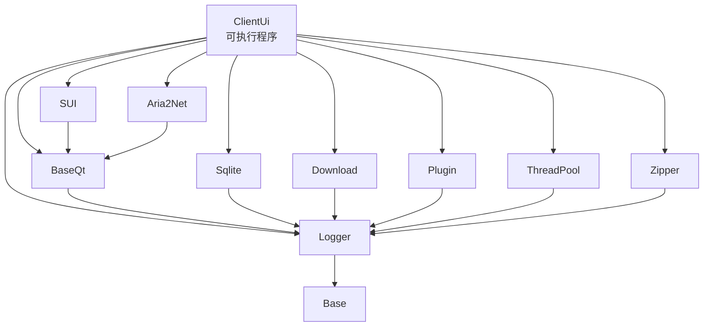

# 架构文档

各模块的**设计说明**：定位、依赖、分层、关键抽象、设计取舍，以及架构级风险。

> 本文档只回答"**怎么设计的**"。要回答"**具体怎么实现的**"（类型清单、SQL/算法细节、边界与错误处理）请看 [`../detailed-design/`](../detailed-design/README.md)；要回答"**怎么用**"（前置条件、示例代码、调用约定）请看 [`../usage/`](../usage/README.md)。
>
> 范围仅限主仓库 `sVanilla/src`。`ThirdParty/` 下的 git 子模块（`vcpkg`、`spdlog`、`sVanillaPluginCommon`、`sVanillaPlugins`）不在范围内，仅在它们作为边界契约出现时提及。

## 〇、文档三级结构

| 目录 | 回答 | 粒度 |
| --- | --- | --- |
| [`../architecture/`](README.md) | 是什么架构、为什么这么选 | 跨模块：依赖方向、分层、关键抽象、取舍 |
| [`../detailed-design/`](../detailed-design/README.md) | 具体怎么实现、边界在哪 | 模块内：逐类型、逐入口、逐分支 |
| [`../usage/`](../usage/README.md) | 怎么调、怎么不踩坑 | 调用方视角：前置条件、最小示例、约定与陷阱 |

同一模块在两处**同名**（如 `architecture/sqlite.md` 与 `detailed-design/sqlite.md`），应成对阅读。判定内容归属的经验法则：**换一种实现方式后这句话是否仍然成立**——成立放架构，不成立（依赖具体函数 / SQL / 常量）放详细设计。

## 一、模块依赖

箭头 `A --> B` 表示 **A 依赖 B**（A 的源码 include 了 B，或链接了 B）。

主仓库之外还有两个边界：`Download` 与 `Plugin` 依赖子模块 `sVanillaPluginCommon` 定义的类型（`AbstractDownloader`、`IPlugin`），主仓库只包含它们的头文件。

## 二、模块索引

| 模块 | 类型 | 路径 | 职责 | 架构文档 | 详细设计 |
| --- | --- | --- | --- | --- | --- |
| Base | 仅头文件 | `sVanilla/src/Base` | 预处理宏工具：字符串化、记号拼接、可变参数计数 | [base.md](base.md) | [base.md](../detailed-design/base.md) |
| Logger | 静态库 | `sVanilla/src/Logger` | spdlog 封装：具名 logger 注册、轮转与异步、日志宏 | [logger.md](logger.md) | [logger.md](../detailed-design/logger.md) |
| ThreadPool | 静态库 | `sVanilla/src/ThreadPool` | 通用线程池 + 以 Qt 信号返回结果的任务类型 | [threadpool.md](threadpool.md) | [threadpool.md](../detailed-design/threadpool.md) |
| Zipper | 静态库 | `sVanilla/src/Zipper` | 基于 minizip 的压缩 / 解压，含路径穿越防护 | [zipper.md](zipper.md) | [zipper.md](../detailed-design/zipper.md) |
| BaseQt | 静态库 | `sVanilla/src/BaseQt` | 跨线程投递、树结构、模型遍历器、UI 工具函数 | [baseqt.md](baseqt.md) | [baseqt.md](../detailed-design/baseqt.md) |
| SUI | 静态库 | `sVanilla/src/SUI` | 可复用 Qt 控件与 WebEngine 包装 | [sui.md](sui.md) | [sui.md](../detailed-design/sui.md) |
| Sqlite | 静态库 | `sVanilla/src/Sqlite` | SQLite RAII 封装、SQL 组装、Storage 抽象 | [sqlite.md](sqlite.md) | [sqlite.md](../detailed-design/sqlite.md) |
| Aria2Net | 静态库 | `sVanilla/src/Aria2Net` | aria2 本地服务进程的启动与关闭 | [aria2net.md](aria2net.md) | [aria2net.md](../detailed-design/aria2net.md) |
| Download | 静态库 | `sVanilla/src/Download` | 下载状态轮询线程：按状态驱动下载器回调 | [download.md](download.md) | [download.md](../detailed-design/download.md) |
| Plugin | 静态库 | `sVanilla/src/Plugin` | 插件动态库加载、配置管理与异常隔离 | [plugin.md](plugin.md) | [plugin.md](../detailed-design/plugin.md) |
| ClientUi | 可执行程序 | `sVanilla/src/ClientUi` | 主程序：页面、设置、登录、下载 UI、业务存储适配、部署 | [clientui.md](clientui.md) | [clientui.md](../detailed-design/clientui.md) |

每个模块的详细设计（文件清单、类型与接口、算法细节、时序、边界矩阵、测试映射）见 [`../detailed-design/`](../detailed-design/README.md) 同名篇；项目整体结构见 [`../project.md`](../project.md)。行数统计口径为 `.h` + `.cpp`（不含 `.ui`、`.qrc`、`CMakeLists.txt`）。

## 三、标注约定

"注意事项"一节统一用下列标签，便于快速扫描风险：

| 标签 | 含义 | 处理建议 |
| --- | --- | --- |
| `[陷阱]` | 反直觉行为、边界条件、容易踩的坑 | 读源码前必读 |
| `[约束]` | 调用方必须遵守的约定 | 违反会出错 |
| `[事实]` | 影响理解的重要背景 | 了解即可 |

标签的落位：

- **详细设计**收录 `[陷阱]` 的**处理建议**，以及影响理解实现的 `[事实]`；
- **架构文档**只保留跨模块、与具体实现无关的结论（分层与依赖约定、取舍、架构级风险 `R1`…）；
- **使用文档**收录面向调用方的 `[约束]` 与 `[陷阱]`。
