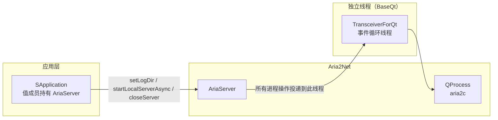
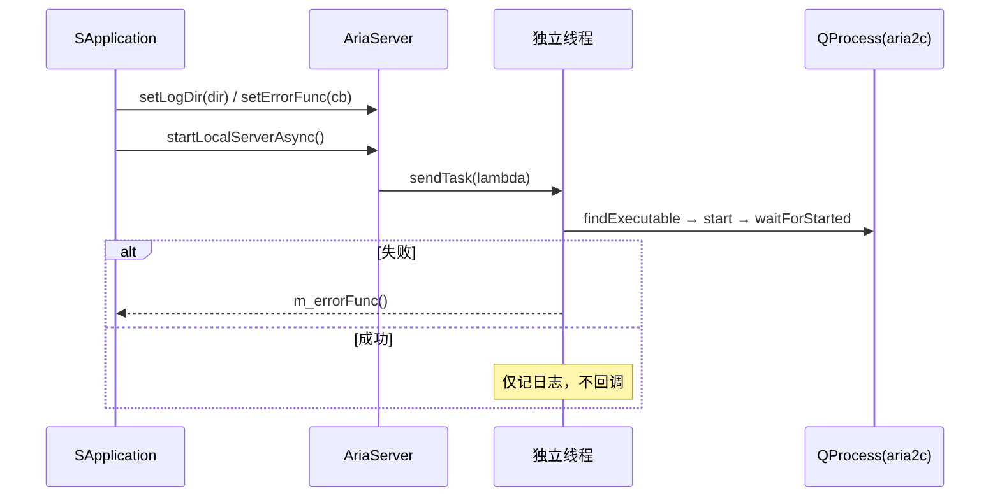

# Aria2Net 架构设计

把随程序分发的 `aria2c` 作为**本地 RPC 服务**拉起来，以及把它关掉。它是"进程生命周期管理"，**不是** JSON-RPC 客户端——真正的 RPC 调用（`aria2.addUri` 等）由插件公共库中的 `AriaClient` 完成。

> 静态库 `Aria2Net` · `sVanilla/src/Aria2Net` · 依赖 Qt Core/Gui/Widgets、nlohmann-json、spdlog、`BaseQt`（`TransceiverForQt`） · 详细设计见 [`../detailed-design/aria2net.md`](../detailed-design/aria2net.md) · 用法见 [`../usage/aria2net.md`](../usage/aria2net.md)

## 一、设计

把 aria2 作为独立进程托管，好处是下载引擎崩溃不会拖垮界面进程，且可直接复用 aria2 成熟的分片、续传、限速能力。



**关键设计：所有对 `m_aria2Process` 的操作（启动、关闭、析构时等待）都被投递到 `TransceiverForQt` 的独立线程执行**，避免 `QProcess::waitForStarted` / `waitForFinished` 阻塞 UI 线程；`AriaServer` 自身不直接在调用线程触碰进程对象。

**关键接口**

```cpp
namespace aria2net {

class AriaServer
{
public:
    AriaServer();
    ~AriaServer();                       // 同步等待 aria2c 被杀死

    void startLocalServerAsync();        // 异步启动，结果通过 callback 感知
    void closeServer();
    void forceCloseServer();
    void testServer();                   // 空实现

    void setErrorFunc(std::function<void()> func);
    void setCloseFunc(std::function<void()> func);
    void setLogDir(const QString& dir);  // 内部拼成 <dir>/aria 并 mkpath
};

}
```

**启动行为** —— 在 `QApplication::applicationDirPath() + "/aria/"` 下查找 `aria2c`，以固定命令行参数启动：

| 类别 | 参数 |
| --- | --- |
| RPC | `--enable-rpc`、`--rpc-listen-all=false`、`--rpc-allow-origin-all=false`、`--rpc-listen-port=6800`、`--rpc-secret=sVanilla` |
| 会话 | `--input-file` / `--save-session` 指向 `<logDir>/aria/aira.session`，间隔 30 s |
| 日志 | `--log=<logDir>/aria/aira.log`、`--log-level=debug` |
| 并发 | `--max-concurrent-downloads=6`、`--max-connection-per-server=16`、`--split=5`、`--min-split-size=10M` |
| 限速 | `--max-overall-download-limit=0` 等全部为 0（不限速） |
| 其它 | `--continue=true`、`--allow-overwrite=true`、`--auto-file-renaming=false`、`--file-allocation=none` |
| UA | 硬编码 `--header=User-Agent: ...Chrome/130...` |



选择"异步 + 错误回调"是为了不阻塞 UI，代价是**调用方无法同步获知启动成功**（**没有成功回调**），只能被动等错误回调。

## 二、注意事项

| 标注 | 内容 |
| --- | --- |
| `[事实]` | **`m_closeFunc` 已连到 `QProcess::finished`**，进程退出时调用；但 `setCloseFunc()` 在主仓库无调用点，默认回调为空。成员 `m_future` 声明了但全程未使用。 |
| `[陷阱]` | **`startLocalServerAsync` 用了 `[&]` 捕获的 lambda，却被投递到另一线程执行。** 当前安全（外层局部变量都在 lambda 内声明，`[&]` 实际只捕获 `this`），但写法脆弱——后续若在 lambda 外新增局部变量并被 `[&]` 捕获，就会变成跨线程悬垂引用。 |
| `[陷阱]` | **析构函数会阻塞。** 析构里用 `promise/future` 同步等待另一线程完成 `kill()` + `waitForFinished()`；若 aria2c 不响应 `kill`，析构会一直卡住。 |
| `[事实]` | RPC 端口（6800）与密钥（`sVanilla`）为编译期硬编码，运行时不可配置；`--rpc-listen-all=false` 与 `--rpc-allow-origin-all=false` 限制了暴露面。 |
| `[事实]` | `closeServer()` 与 `forceCloseServer()` 实现完全相同（都是 `kill()` + `waitForFinished()` + `reset()`），没有"优雅退出"与"强制退出"的区别。 |
