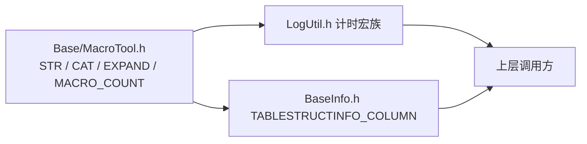
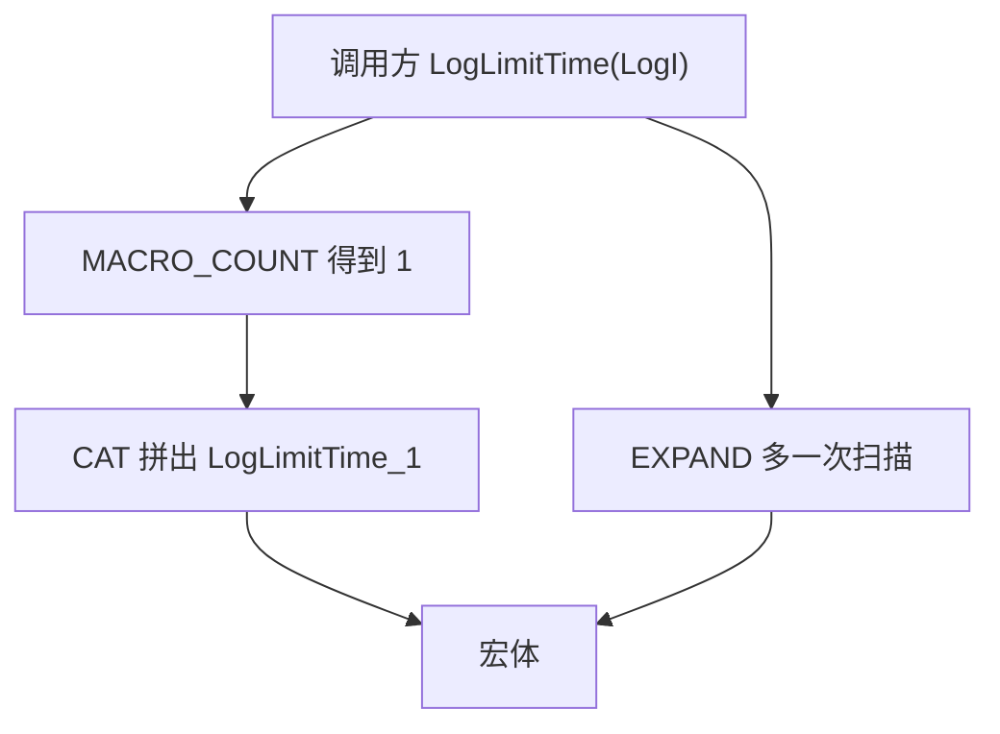
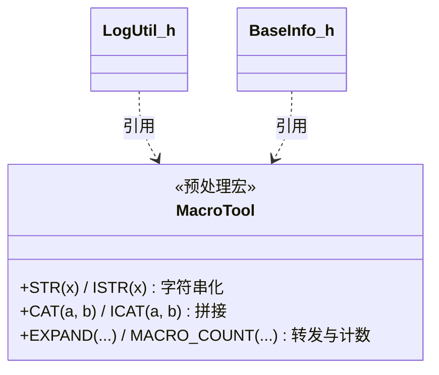
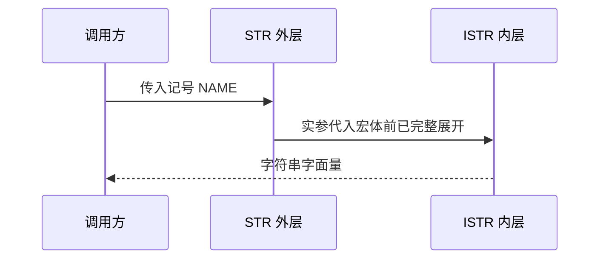
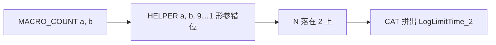
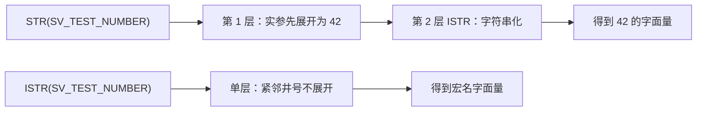

# Base 架构设计

预处理期的宏工具箱：把「字符串化」「记号拼接」「可变参数计数」做成可复用宏，供上层在**预处理阶段**做"同一语义、不同参数个数"的重载式分发。它不提供任何运行时类型、函数或对象，也不感知业务语义；边界止于宏展开。

> 仅头文件 · `sVanilla/src/Base` · 无构建目标 · 详细设计见 [`../detailed-design/base.md`](../detailed-design/base.md) · 用法见 [`../usage/base.md`](../usage/base.md)

## 一、总体架构

### 1.1 在仓库中的位置

Base 位于依赖图最底层，只有两个直接下游：`Logger/LogUtil.h`（计时宏族按实参个数分发）与 `Sqlite/SqlComposer/BaseInfo.h`（`TABLESTRUCTINFO_COLUMN` 按实参个数分发、用 `STR` 取列名）。



外部边界契约：本目录**没有 `CMakeLists.txt`**，无法通过 `target_link_libraries` 传递 include 目录，引用方必须自己把 `sVanilla/src` 加入 include 路径——测试目标写 `${CMAKE_SOURCE_DIR}/sVanilla/src`，库目标写 `${CMAKE_CURRENT_SOURCE_DIR}/..`。

### 1.2 分层与职责

只有一层：全部能力就是 7 个宏，按用途分三组。

| 分组 | 宏 | 职责 |
| --- | --- | --- |
| 字符串化 / 记号拼接 | `STR(x)` / `ISTR(x)`、`CAT(a, b)` / `ICAT(a, b)` | `STR` / `CAT` 先展开参数再字符串化或拼接，`ISTR` / `ICAT` 直接操作 |
| 可变参数 | `EXPAND(...)` / `MACRO_COUNT(...)` / `HELPER_OF_MACRO_COUNT(...)` | `EXPAND` 原样转发并多引入一次扫描；`MACRO_COUNT` 返回实参个数，支持 1–9 |

### 1.3 调用方向



方向严格单向：Base 只被 include，不 include 任何项目内头文件，也不依赖任何库。

## 二、目录结构与文件职责

逐文件的行数与职责见 [详细设计](../detailed-design/base.md) 第一节。

```text
sVanilla/src/Base
`-- MacroTool.h        # 全部 7 个宏（无 CMakeLists.txt，无构建目标）
```

## 三、核心类设计

类型清单与逐宏展开规则见 [详细设计](../detailed-design/base.md) 第二、三节；这里只保留类之间的关系。



## 四、核心数据流

### 4.1 两级展开：一次 `STR` 调用



关键在第二步：函数式宏的实参在代入宏体前会先完整展开，**除非它紧邻 `#` 或 `##`**。`STR` 里的 `x` 不紧邻 `#` 所以先展开，`ISTR` 里的 `x` 紧邻 `#` 所以不再展开——两级结构正是把"展开"与"字符串化"拆到两层完成。

### 4.2 参数计数到宏分发



实参排在前面，补的倒序数字 `9…1` 被顶到后面的坑位；实参越少，落到 `N` 上的数字越大，正好等于实参个数。

## 五、关键机制详解

### 5.1 两级展开（为什么不能合并成一层）



`ISTR` / `ICAT` 得到未展开的记号，适合"就要字面记号"；`STR` / `CAT` 得到展开后的值，分发必须走外层宏。这是可变参数宏最常见的错误来源，思路与 Boost.Preprocessor 一致；`test/Base/base_test.cpp` 覆盖了这一行为（清单见详细设计第六节）。

### 5.2 参数计数与"宏重载"

`MACRO_COUNT` 把"有几个实参"变成数字记号，`CAT(Name_, n)` 把数字拼到宏名后得到 `Name_1` / `Name_2`，`EXPAND` 再补一次扫描保证刚拼出的宏名被继续识别为宏——没有它，拼出的记号会以普通标识符留在代码里；这也是 MSVC 传统预处理器下可变参数宏行为与标准不一致时的常用兜底。

做成宏而非模板/函数的原因：模板无法让 `LogLimitTime(LogI)` 与 `LogLimitTime(LogI, 5000)` 展开成**结构不同**的代码（前者补默认阈值、后者用传入值），也无法凭空造出 `scope_guard` 变量名；函数则做不到"把日志级别宏当参数传"。

## 六、并发与生命周期模型


作用范围只在编译流水线最前段：除 `#define` 外不定义变量、类型或函数，因此**无运行时状态、无线程、无锁、无所有权问题**，跨翻译单元也不产生静态对象或初始化顺序问题；宏展开失败表现为编译错误；文件以 `#pragma once` 开头，重复包含安全。

## 七、设计优点

- **成本为零、一处实现多处复用**：不产生构建目标，不引入运行时开销；Logger 计时宏族与 Sqlite 字段注册宏共用同一套 `MACRO_COUNT` + `CAT` 分发。
- **语义被测试钉住**：`test/Base` 只链接 `GTest::gtest_main`，断言 `STR` / `ISTR` / `CAT` / `EXPAND` / `MACRO_COUNT` 的行为，间接保护上层日志宏。扩展 N 参数分支只需新增 `Name_N`。

## 八、设计取舍

| 方案 | 优点 | 为什么没选 |
| --- | --- | --- |
| 当前：手写少量宏 | 无依赖、无构建目标、行为完全可控 | — |
| Boost.Preprocessor / 可变参数模板 | 上限高、类型安全、错误信息清晰 | 项目只需计数 + 拼接，不值得引入依赖；模板无法生成不同代码结构，每分支一个独立宏名又要求调用方写 `LogLimitTime2` 这类名字 |

## 九、注意事项

| 标注 | 内容 |
| --- | --- |
| `[事实]` | `MACRO_COUNT` 的能力上限由 `HELPER_OF_MACRO_COUNT` 的占位数量决定（当前 9）；超出上限不会显式报错，而是产生难以理解的宏展开错误。零实参调用返回 **1 而不是 0** |
| `[事实]` | 本目录**没有 `CMakeLists.txt`**，不产生构建目标，引用方须自行确保 `sVanilla/src` 在 include 路径上（测试目标写 `${CMAKE_SOURCE_DIR}/sVanilla/src`，库目标写 `${CMAKE_CURRENT_SOURCE_DIR}/..`） |
| `[事实]` | `ISTR` / `ICAT` 是公开可调用的内层宏，直接调用会退回单层语义（不展开参数）；调用方应只用 `STR` / `CAT` |
| `[事实]` | Base 只被 include，不定义变量、类型或函数，因此无运行时状态、无线程与锁、无静态初始化顺序问题；宏展开失败表现为编译错误；整个文件体被 `// clang-format off` / `on` 包裹 |
