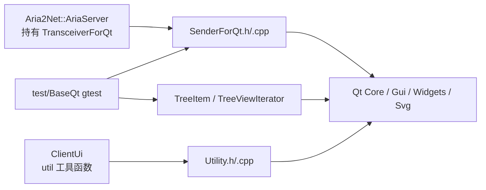
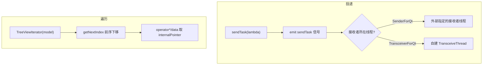
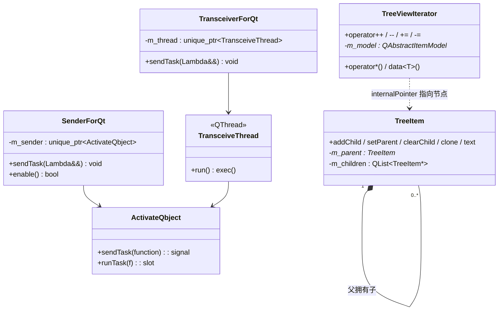
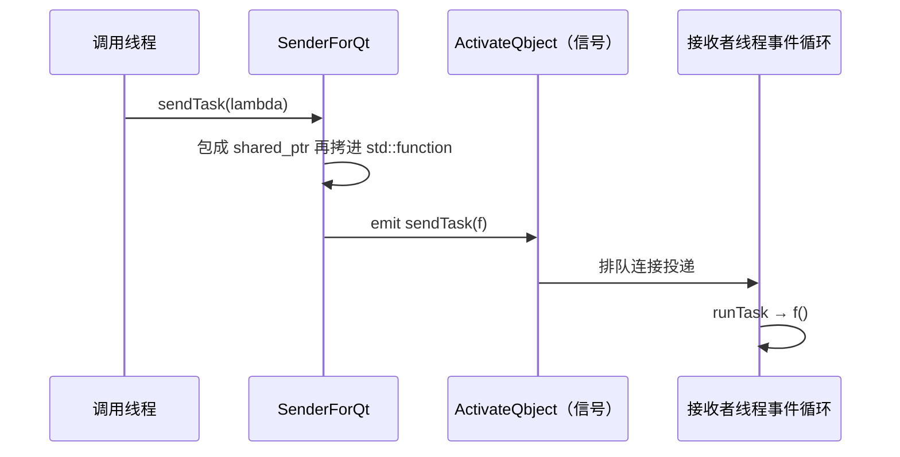
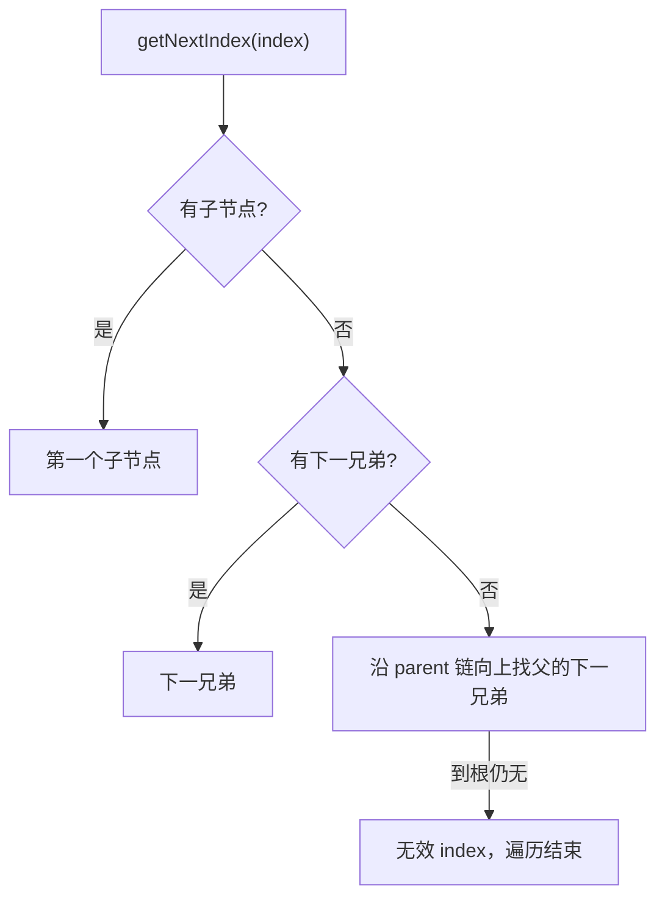

# BaseQt 架构设计

BaseQt 是 Qt 相关的基础设施层，只解决三件与业务无关的事：**把闭包跨线程投递到指定 QObject 所在线程执行**、**提供一棵裸指针树节点与一个 model 遍历器**、**提供几个通用 UI 工具函数**。它不含业务语义，不做日志、网络与持久化，也不定义任何应用级单例。

> 静态库 `BaseQt` · `sVanilla/src/BaseQt` · 依赖 Qt Core/Gui/Widgets/Svg · 详细设计见 [`../detailed-design/baseqt.md`](../detailed-design/baseqt.md) · 用法见 [`../usage/baseqt.md`](../usage/baseqt.md)

## 一、总体架构

### 1.1 在仓库中的位置



`SUI` 在 `CMakeLists.txt` 里链接 `BaseQt`，可直接 `#include "BaseQt/Utility.h"`；`Aria2Net`、`ClientUi` 同样通过链接依赖使用，三者各取一块——这是本模块"工具箱"定位的直接体现：没有统一入口，消费方按需取用其中一块。

### 1.2 分层与职责

| 子块 | 关键类型 | 职责 | 生产代码引用 |
| --- | --- | --- | --- |
| 跨线程投递 | `ActivateQbject`、`TransceiveThread`、`SenderForQt`、`TransceiverForQt` | 把闭包投到目标线程执行 | `Aria2Net::AriaServer`（`TransceiverForQt`） |
| 树结构 | `TreeItem` | 裸指针树节点，父拥有子 | 暂无生产引用，由 `test/BaseQt` 覆盖 |
| 模型遍历 | `TreeViewIterator` | 对 `QAbstractItemModel` 做深度优先前序遍历 | 暂无生产引用，由 `test/BaseQt` 覆盖 |
| UI/文件工具 | `util::showInFileExplorer`、`createMenu`、`animate`、`binToImage`、`readFileToVector` | 无状态自由函数 | `ClientUi` |

四个子块**彼此无依赖**，唯一的共同点是都依赖 Qt。它们被放进同一个库，只是因为都很小、都归属"Qt 基础设施"。

### 1.3 调用方向



## 二、目录结构与文件职责

逐文件的行数与职责见 [详细设计](../detailed-design/baseqt.md) 第一节。

```text
sVanilla/src/BaseQt
|-- SenderForQt.h/.cpp     # 跨线程投递（两个 sendTask 为模板，留在头文件）
|-- TreeItem.h/.cpp        # 裸指针树
|-- TreeViewIterator.h/.cpp# 模型前序遍历
|-- Utility.h/.cpp         # util 命名空间自由函数
`-- CMakeLists.txt
```

## 三、核心类设计

类型清单、成员与所有权见 [详细设计](../detailed-design/baseqt.md) 第二至五节；这里只保留类之间的关系。



## 四、核心数据流

### 4.1 跨线程投递



闭包被包进 `shared_ptr` 再拷进 `std::function`，是因为 `Q_DECLARE_METATYPE` 要求元类型可拷贝——副作用是**捕获移动-only 对象会编译失败**。

### 4.2 前序遍历的一步



## 五、关键机制详解

### 5.1 为什么需要两套投递器

| | `SenderForQt` | `TransceiverForQt` |
| --- | --- | --- |
| 任务在哪执行 | 接收者对象所在线程 | 自己创建的工作线程 |

两者的差别不在"投递"而在"目标"：`SenderForQt` 用于"我要在**某个已存在的对象**的线程上做事"（典型是回到 UI 线程刷新界面），`TransceiverForQt` 用于"我需要**一个专属后台线程**来跑东西"（`Aria2Net::AriaServer` 用它承载 aria2 进程的交互）。若只留一套，另一类场景就得由调用方自己 `moveToThread`，重复且易错。

### 5.2 为什么树用裸指针

`TreeItem` 的定位是**给自定义 `QAbstractItemModel` 做数据骨架**，`QModelIndex::internalPointer()` 存的正是它的裸指针。所有权约定是"父拥有子"（析构时递归删除），不共享、不引用计数——这与 model 的生命周期一致：model 持有根节点，树随 model 一起销毁。代价是外部只能拿裸指针，且移动语义会带来悬垂。

### 5.3 遍历器为什么绑定自定义 model

`TreeViewIterator` 通过 `internalPointer()` 取节点，这个指针只对自定义 model 有意义；`QTreeWidget` 用的是内部私有结构，`reinterpret_cast` 出来是错误指针。因此它是"**配合 `TreeItem` 一起用的遍历器**"，不是通用 Qt 遍历器。

## 六、并发与生命周期模型

| 子块 | 并发约定 | 所有权 |
| --- | --- | --- |
| 投递器 | 调用方可在任意线程调 `sendTask`；实际执行由 Qt 排队连接调度 | `unique_ptr` 持有 sender / thread |
| `TreeItem` | 无锁、非线程安全，约定只在 GUI 线程操作 | 父拥有子，递归删除 |
| `TreeViewIterator` | 只持 `const QAbstractItemModel*` 裸指针，**不拥有** model | 遍历期间 model 必须存活且结构不变 |
| `util` | 无状态自由函数 | 无 |

生命周期约束：**投递器析构前必须确保目标线程还在跑**（`TransceiveThread` 的 `run()` 只有 `exec()`，析构时 quit 即可）；`TreeViewIterator` 遍历中修改 model 会使 index 失效。

## 七、设计优点

- **零业务耦合**：四个子块都只依赖 Qt，可被任意上层复用，也可单独测试。
- **投递语义显式**：`SenderForQt` 与 `TransceiverForQt` 的名字就说明了"投给谁"，调用方不必理解 Qt 的线程亲和性细节。
- **树与遍历器配套**：`TreeItem` 提供结构、`TreeViewIterator` 提供遍历，两者合起来覆盖了自定义树 model 最常见的需求。
- **工具函数集中**：`util` 下的函数无状态、无副作用，便于单测覆盖主要分支。

## 八、设计取舍

| 方案 | 优点 | 为什么没选 |
| --- | --- | --- |
| `TreeItem` 用裸指针 | 与 `QModelIndex::internalPointer()` 天然契合，无引用计数开销 | — |
| `TreeItem` 用 `shared_ptr` | 无悬垂风险 | 父子双向引用要 `weak_ptr` 打破环；且 `internalPointer()` 拿不到 `shared_ptr`，收益有限 |
| 只留一套投递器（统一投到接收者线程） | API 更少 | 会强迫"需要专属后台线程"的调用方自己管理 `QThread`，重复且易错 |
| 用 `std::function` 直接做元类型 | 少一层 `shared_ptr` | Qt 元类型要求可拷贝，`std::function` 捕获移动-only 对象时不可拷贝，包一层 `shared_ptr` 可放宽到"可拷贝的句柄" |
| 遍历器走 `QModelIndex` 递归 | 实现更短 | 迭代器形式支持 `+=` / `-=` 与前后移动，调用方可写出声明式遍历 |

## 九、注意事项

| 标注 | 内容 |
| --- | --- |
| `[事实]` | 两套投递器语义不同：`SenderForQt` 把闭包投到**接收者所在线程**，`TransceiverForQt` 投到**自己创建的工作线程**；闭包被包进 `shared_ptr` 以满足元类型的可拷贝要求 |
| `[事实]` | `TreeItem` 是裸指针树，**父拥有子**（析构时递归删除），不共享、不引用计数 |
| `[事实]` | `TreeViewIterator` 走深度优先前序，取值依赖 `QModelIndex::internalPointer()`，**仅适用于自定义 model**，对 `QTreeWidget` 不成立 |
| `[事实]` | `util` 命名空间下的工具函数无状态；`createMenu` / `animate` / `binToImage` 需要 Qt 环境（字体度量、动画、图像解码） |
| `[事实]` | `TreeItem` 与 `TreeViewIterator` 目前**没有生产代码引用**，仅在 `test/BaseQt` 中使用 |
