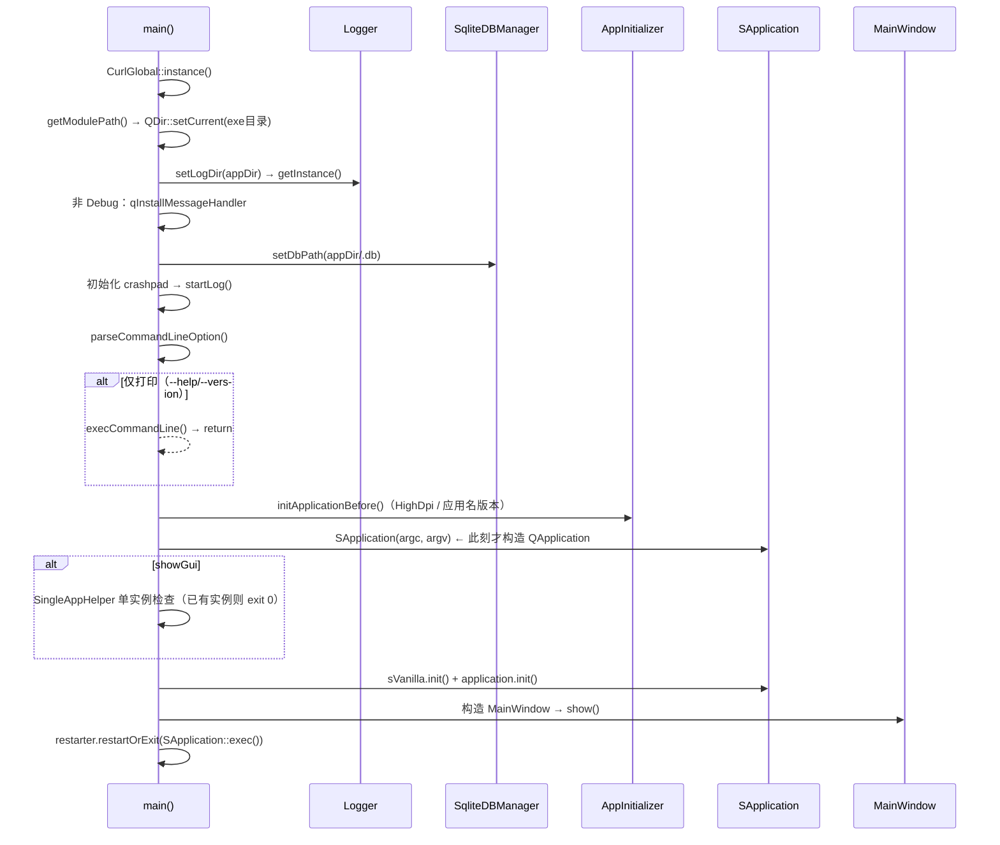

# ClientUi 架构设计

**唯一可执行入口**，扮演应用层 / 组装层：把下层服务（插件、下载、存储、线程池、外部进程）组装成面向用户的界面与流程。它本身不实现下载或持久化算法，而是**编排**。

> 可执行程序（目标名 `sVanilla`） · `sVanilla/src/ClientUi`
> 依赖几乎全部主仓库模块（`SUI` / `BaseQt` / `Aria2Net` / `Download` / `Plugin` / `Sqlite` / `ThreadPool` / `Zipper` / `Logger`）+ Qt Widgets / WebEngine + crashpad、ftxui、indicators、QWindowKit、VanillaStyle
> · 详细设计见 [`../detailed-design/clientui.md`](../detailed-design/clientui.md) · 用法见 [`../usage/clientui.md`](../usage/clientui.md)

## 一、设计

**目录结构与职责**

| 子目录 | 文件数 | 职责 |
| --- | --- | --- |
| `MainWindow/` | 主窗口、`SApplication`、单实例、重启、翻译、自定义标题栏 |
| `Home/` | 首页：链接输入、剪贴板、历史、导入插件、登录入口 |
| `VideoList/` | 视频列表页：列表 / 网格视图、排序、搜索、批量下载 |
| `Download/` | 下载页：下载中 / 已完成两栏、列表项、信息面板、`UiDownloader` |
| `Setting/` | 设置页及其 5 个子页（默认 / 账号 / 高级 / 插件 / 关于） |
| `Login/` | 登录对话框（扫码 / 账号 / 内嵌 WebEngine）、登录状态监控线程 |
| `Storage/` | `StorageManager` + 4 个业务 Storage |
| `Plugin/` | `PluginInterface`：解析 URL 与注入 Cookie 的门面 |
| `PlatformInitializer/` | 跨平台初始化（Windows / Linux / macOS 分派） |
| `CommandLine/` | 命令行解析与纯 CLI 下载流程 |
| `Utils/` | `runTask`、QSettings 封装、URL / 封面 / 排序 / 速度等工具 |
| `Dump/` | Crashpad 初始化 |
| `Config/` | 应用级配置常量 |

整体是**分层 + 按功能分目录**：`MainWindow` 提供壳与全局服务，各功能页各自成目录，`Utils` / `Storage` / `Plugin` 提供横切能力。

**启动流程（`main.cpp`）** —— 顺序很关键，很多全局状态在这里定型：



要点：① 先 `CurlGlobal::instance()`；② `QDir::setCurrent(exe目录)`——**把进程工作目录改掉**，此后所有相对路径以它为准；③ `Logger::setLogDir` → `getInstance()` 注册 9 个 logger；④ 非 Debug 才 `qInstallMessageHandler`；⑤ `setDbPath`；⑥ 初始化 crashpad；⑦ 解析命令行（仅 `--help` / `--version` 时打印后返回）；⑧ `initApplicationBefore()` 设 HighDpi 与应用名 / 版本；⑨ **到这里才构造 `QApplication`**（`SApplication application(argc, argv)`）；⑩ GUI 模式做单实例检查；⑪ `sVanilla.init()`（平台初始化）→ `application.init()`（启动 aria2、异步加载插件）；⑫ 建 `MainWindow`、`show()`，最后 `restarter.restartOrExit(SApplication::exec())`。

**应用服务：`SApplication`** —— `class SApplication : public QApplication`，全局访问宏 `#define sApp static_cast<SApplication*>(qApp)`，以**值成员**持有全部应用级服务：

| 成员 | 访问器 |
| --- | --- |
| `aria2net::AriaServer` | `ariaServer()` |
| `PluginInterface` | `pluginInterface()`（`pluginManager()` 由其转发） |
| `Translater` | `translater()` |
| `download::DownloadStatusThread` | `downloadThread()` |
| `ThreadPool` | `threadPool()` |
| 插件异步加载状态 | `isLoadingPlugins()` / `waitForPluginLoadTask()` |

这是 **Service Locator** 模式（而非依赖注入）：优点是任何页面都能便捷取用全局服务；代价是依赖关系隐式、不利于单测（因此 `SApplication` 的逻辑较少被单元测试覆盖）。`appDir()` 是静态方法：若 exe 同级存在 `manifest.json` 则视为"已安装"，返回 `QStandardPaths::GenericDataLocation/<软件名>`，否则返回 `QApplication::applicationDirPath()`。

**页面结构** —— `MainWindow` 内是 `QStackedWidget`，4 个页面按固定索引排列，顶部标题栏按钮与 `Ctrl+1..4` 均可切换：

| 索引 | 页面 | 类 |
| --- | --- | --- |
| 0 | 首页 | `HomePage` |
| 1 | 视频列表 | `VideoWidget`（内部再嵌一层 `QStackedWidget`） |
| 2 | 下载 | `DownloadWidget` |
| 3 | 设置 | `SettingsPage` |

**存储** —— `StorageManager`（Meyers 单例）持有 4 个 Storage，统一使用 `appDir()/.db/data.db`：

| Storage | 业务表 |
| --- | --- |
| `DownloadingItemStorage` | `DownloadingItem` |
| `DownloadedItemStorage` | `DownloadedItem` |
| `SearchHistoryStorage` | `SearchHistory`（另建触发器限制条数与累计搜索次数） |
| `CookiesInfoStorage` | `CookiesInfo` |

每个 Storage 都成对取连接：写句柄用 `writeDBWithMutexPtr`，读句柄用 `createDBWithMutexPtr`。底层见 [sqlite.md](sqlite.md)。

**跨线程更新界面** —— `Utils/RunTask.h` 的 `runTask(taskFunc, callback, object)` 是唯一入口：

```
封装为 TemplateSignalReturnTask → connect(result, object, ...) → sApp->threadPool().enqueue(task)
```

任务体在工作线程执行，回调因 `object` 属主在主线程而走 Qt 队列连接，从而安全地更新界面。底层见 [threadpool.md](threadpool.md)。

选择 Service Locator 是为了让页面代码简短；选择"先设全局状态再构造 `QApplication`"是为了让日志 / 数据库路径在最早时刻就正确——但这造成的顺序依赖本身也是风险来源（见注意事项）。

## 二、注意事项

| 标注 | 内容 |
| --- | --- |
| `[约束]` | **`SApplication::appDir()` 在 `QApplication` 构造之前就被调用**（`main.cpp` 中日志与数据库路径的设置早于 `SApplication application(...)`），而它内部使用了 `QApplication::applicationDirPath()`。修改启动顺序时要留意这个既有的先后依赖。 |
| `[陷阱]` | **`runTask` 的任务对象在非属主线程被销毁。** `SignalReturnTask` 继承 `QObject` 且在调用线程（通常主线程）创建，但 `shared_ptr` 被线程池的任务 lambda 持有，lambda 在工作线程执行完毕后释放，于是 `QObject` 在工作线程析构。这是该机制的固有特性，目前未出问题，但不要给任务对象加依赖线程亲和性的成员。 |
| `[陷阱]` | **下载页存在工作线程直接触碰界面的路径。** `DownloadWidget::initHistoryData()` 用 `sApp->threadPool().enqueue(...)` 在工作线程里调用 `addDownloadTask()`，而后者可能触发 `ToastTip::showTip()`。同类代码还有捕获 `[this]` 后在工作线程解引用已可能析构对象的写法。 |
| `[陷阱]` | **多处使用函数内 `static` 变量做去重 / 防抖**（`MainWindow::parseUrl` 的 `lastUrl`、各页面的 `parseUrlVersion` 等），属进程级共享状态，隐含"单窗口、单线程访问"的假设。 |
| `[事实]` | 单实例实现 `SingleAppHelper` 在监听失败且为 `AddressInUseError` 时会先 `removeServer` 再重试，用于清理上次崩溃残留的本地套接字。 |
| `[事实]` | 插件热加载：`SApplication::init()` 用 `QFileSystemWatcher` 监视 `plugin/`，触发 `PluginManager::pluginDirFileAdded()`；初始 `loadPlugins()` 跑在 `std::async` 线程中，完成后发 `pluginsLoaded` 信号。见 [plugin.md](plugin.md)。 |
| `[事实]` | `PluginInterface` 提供 `parseUrl()` / `getPlugin()` / `setCookiesForPlugins()`；它会先把带跳转的短链用 curl 解析出真实地址再匹配插件，并按历史解析耗时给候选插件排序。指定 `pluginId` 时**直接返回该插件**，不再校验它是否声明能解析该 URL。 |
| `[事实]` | `DownloadManager` 是极薄的适配器，`addItem()` 只是转发到 `sApp->downloadThread().addTask()`。真正把 UI 与下载器粘起来的是 `UiDownloader`（同时继承 `QObject` 与 `download::AbstractDownloader`），它在转发状态的同时同步 `DownloadingItem` / `DownloadedItem` 两张表。见 [download.md](download.md)。 |
