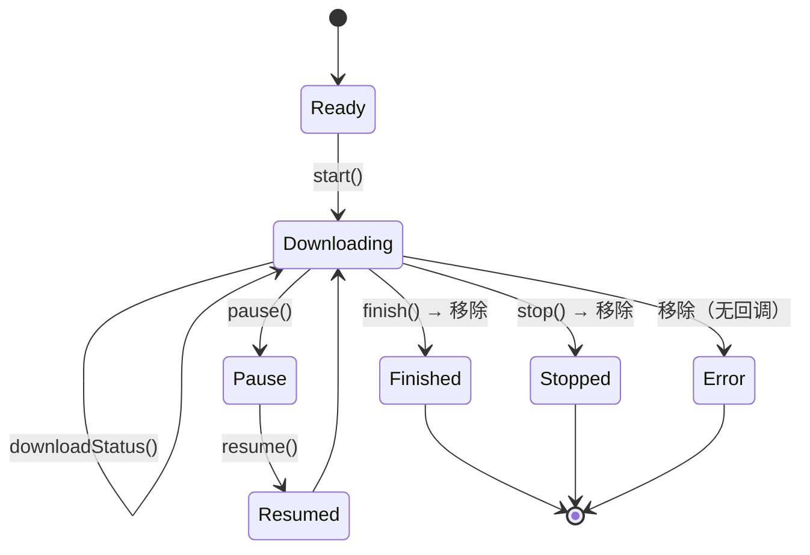

# Download 架构设计

模块只有一个类 `DownloadStatusThread`——一个**按状态驱动下载器虚函数**的轮询线程。它把"下载任务需要被推进"这件事集中到**一条后台线程**上处理，下载器本身不必各自持有线程或定时器。

> 静态库 `Download` · `sVanilla/src/Download` · 依赖 nlohmann-json、spdlog，以及子模块 `sVanillaPluginCommon` 的 `AbstractDownloader.h` · 详细设计见 [`../detailed-design/download.md`](../detailed-design/download.md) · 用法见 [`../usage/download.md`](../usage/download.md)

## 一、设计

**设计取舍：为什么用轮询**

| 方案 | 优点 | 代价 |
| --- | --- | --- |
| **集中轮询（本实现）** | 线程数与任务数无关；状态推进逻辑集中；单个下载器异常可被统一捕获 | 状态变化有延迟（最坏 ≈ 一个轮询周期）；每轮全量拷贝任务表 |
| 每任务一个线程 / 定时器 | 实时性好 | 线程 / 定时器数随任务数增长；异常处理分散 |
| 下载器主动推送 | 无延迟 | 下载器实现复杂；跨线程回调需各自加锁 |

选择轮询是为了让下载器（多由插件实现）保持简单——它们只需暴露 `status()` 与几个回调，不必关心线程与事件循环。

**关键接口**

```cpp
namespace download {

class DownloadStatusThread {
public:
    DownloadStatusThread();                                        // 启动内部线程
    ~DownloadStatusThread();                                       // stop() + join()

    bool addTask(std::shared_ptr<AbstractDownloader> downloader);  // 同 guid 重复返回 false
    void stop();
    bool empty() const;
};

}
```

任务表是 `std::unordered_map<guid, shared_ptr<AbstractDownloader>>`，`guid` 由 `AbstractDownloader::guid()` 提供。

**线程循环**

```
while (m_running):
    等待条件变量（任务表非空 或 已停止）
    加锁把整个任务表拷贝成快照
    对快照中每个任务：switch (status) → 调用对应虚函数，可能加入待移除列表
    加锁按 key 移除任务（并校验 iter->second == value，避免误删同 guid 的新任务）
    sleep 600ms
```

两个设计要点：**回调在锁外执行**（先把任务表快照出来，再在锁外调用下载器虚函数，这样插件回调里若再次 `addTask` / 查询也不会死锁）；**移除时校验指针**（移除前比较 `iter->second == value`，避免在回调期间同一 `guid` 被替换成新任务后误删）。

**状态 → 回调映射**



| `status()` | 调用的虚函数 | 是否移除任务 |
| --- | --- | --- |
| `Ready` | `start()` | 否 |
| `Downloading` | `downloadStatus()` | 否 |
| `Pause` | `pause()` | 否 |
| `Resumed` | `resume()` | 否 |
| `Stopped` | `stop()` | **是** |
| `Finished` | `finish()` | **是** |
| `Error` | 不调用任何虚函数 | **是** |

**异常路径**：任一虚函数抛 `std::exception` 或未知异常 → `setStatus(Error)` 并移除任务。这是"单个下载器异常不会拖垮整个轮询线程"的保证，由 `test/Download` 覆盖。

## 二、注意事项

| 标注 | 内容 |
| --- | --- |
| `[事实]` | `addTask` 的唤醒条件是"任务表非空"而非 `insert` 是否成功——插入失败（同 guid 已存在）时也可能 `notify_one`，逻辑上无害但语义反直觉；真正重复时函数返回 `false`。 |
| `[事实]` | 每轮都把整个任务表**全量拷贝**成快照（在锁内），任务数量大时每 600 ms 产生一次 O(n) 拷贝；同时意味着单轮处理期间新增 / 移除的任务不会被本轮看到。 |
| `[事实]` | `AbstractDownloader` 定义在 git 子模块 `ThirdParty/sVanillaPluginCommon`，主仓库只 include 其头文件。从本模块可验证的契约子集是 `guid()`、`status()`、`setStatus(...)` 与 6 个回调虚函数 `start` / `downloadStatus` / `pause` / `resume` / `stop` / `finish`；**状态枚举的完整取值以子模块为准**。 |
| `[陷阱]` | **600 ms 是"每轮末尾固定 sleep"，不是定时器。** 若一次遍历中所有任务的处理耗时很长，实际轮询间隔会明显大于 600 ms。状态变化的感知延迟最坏约为 600 ms + 单轮处理耗时。 |
