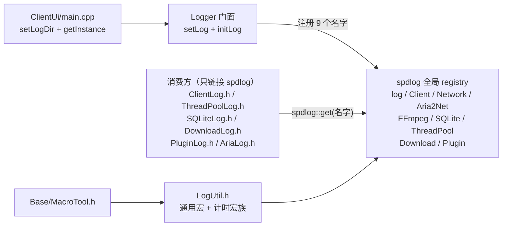
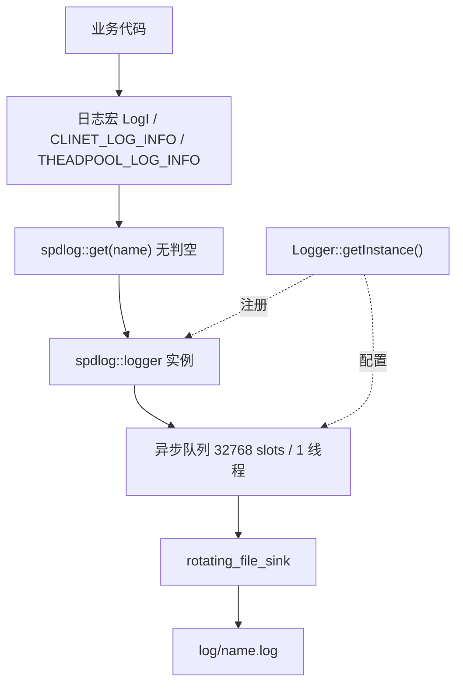
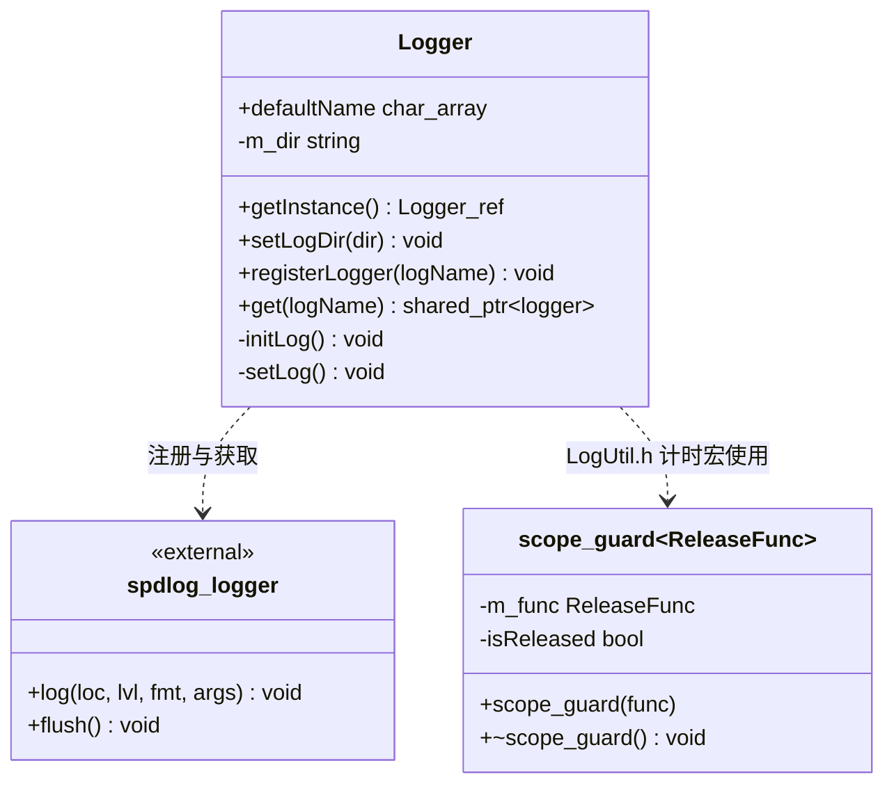
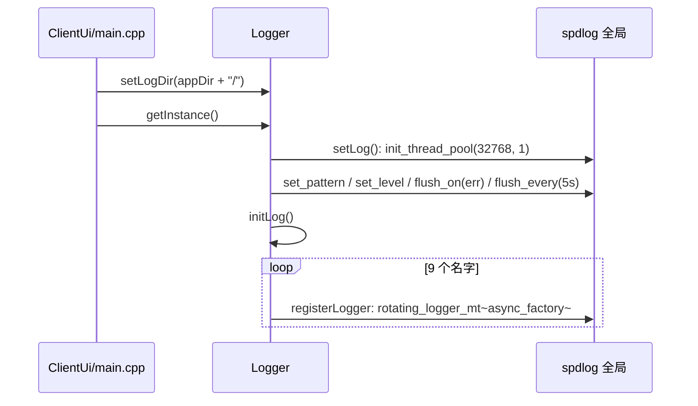
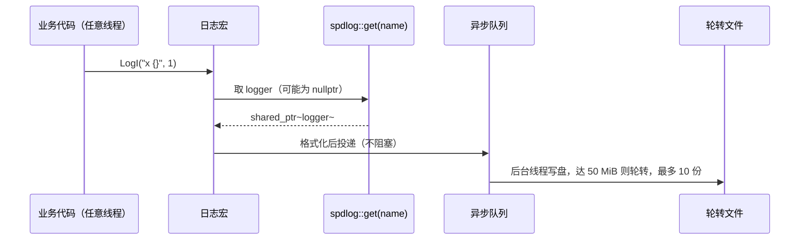
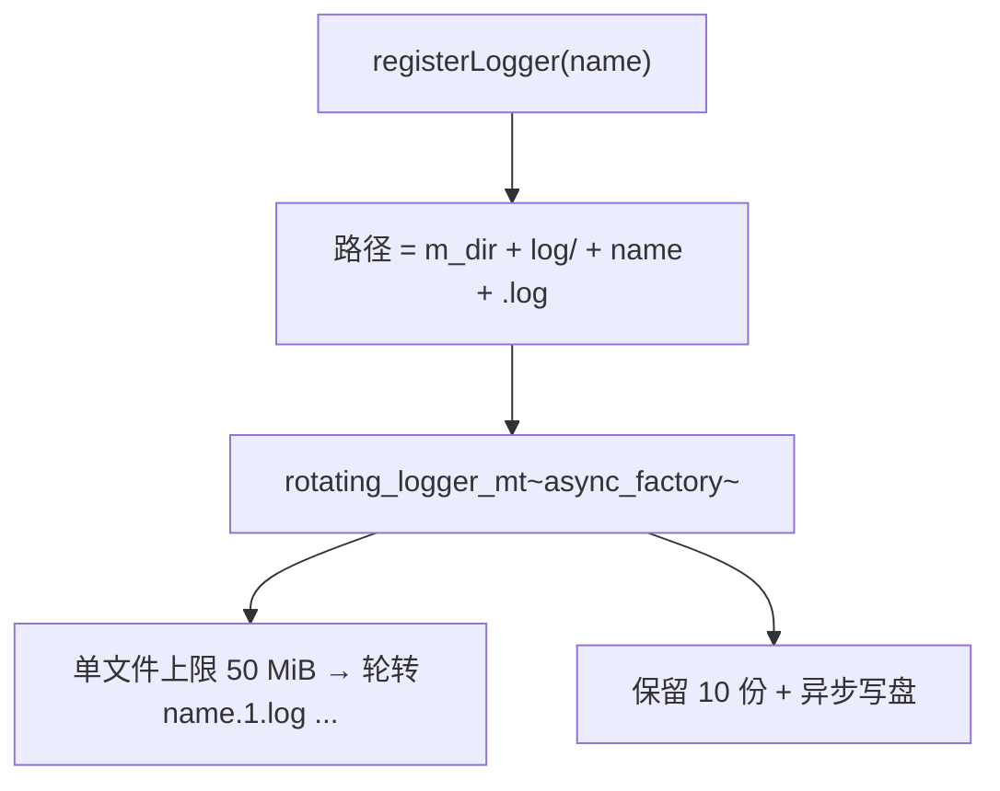
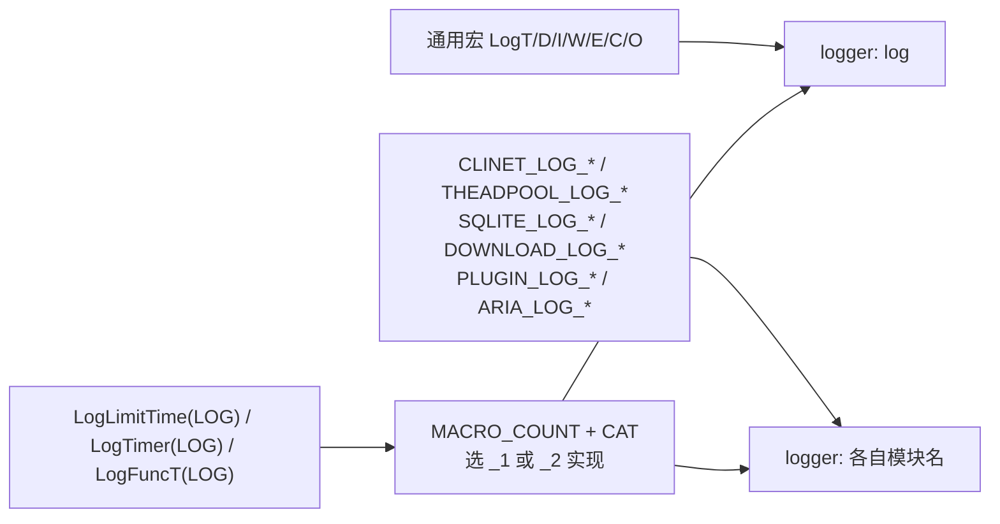
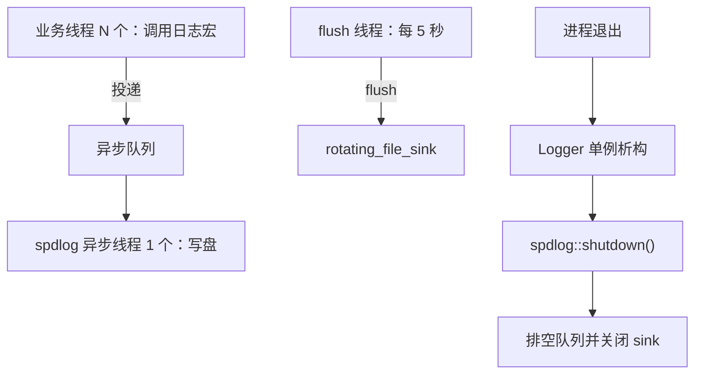
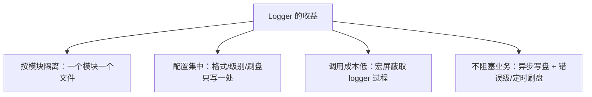

# Logger 架构设计

对 spdlog 的薄封装：进程启动时一次性完成全局配置与**具名 logger 注册**，之后各模块通过宏把日志写进属于自己的轮转文件。日志能力（格式化、轮转、异步、级别）全部来自 spdlog；本模块只负责"约定名字 + 集中初始化 + 提供宏"，不实现 sink、不拦截日志内容、也不提供运行期配置。

> 静态库 `Logger` · `sVanilla/src/Logger` · 依赖 spdlog · 详细设计见 [`../detailed-design/logger.md`](../detailed-design/logger.md) · 用法见 [`../usage/logger.md`](../usage/logger.md)

## 一、总体架构

### 1.1 在仓库中的位置

依赖形态有一个反直觉的特点：**编译期几乎无人依赖它，运行期几乎所有模块都依赖它**。唯一链接 `Logger` 静态库的是 `ClientUi`（`src/ClientUi/CMakeLists.txt`），也是唯一调用 `Logger::setLogDir()` / `getInstance()` / `get()` 的地方（`main.cpp:97-98`）；`Aria2Net` / `Download` / `Plugin` / `Sqlite` / `ThreadPool` / `Zipper` / `BaseQt` 各有自己的 `*Log.h`，**只 include spdlog**，宏体写作 `SPDLOG_LOGGER_CALL(spdlog::get("名字"), ...)`，链接的是 `spdlog::spdlog` 而非 `Logger`。



因此它们与 Logger 之间是"**通过 logger 名字的隐式契约**"耦合：名字由 `Logger::initLog()` 注册，消费方硬编码同一字符串；任一侧改名而另一侧不改，编译期毫无提示，运行期表现为解引用空 `shared_ptr`（段错误）。

外部边界：spdlog 的 registry 是全局单例，Logger 只是它的"初始化器 + 命名约定"；一旦 `spdlog::shutdown()` 被调用，所有宏都会拿到空指针。

### 1.2 分层与职责

| 层 | 关键类型 / 宏 | 职责 |
| --- | --- | --- |
| 门面层 | `Logger`（`Logger.h` / `.cpp`） | Meyers 单例；`setLog()` 全局配置，`initLog()` 注册 9 个具名 logger，`get()` 转发 `spdlog::get` |
| 宏层 | `LogUtil.h` 的 `LogT/D/I/W/E/C/O`、计时宏族、`scope_guard` | 屏蔽"取 logger"的过程；用 RAII 统计函数耗时 |
| 命名契约层 | 各模块 `*Log.h`、`LoggerConfig.h` 的 `LOGGER_CALL` / `LOGGER_API` / `LOGGER_PORT` | 把模块与 logger 名字绑定；导出宏与调用约定宏当前无使用点 |
| 底层 | spdlog（`rotating_file_sink`、`async_factory`、thread pool） | 格式化、轮转、异步写盘、级别过滤 |

### 1.3 调用方向



单向依赖成立：Logger 不 include 任何业务模块；业务模块 include spdlog 与本模块头文件。唯一的"反向"是运行期的名字契约（见 1.1）。

## 二、目录结构与文件职责

逐文件的行数与职责见 [详细设计](../detailed-design/logger.md) 第一节。

```text
sVanilla/src/Logger
|-- CMakeLists.txt        # STATIC 库 Logger，链接 spdlog::spdlog
|-- Logger.h              # 门面类声明（全静态接口 + 私有构造）
|-- Logger.cpp            # 单例、全局配置、9 个具名 logger 注册
|-- LoggerConfig.h        # 调用约定 / DLL 导出宏（当前未被使用）
`-- LogUtil.h             # 通用日志宏、scope_guard、计时宏族
```

## 三、核心类设计

类型清单、成员与所有权见 [详细设计](../detailed-design/logger.md) 第二、三节；这里只保留类之间的关系。



## 四、核心数据流

### 4.1 进程启动：一次注册，全局可用



顺序很重要：`setLogDir()` 必须在 `getInstance()` 之前，因为 `m_dir` 只在 `registerLogger()` 拼路径时被读取一次。

### 4.2 一次日志调用



宏是**无条件解引用**的，链路上没有任何空指针检查——这是"未注册即段错误"的根源。

## 五、关键机制详解

### 5.1 具名 logger 注册与落盘



`initLog()` 注册 9 个名字：`log`、`Client`、`Network`、`Aria2Net`、`FFmpeg`、`SQLite`、`ThreadPool`、`Download`、`Plugin`，其中 `log` 用的是 `defaultName` 常量。**按模块落一个文件**是这套设计的核心收益：排查某子系统时只看对应文件，不被其它模块的高频日志淹没。

### 5.2 宏路由与两级宏分发



各计时宏的展开与 `Log_Unique_Timer_END` 的一次性回调语义见 [详细设计](../detailed-design/logger.md) 3.2。

### 5.3 异步写盘与刷盘策略


## 六、并发与生命周期模型



- **锁**：Logger 自身**不加任何锁**，并发保护完全交给 spdlog（`async_factory` 队列锁 + `rotating_file_sink_mt` 内部互斥量）。
- **所有权**：logger 由 spdlog 全局 registry 持有 `shared_ptr`；`Logger::get()` 返回副本，不会因 Logger 析构而悬空——但 registry 被 `shutdown()` 清空后就取不到了。
- **析构顺序**：`Logger` 是函数内静态对象，退出时析构并调 `spdlog::shutdown()`。**在其它静态对象的析构函数里打日志是不安全的**，那时 registry 可能已清空。
- **异常传播**：`registerLogger` 重复注册同名 logger 时 spdlog 抛 `spdlog::spdlog_ex`；日志宏不抛异常，只可能段错误。
- **初始化约束**：`registerLogger` 用 `async_factory`，独立调用前必须先 `spdlog::init_thread_pool`；测试里由 `LoggerFacadeTest::SetUpTestSuite` 显式完成。

## 七、设计优点



- **配置只有一个入口**：格式、级别、刷盘策略、异步池都在 `setLog()` 里，改一处全局生效。
- **调用点极简**：业务只写 `LogI("x {}", 1)`，不必知道 logger 怎么取。
- **自带定位信息 + 耗时统计零侵入**：`scope_guard` + RAII 让统计函数耗时只需一行宏。

## 八、设计取舍

| 方案 | 优点 | 为什么没选 / 当前取舍 |
| --- | --- | --- |
| 当前：spdlog + 具名 logger + 宏 | 能力完备、接入成本极低、按模块隔离 | — |
| 直接用 `spdlog::info(...)` 默认 logger | 更简单 | 所有日志混进一个文件，无法按模块隔离 |
| 自己实现 sink / 异步队列 | 完全可控 | spdlog 已提供轮转、异步、格式化，重复实现无收益 |
| 运行期可配置（级别、路径、份数） | 运维友好 | 当前全是编译期常量 + 启动期一次性决策，换取实现简单；代价是改配置要改代码重启 |
| 宏里加空指针判空 | 未注册时不会段错误 | 每条日志多一次分支，且会掩盖"忘记初始化"这个真实错误；当前选择快速崩溃暴露问题 |
| 懒注册（按需创建 logger） | 新模块不用改 `initLog()` | 名字不再是显式契约，拼错名字会静默创建新文件而非崩溃；当前选择让错误尽早暴露 |

## 九、注意事项

| 标注 | 内容 |
| --- | --- |
| `[事实]` | 日志文件名恒为 `<name>.log`，单文件 50 MiB、保留 10 份，异步线程池只有 **1 个**后台线程，刷盘策略为 error 级立即刷 + 每 5 秒定时刷——全部是编译期常量，运行期不可配置 |
| `[事实]` | 通用宏 `LogI` / `LogD` / … 与模块无关，**永远写往 `log` 这一个 logger**；需要按模块分流必须使用对应的 `<MODULE>_LOG_*` 宏 |
| `[事实]` | **`Network` 与 `FFmpeg` 两个 logger 被注册但没有任何使用点**，每次启动都会生成两个空日志文件 |
| `[事实]` | **编译期解耦、运行期耦合**：只有 `ClientUi` 链接 `Logger`，其它模块只链接 spdlog 并硬编码 `spdlog::get("名字")`；改名字而不同步修改消费方，编译期无提示、运行期段错误 |
| `[事实]` | `Logger::get()` 对未注册名字返回空 `shared_ptr`，**不抛异常**；日志宏不判空，未注册即解引用空指针 |
| `[事实]` | 单元测试里由各测试自带的 `NullLoggerEnvironment`（gtest `Environment`）把 logger 注册到 `null_sink`，测试期不产生日志文件；生产侧由 `ClientUi/main.cpp` 的 `Logger::getInstance()` 完成 |
| `[事实]` | `LoggerConfig.h` 定义的 `LOGGER_CALL` / `LOGGER_API` / `LOGGER_PORT` / `LOGGER_DLL_*` **在仓库内没有任何使用点** |
| `[事实]` | `setLogDir()` 写入静态 `std::string`，无锁保护，且必须在首次 `getInstance()` 之前调用，传入值需自带尾部分隔符（路径拼法是 `m_dir + "log/"`） |
