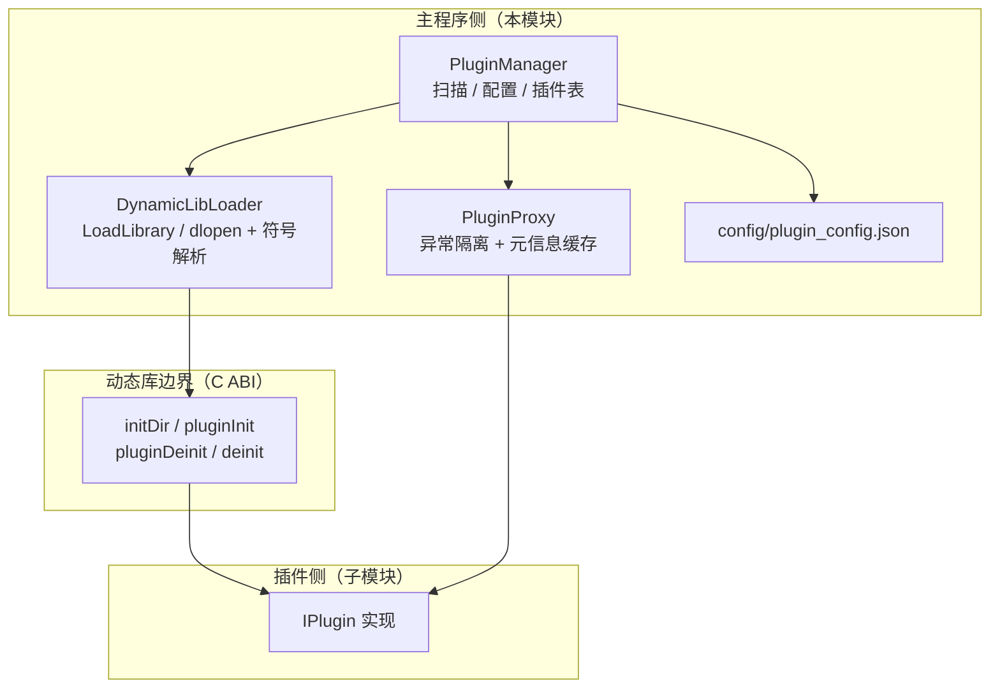

# Plugin 架构设计

插件体系的**主程序侧**：扫描动态库、读配置、加载符号、包装实例、按 `pluginId` 查询。插件本身的接口契约（`IPlugin`）定义在子模块 `sVanillaPluginCommon`，主程序只依赖该契约，不依赖任何具体站点插件。

> 静态库 `Plugin` · `sVanilla/src/Plugin` · 依赖 spdlog、nlohmann-json，以及子模块 `sVanillaPluginCommon` 的 `IPlugin.h` · 详细设计见 [`../detailed-design/plugin.md`](../detailed-design/plugin.md) · 用法见 [`../usage/plugin.md`](../usage/plugin.md)

## 一、设计

要同时满足三个目标：**扩展**（不重新编译即可支持新站点）、**隔离**（单个插件抛异常不能拖垮界面进程）、**可管理**（启用状态与元信息可持久化、可在设置页展示）。

`IPlugin` 是第一等边界：主程序拿到的是 `PluginProxy` 包装后的 `IPlugin`，永远不会直接触碰插件实例。

**关键类型**

| 类型 | 文件 | 职责 |
| --- | --- | --- |
| `DynamicLibLoader` | `DynamicLibLoader.h/.cpp` | 跨平台动态库加载与符号解析（`LoadLibrary`/`dlopen`） |
| `PluginProxy` | `PluginManager.h/.cpp` | `IPlugin` 的异常隔离包装，对上提供永不抛异常的接口 |
| `PluginConfig` | `PluginManager.h` | 单个插件的配置项（nlohmann 序列化） |
| `PluginManager` | `PluginManager.h/.cpp` | 目录扫描、配置持久化、插件表管理与热加载 |

**动态库导出符号（C ABI 契约）** —— `loadPluginSymbol()` 依次解析 4 个符号：

| 符号 | 签名 | 用途 |
| --- | --- | --- |
| `initDir` | `void (*)(const char*)` | 传入配置目录（尾部分隔符自动补齐）；**在 `pluginInit` 之前调用** |
| `pluginInit` | `IPlugin* (*)()` | 创建插件实例 |
| `pluginDeinit` | `void (*)(IPlugin*)` | 作为 `shared_ptr<IPlugin>` 的**删除器**，实例销毁时自动调用 |
| `deinit` | `void (*)()` | 库卸载前调用（`unloadLibrary()` 中先调它再 `FreeLibrary`/`dlclose`） |

调用时序：`initDir(dir)` → `pluginInit()`；卸载时 `deinit()` → 卸载动态库。这是典型的 **C ABI 工厂函数**模式，用一组稳定函数跨越动态库边界，避免 C++ 名字修饰与 STL 布局差异带来的 ABI 风险。

**`PluginProxy` 的异常隔离（设计重点）** —— 整个插件体系最重要的设计点：**主程序绝不会因为插件抛异常而崩溃**。

- **构造期**：调用真实插件的 `pluginMessage()` 并缓存；抛异常则只记 WARN，`isValid()` 保持 `false`，上层 `addPlugin` 据此**丢弃该插件**。
- **运行期**：各接口独立 `try/catch`，异常时返回安全兜底值：

  | 接口 | 异常时的返回值 |
  | --- | --- |
  | `websiteIcon()` | 函数内静态空 `vector<uint8_t>` |
  | `canParseUrl(url)` | `false` |
  | `getVideoView(url)` | `{}` |
  | `getDownloader(...)` | 空 `shared_ptr` |
  | `loginer()` | 持有 `EmptyLoginApi` 的 `LoginProxy` |

- `pluginMessage()` 直接返回**构造期缓存**的副本，不再调用真实插件，因此天然不会抛。

已由 `test/Plugin` 中的 `PluginProxyTest` 用例覆盖。

**插件配置**

- 配置文件 `config/plugin_config.json`（常量 `PluginManager::m_configPath`）；目录 `plugin/`（常量 `m_pluginDir`，**相对路径**）。
- 动态库扩展名按平台固定：`_WIN32` → `.dll`，`__linux__` → `.so`，`__APPLE__` → `.dylib`。
- 序列化字段：`name`、`version`、`libName`、`id`、`description`、`libFile`、`enabled`；**`isValid` 不参与序列化**（仅运行时状态）。
- 写盘用 `json.dump(4)`，且仅当内部 `m_configChanged` 为真才写。

用 C++ 虚接口（而非纯 C 函数表）换来了写插件的便利；代价是对编译器 / STL ABI 更敏感（因此主程序与插件须用同一套工具链）。

## 二、注意事项

| 标注 | 内容 |
| --- | --- |
| `[事实]` | **符号加载失败会记 WARN**（`DynamicLibLoader.cpp:179`，含系统错误信息）。此前 Windows 分支只 `LocalFree` 释放内存、从不打印，非 Windows 分支连读取都没有，「符号缺失」表现为加载失败但没有具体原因。 |
| `[陷阱]` | **`m_configChanged` 的置位不完整。** `addPlugin` 只在"新增配置项"时置真，**已存在同名配置被更新时不会置真**（`setPluginConfig` 会置真，走设置页路径是安全的），可能导致这次修改不落盘。 |
| `[陷阱]` | **`~PluginManager()` 只调用 `saveConfig()`**，不显式 `unloadPlugins()`，依赖成员逆序析构来卸载插件。而 `unloadPlugins()` 在**持锁状态**下 `clear` 容器（销毁插件对象），若插件析构时回调 `PluginManager`，靠 `std::recursive_mutex` 才不至于死锁。 |
| `[陷阱]` | **`pluginDirHaving()` 没有异常保护。** 它直接构造 `std::filesystem::directory_iterator(相对路径)`，目录不存在时会抛异常。 |
| `[事实]` | `loadPlugins()` 之前必须先 `setPluginConfigDir(...)`；未设置时配置路径退化为相对 CWD 的 `config/plugin_config.json`（`SApplication` 构造时用 `appDir()` 完成这一步）。配置文件不存在时 `loadConfig()` 会吞掉解析异常，随后自动创建并保存一份默认配置。 |
| `[事实]` | 插件热加载由 `PluginManager::pluginDirFileAdded()` 驱动，`SApplication` 用 `QFileSystemWatcher` 监视 `plugin/` 目录；`SApplication::init()` 中 `loadPlugins()` 运行在 `std::async` 线程里，通过 `pluginsLoaded` 信号通知界面。 |
| `[事实]` | `DynamicLibLoader` 同时有实例方法 `loadLibrary()` 与静态 `loadLibrary(const std::string&)`（`unloadLibrary` 同理），实例方法内部调用的其实是**静态版**。阅读调用点时要看清是哪个。 |
