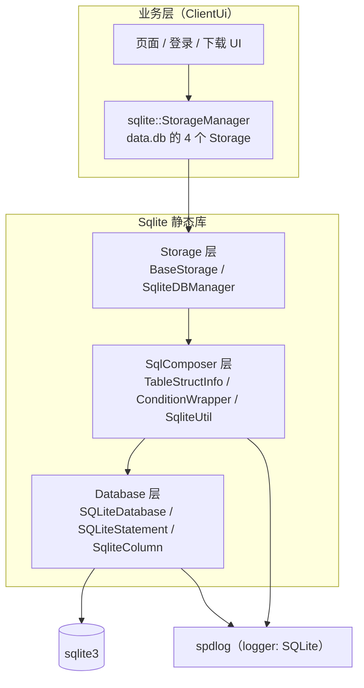
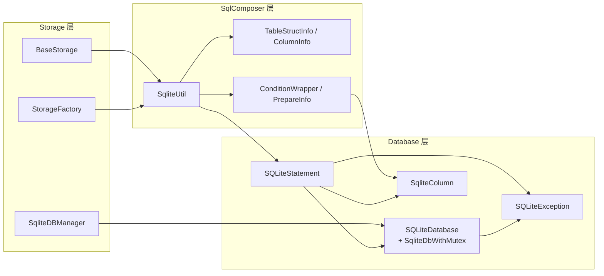
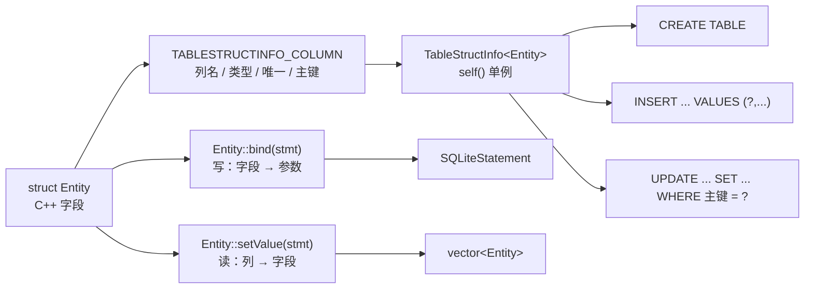
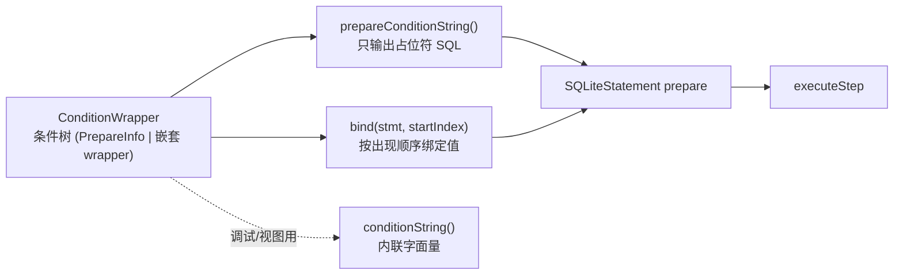
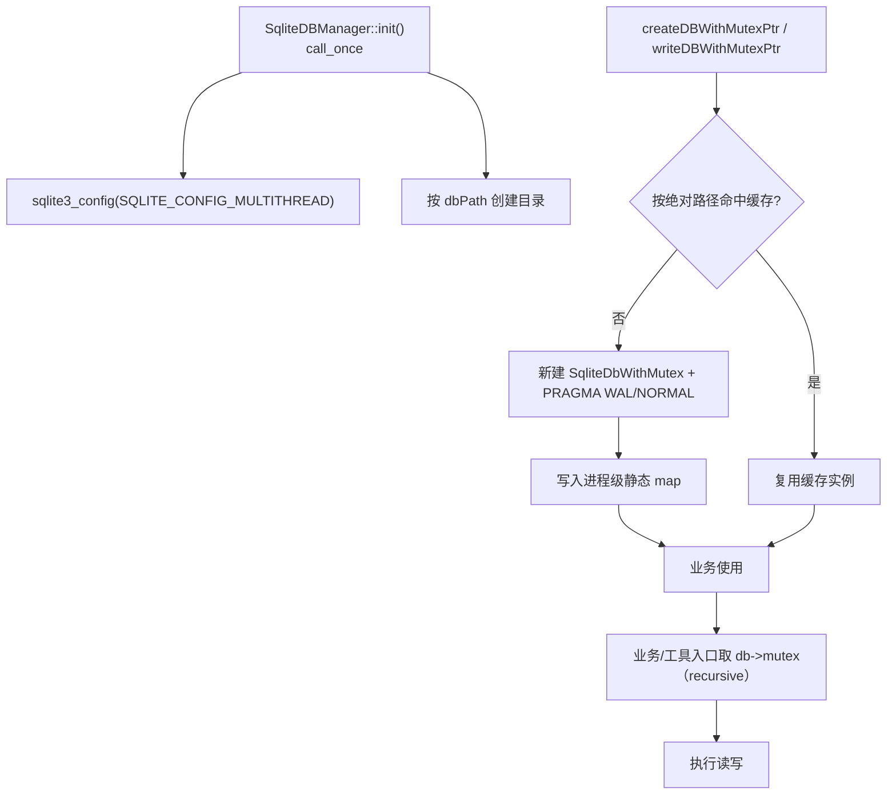
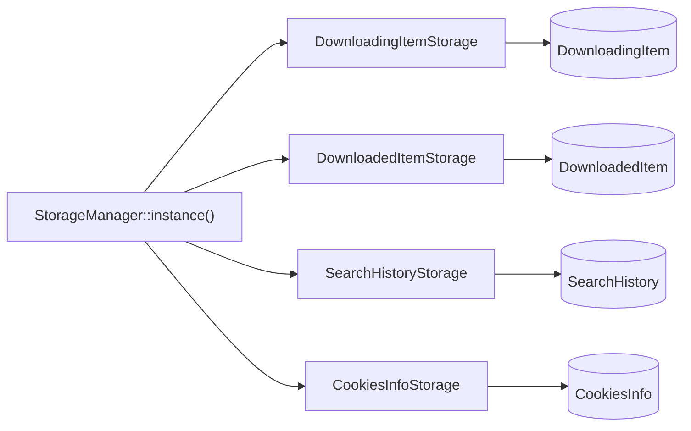
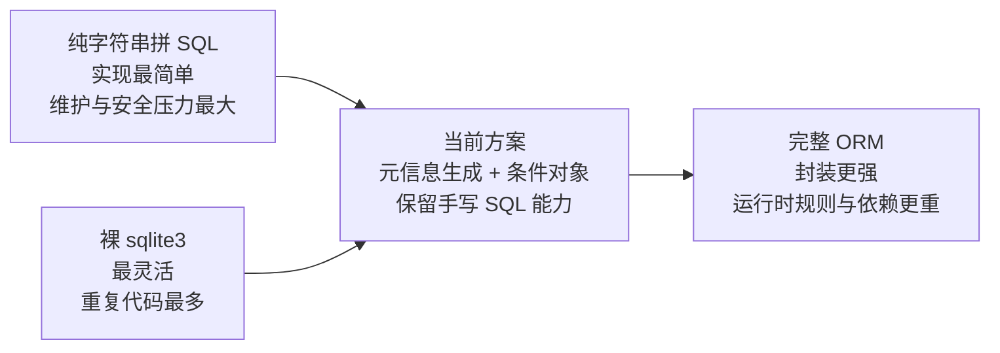

# Sqlite 架构

项目自研的轻量 SQLite 封装，定位在「裸 `sqlite3` C API」与「完整 ORM」之间：底层 RAII 管理连接与语句，中间层由**结构体元信息**生成 SQL，业务层以 `Storage` 形式暴露读写接口。它**不做**自动迁移、关系映射与懒加载。

> 静态库 `Sqlite` · `sVanilla/src/Sqlite` · 依赖 `unofficial::sqlite3::sqlite3`、spdlog（logger 名 `"SQLite"`）
>
> 配套文档：实现级细节（类型清单、SQL 生成规则、算法、边界与错误处理）见 [`../detailed-design/sqlite.md`](../detailed-design/sqlite.md)；调用约定与示例见 [`../usage/sqlite.md`](../usage/sqlite.md)。

## 一、在系统中的位置



| 边界 | 说明 |
| --- | --- |
| 向上 | 只服务本仓库的业务表（下载中 / 已下载 / 搜索历史 / Cookie），不是通用数据库中间件；`StorageManager` 是唯一的重业务装配点 |
| 向外（对 `sqlite3`） | 通过 `sqlite3` 的句柄与语句 API，不依赖 ORM 框架；编译期只暴露 `Database/*.h` 与 `SqlComposer/*.h` 中的类型 |
| 与 Qt 的关系 | **完全无关**。库内不 include 任何 Qt 头，因此 `test/SQLite` 可以脱离 Qt 单独构建运行；业务侧的 `ClientUi/Storage` 才引入 Qt 类型 |
| 反向依赖 | 不存在。库的 `target_include_directories` 只有模块上级目录，源码一律 `#include "Sqlite/..."` 形式 |

## 二、三层结构与依赖方向



| 层 | 目录 | 关键类型 | 职责 | 依赖 |
| --- | --- | --- | --- | --- |
| Database | `Database/` | `SQLiteDatabase`、`SqliteDbWithMutex`、`SQLiteStatement`、`SqliteColumn`、`SQLiteException` | C API 的 RAII 封装：连接、预处理语句、参数绑定、列取值、错误信息 | `sqlite3` |
| SqlComposer | `SqlComposer/` | `BaseTableStructInfo`/`ColumnInfo`、`ConditionWrapper`/`PrepareInfo`、`SqliteUtil`、`IndexColInfo` | 由结构体元信息生成建表 / 增删改查 / 索引 / 视图 SQL，以及结构化条件 | Database 层 |
| Storage | `Storage/` | `BaseStorage`、`SqliteDBManager`、`StorageFactory` | 连接获取与缓存、业务存储基类 | SqlComposer 层 |

**依赖严格单向**：业务 → Storage → SqlComposer → Database → `sqlite3`。底层不反向依赖业务，因此任何"业务语义"都必须留在业务层（`ClientUi/Storage/*`），库内只出现通用 CRUD 与条件组装。

## 三、两个核心抽象

### 3.1 声明式表结构：元信息 + 显式绑定双通道

表结构用宏在**编译期为实体生成一份 `TableStructInfo<Entity>` 特化**，字段级信息（列名、SQL 类型、是否唯一、是否主键/自增）全部集中在一处声明；SQL 由这份元信息在首次访问时生成并缓存。



双通道是有意设计：**"表结构长什么样"由宏声明，"怎么读写字段"由 `bind()`/`setValue()` 手写**。代价是新增字段要改两处，收益是不引入运行时反射、字段顺序与取值语义完全可控（也因此在扩展时容易漏改——见第六节）。

### 3.2 结构化条件：结构生成与参数绑定分离

查询条件不做字符串拼接，而是先构造一棵条件树，再分两步落地：



设计要点：

- **条件树**由 `std::variant<PrepareInfo, ConditionWrapper>` 递归构成，因此"AND 组里嵌一个 OR 组"是一等公民，不需要调用方自己维护括号；
- **结构 / 值分离**是参数化查询的前提：`prepareConditionString()` 只产出 `column op ?`，值在 `bind()` 阶段按**条件出现顺序**依次绑定；`startIndex` 形参让"SET 段 + WHERE 段"共用一条语句的参数序号空间；
- **两个渲染口径**并存：`prepareConditionString()`（占位符，查询/更新/计数走它）与 `conditionString()`（内联字面量，`CREATE VIEW`、`DELETE` 与调试走它）。后者是当前唯一的注入面，也是使用上必须知道的差异。

### 3.3 值模型：一个 variant 承载四种存储类型

```cpp
using SqliteColumnValue = std::variant<std::monostate, int64_t, double, std::string, BlobColumnValue>;
//                                            NULL        INTEGER  REAL   TEXT          BLOB
```

**索引即类型契约**：variant 的 4 个分支顺序与 SQLite 的存储类一一对应，`SqliteColumn::getType()` 用 `static_assert` 把它钉死，条件层也用 `m_value.index() == 1` 判断"是否有值可绑"。这条契约是架构级的——调整分支顺序会静默改变所有取值语义，因此它有三处编译期校验兜底。

构造侧还有一套**编译期类型索引**（`TypeToIndex<T>`：整型 / 浮点 / 字符串 / BLOB 四段），用于"从主键列反查实体字段值"以及在 `bool`、窄整型等无法直接进 variant 的类型上做收敛。

## 四、连接与并发模型



架构约定有三条：

1. **连接按"绝对路径"缓存，进程级静态 map 持有**。`SqliteDBManager` 是纯静态类，`dbPath` 是全局变量（`setDbPath` 赋值），因此"数据库位置"是进程级单点配置，必须在任何连接创建前确定。
2. **`createDBPtr(path, true)` 与 `writeDBPtr(path)` 是两种不同的语义**：前者每次都新建**独立连接**（只在缓存缺失时补写缓存），后者取/建**缓存连接**。`StorageManager` 正是用这个差异为每个业务存储准备"一条写连接（缓存）+ 一条独立读连接"，把读放大摊到不同连接上。
3. **并发保护挂在连接对象上**：`SqliteDbWithMutex = SQLiteDatabase + std::recursive_mutex`，`SqliteUtil` 的每个入口自己取锁，`recursive_mutex` 允许工具函数之间重入。

这条约定的边界很清楚：**只要绕开 `SqliteUtil` 自己拼 SQL，加锁责任就落到调用方身上**，而接口层面没有任何强制手段。这也是当前最主要的架构级风险来源（见第七节 R1）。

## 五、数据视角：业务表与存储

`data.db` 由 `sqlite::StorageManager`（单例）装配，四张表各自独立：

| 表 | 实体 | 主键 / 唯一约束 | 典型用途 |
| --- | --- | --- | --- |
| `DownloadingItem` | `DownloadingItem` | `uniqueId` UNIQUE | 下载中列表：状态轮询、进度落库 |
| `DownloadedItem` | `DownloadedItem` | `uniqueId` UNIQUE | 已下载列表：文件是否存在、去重判断 |
| `SearchHistory` | `SearchHistory` | `url` UNIQUE + PRIMARY KEY | 搜索历史：去重、只保留最近 20 条（触发器） |
| `CookiesInfo` | `CookiesInfo` | `pluginId + domain` 复合 PRIMARY KEY | 登录 Cookie 持久化 |



三点架构性观察：

- **"每表一存储"是刻意的**：通用 CRUD 留在 `BaseStorage`，领域语义（`isDownload`、`updateStatus`、`insertOrUpdate`、`getCookiesInfo`）留在具体存储，页面层不再出现 SQL 字符串；
- **"清理历史"与"累计搜索次数"用触发器而不是业务代码实现**——因为它们必须对任何 UPDATE 生效，而业务侧只在 `insertOrUpdate` 一条路径里写库；
- **约束强度不均**：两张下载表只有 UNIQUE、没有 PRIMARY KEY，因此它们**不具备"按实体更新"的能力**（`updateEntities<Entity>` 的 WHERE 完全来自主键列），只能走"指定列 + 条件"的部分更新入口。这也是新增表时必须先想清楚的一件事。

## 六、设计取舍



| 选择 | 得到 | 付出 |
| --- | --- | --- |
| 元信息 + 宏声明表结构 | 建表/插入/更新 SQL 集中生成，字段定义单点可查 | 宏展开对调试不友好（`BEGIN` 用 `::type` 限定、`END` 的形参不被使用）；实体必须在全局命名空间 |
| 手写 `bind()` / `setValue()` | 无运行时反射，字段顺序与取值语义完全可控，值类型转换可显式收敛 | 新增字段要同步三处（实体、`bind`/`setValue`、`TABLESTRUCTINFO_COLUMN`），顺序错位不会被编译器发现 |
| 条件树 + 结构/值分离 | 参数化查询覆盖绝大多数场景，嵌套逻辑自然表达，附带条件归并优化 | 多一个渲染口径（`conditionString()`）且它仍是注入面；`LIKE` 的前缀语义、空 IN 集合的静默丢弃这类"约定"必须靠文档传递 |
| 连接缓存 + 连接级递归锁 | 业务不需要处理连接生命周期，读放大可分散到独立连接 | 锁的归属分散在调用方（R1）；`dbPath` 成为全局可变状态 |
| 明确不做迁移 / 关系映射 / 懒加载 | 运行时复杂度低，复杂查询可回落到手写 SQL | 表结构变更、跨表关联、分页 JOIN 都要业务侧自己实现；结构演进只能靠"建表用 IF NOT EXISTS"这种兼容性最弱的手段 |

**与完整 ORM 的分界**：本模块只在"单表 + 结构化条件"这一区间提供封装，超出这个区间（多表 JOIN、聚合、窗口函数）就回落成 `queryEntities<Entity>(db, rawSql)` 手写 SQL——把 SQL 字符串集中在对应的业务存储内。

## 七、架构级风险

按架构关注点归组。

| 编号 | 关注点 | 风险 | 影响面 |
| --- | --- | --- | --- |
| R1 | 并发 | 锁的归属没有单点约束：`SqliteUtil` 内部加锁、`BaseStorage` 靠转发继承、业务自拼 SQL 时必须自己加锁且无编译期强制 | 读连接被多线程共享，漏锁 = 同一连接并发使用 |
| R2 | 约束完整性 | 两张下载表没有 PRIMARY KEY，`updateEntities<Entity>` 在无主键实体上会退化为**全表更新**；`deleteEntities()` 默认清空整表 | 数据正确性，一旦误用不可恢复 |
| R3 | 注入与类型安全 | 两个入口（`deleteEntities`、`createViewIfNotExist`）内联字面量而非参数绑定 | 目前调用方的输入均来自本进程，风险可控，但不代表可以继续扩散 |
| R4 | 语义稳定性 | `LIKE` 默认前缀匹配、空 IN 集合静默丢弃 | 查询结果与直觉不一致，且部分行为未被测试锁住 |
| R5 | 表达能力 | 值模型无法表达"长度 0 的 BLOB"（与 NULL 同义）；`SqliteColumn::operator const char*()` 用共享静态缓冲 | 需要精确 round-trip 的场景要绕开封装 |
| R6 | 扩展成本 | 新增表/字段要人工保证三处顺序一致；主键列类型必须在 `TypeToIndex` 特化表内；建表只靠 `IF NOT EXISTS`，列变更无迁移 | 结构演进的出错概率随表数量线性上升 |

## 八、扩展一个新表要动的三处

1. **实体 + 元信息**：全局命名空间的 `struct`，`bind()`/`setValue()` 与 `TABLESTRUCTINFO_COLUMN` 顺序严格一致；需要"按实体更新"就必须声明主键列（`primaryKey` 与 `autoIncrement` **只能二选一**）。
2. **业务存储**：继承 `BaseStorage`，领域方法写在本类；**自拼 SQL 时自己取 `db->mutex`**。
3. **装配**：在 `StorageManager` 的 `create*Storage` 模式里补一个方法（写连接 + 独立读连接 + 建表 + 索引/触发器），并把 storage 暴露给业务。

完整步骤与代码骨架见 [`../detailed-design/sqlite.md`](../detailed-design/sqlite.md) 第八节；调用侧的约束见 [`../usage/sqlite.md`](../usage/sqlite.md)。
