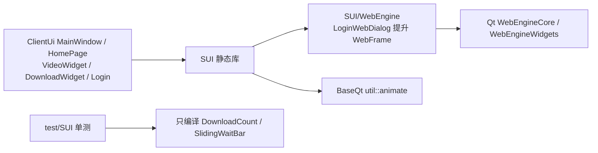
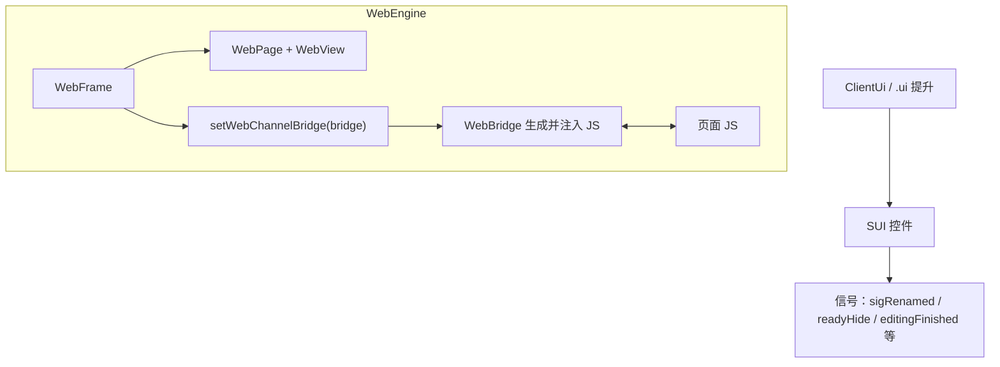
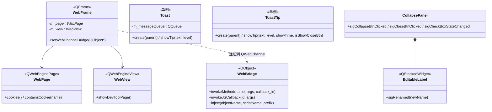
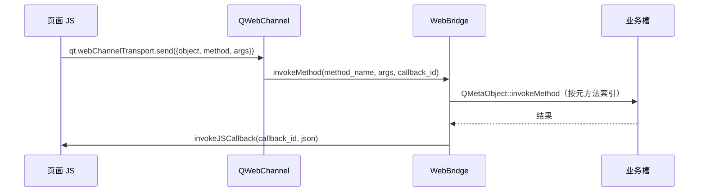
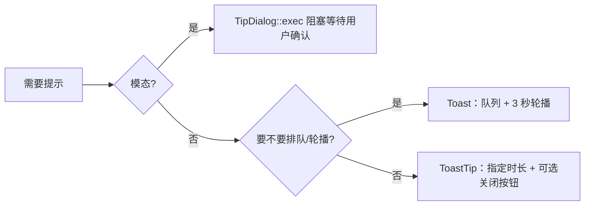

# SUI 架构设计

`SUI`（Simple UI）是可复用的 Qt 控件层，把主程序与登录页都要用到的输入控件、提示弹窗、冻结列表格与 Qt WebEngine 包装沉淀下来。它**不含业务逻辑**：不访问 `Sqlite`、不认识插件、不知道下载任务，只提供"能放进布局里、能被信号驱动"的控件。它兼容 Qt5 / Qt6，用 `QT_VERSION_CHECK` 在少数 API 差异处做分叉。

> 静态库 `SUI` · `sVanilla/src/SUI` · 依赖 Qt Core/Gui/Widgets/Svg/WebEngineCore/WebEngineWidgets、`BaseQt` · 详细设计见 [`../detailed-design/sui.md`](../detailed-design/sui.md) · 用法见 [`../usage/sui.md`](../usage/sui.md)

## 一、总体架构

### 1.1 在仓库中的位置



`ClientUi` 链接 `SUI` 并显式引入 `WebEngineCore` / `WebEngineWidgets`——静态库的 `PRIVATE` 依赖仍会作为链接需求传给消费方。反过来 `test/SUI` 为了不拖入 WebEngine，**只把 `DownloadCount.cpp` 与 `SlidingWaitBar.cpp` 编进测试可执行文件**，这一点在 `test/SUI/CMakeLists.txt` 里有注释说明。

### 1.2 分层与职责

| 类别 | 关键类型 | 职责 |
| --- | --- | --- |
| 基础控件 | `AddLinkLineEdit`、`CollapsePanel`（含 `EditableLabel`）、`DividingLine`、`DownloadCount`、`FileSelector`、`FreezeTreeView`、`RoundImageWidget`、`SearchLineEdit`、`SlidingWaitBar` | 自绘或组合的输入/展示控件 |
| 提示类 | `TipDialog`、`Toast`、`ToastTip` | 模态对话框与非模态吐司 |
| 命名规则 | `NameRuleEditWidget`、`NameRuleSelectWidget`、`NameRuleWidget` | 文件命名规则的 token 拖放编辑 |
| WebEngine | `WebBridge`、`WebFrame`、`WebPage`、`WebSetting`、`WebView` | `QWebEngineView` 包装与 JS ↔ C++ 桥接 |

四组之间基本独立：WebEngine 组自成体系（唯一的对外契约是 `WebFrame` 可被 `.ui` 提升），提示类与基础控件不互相依赖。

### 1.3 调用方向



## 二、目录结构与文件职责

逐文件的行数与职责见 [详细设计](../detailed-design/sui.md) 第一节。

```text
sVanilla/src/SUI
|-- *.h/.cpp             # 基础控件（9 个）
|-- Tips/                # TipDialog / Toast / ToastTip
|-- NameRule/            # 命名规则三件套
|-- WebEngine/           # WebBridge / WebFrame / WebPage / WebSetting / WebView
`-- CMakeLists.txt
```

## 三、核心类设计

类型清单、成员与所有权见 [详细设计](../detailed-design/sui.md) 第二至五节；这里只保留类之间的关系。



## 四、核心数据流

### 4.1 JS ↔ C++ 桥接



桥接的关键约定是**注册名**：`WebFrame::setWebChannelBridge` 用 `bridge->objectName()` 作为 QWebChannel 注册名，因此 C++ 侧的对象名与 JS 侧引用必须逐字符一致。`WebBridge` 构造时默认 `setObjectName("WebBridge")`，调用方可改名但必须同步改 JS。

### 4.2 提示的两种形态



三层提示并存是有意的：`TipDialog` 用于必须打断用户的重要决策，`Toast` 用于批量到达的轻提示（如下载完成），`ToastTip` 用于单条、需要控制时长的提示。

## 五、关键机制详解

### 5.1 为什么自己生成桥接 JS

`WebBridge::inject` 遍历 `QMetaObject` 的方法列表，为每个方法生成一段 JS 函数（含参数 `undefined` 兜底），再与 `kInjectJSCode` 一起注入到 `MainWorld` / `DocumentCreation` / 含子帧。这样做的好处是：**C++ 侧新增一个 `public slots` 方法，只需把方法名加进列表，JS 侧自动获得同名函数**，不用手写 `qwebchannel.js` 的封装层。

代价是生成的 JS 直接构造 `qt.webChannelTransport.send({type: 6, method: <索引>})`，依赖 QWebChannel 的内部协议细节，Qt 大版本升级可能失效。

### 5.2 为什么提示要做成两层非模态

`Toast` 有消息队列、3 秒自动切换、位移动画，适合"短时间涌入多条"的场景；`ToastTip` 无队列、可指定时长、可带关闭按钮，适合"单条且要停留"的场景。二者都是裸指针静态单例 + `create()` + 静态 `showTip()` 的用法。功能上有重叠，但语义差异确实存在，合并需要重新设计调用点。

### 5.3 自绘控件的参数内聚

`DownloadCount`、`SlidingWaitBar` 这类控件把绘制常量（`padding`、`radius`、定时器间隔 30 ms 等）写成文件内的编译期常量，不暴露 setter。理由是使用方只有 `ClientUi` 一处，配色与尺寸统一由控件负责更符合"控件层"的定位；反过来说，第二个消费方出现时这里就要改成可配置。

## 六、并发与生命周期模型

| 类别 | 并发约定 | 所有权 |
| --- | --- | --- |
| 基础控件 | 只在 GUI 线程创建与操作（Qt 通用约束） | 由父部件拥有；`QPropertyAnimation` 以控件为父并在停止后自删 |
| 提示类 | 单例静态裸指针，`create(parent)` 后由父部件级联析构 | 调用方须保证先 `create()` 再 `showTip()` |
| WebEngine | `WebPage` / `WebView` 在 GUI 线程；JS 调用经排队连接回到主线程 | `WebFrame` 拥有 page/view；`QWebChannel` 以 `WebFrame` 为父 |
| `WebBridge` | `asynCall` 用 `QTimer::singleShot(0, ...)` 把操作挪回事件循环 | 由调用方注册给 `WebFrame` |

生命周期约束：**`WebBridge` 必须先于 `WebFrame` 析构前完成 JS 回调**，否则页面可能调用已销毁对象；提示类单例**不会随父部件置空而重置**；重复 `create()` 会先 `delete` 旧实例再重建，但父部件失效后旧指针不会自动清空。

## 七、设计优点

- **业务逻辑零耦合**：控件只发信号，不感知下载/插件/数据库，可被登录页与主界面共用。
- **WebEngine 封装完整**：页面、视图、证书、cookie、权限、DevTools、JS 桥接一次封装，`ClientUi` 只需提升一个 `WebFrame`。
- **提示分层清晰**：模态 / 队列式 / 定时式三种形态覆盖了 UI 的全部提示需求。
- **Qt5 / Qt6 双兼容**：差异点集中在少数 `QT_VERSION_CHECK` 分叉处。

## 八、设计取舍

| 方案 | 优点 | 为什么没选 |
| --- | --- | --- |
| 当前：自绘/组合控件 + 生成式 JS 桥 | 依赖少、可控、新增槽方法成本低 | — |
| 直接用 `qwebchannel.js` + `QWebChannel` 标准用法 | 不依赖内部协议、升级安全 | 需要手写每个方法的 JS 封装层，且要管理 `qwebchannel.js` 的加载时机 |
| 提示只用一套组件 | 无重复、无混用 | 队列式与定时式的交互语义差别大，合并会牺牲其中一类场景 |
| 控件尺寸/配色做成可配置 | 复用性更好 | 当前只有一个消费方，过早参数化会增加维护面 |
| 用 `QSS` 代替自绘 | 样式可主题化 | 圆角边框、分割线、往复滑块这类效果用 QSS 表达困难 |

## 九、注意事项

| 标注 | 内容 |
| --- | --- |
| `[事实]` | 测试只覆盖 `DownloadCount` 与 `SlidingWaitBar` 两个无外部依赖的自绘控件；WebEngine、Tips、NameRule 与其余控件均无单元测试 |
| `[事实]` | `WebFrame::setWebChannelBridge` 用桥接对象的 `objectName()` 作为 QWebChannel 注册名，因此**桥接对象名与 JS 侧必须逐字符一致**（`WebBridge` 已默认取 `"WebBridge"`） |
| `[事实]` | `Toast`（队列式、3 秒轮播）与 `ToastTip`（可指定时长、可带关闭按钮）是两套并存的单例提示组件，调用方容易混用 |
| `[事实]` | 图标与样式走 qrc（如 `:/icon/toast/<level>.svg`、`:/icon/tip/<level>.svg`），代码里的路径与 `sVanilla.qrc` 必须同步 |
| `[事实]` | `test/SUI` 为避免链接 WebEngine，只把 `DownloadCount.cpp` 与 `SlidingWaitBar.cpp` 编进测试可执行文件 |
