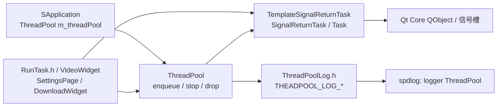
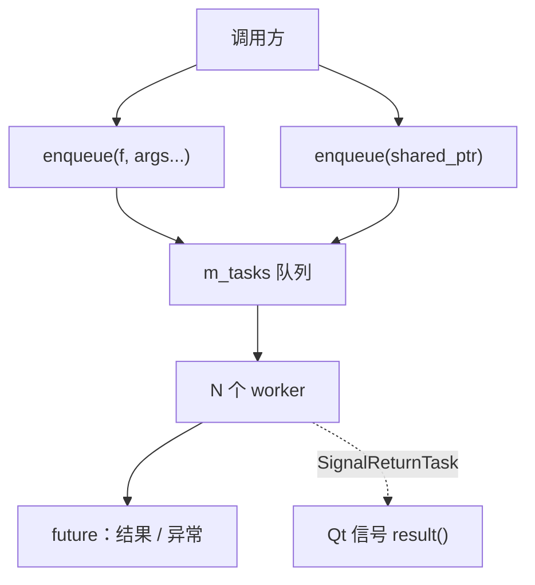
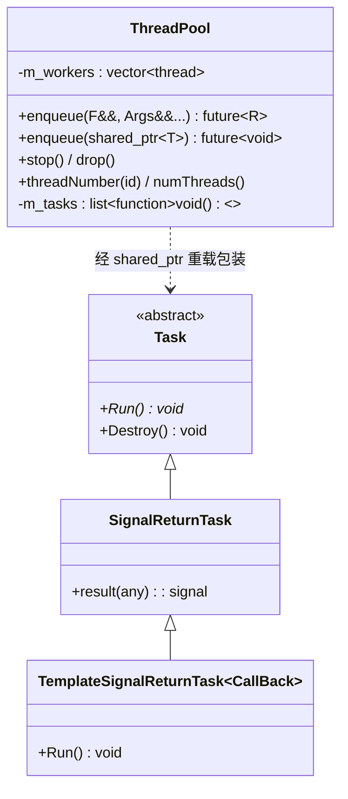
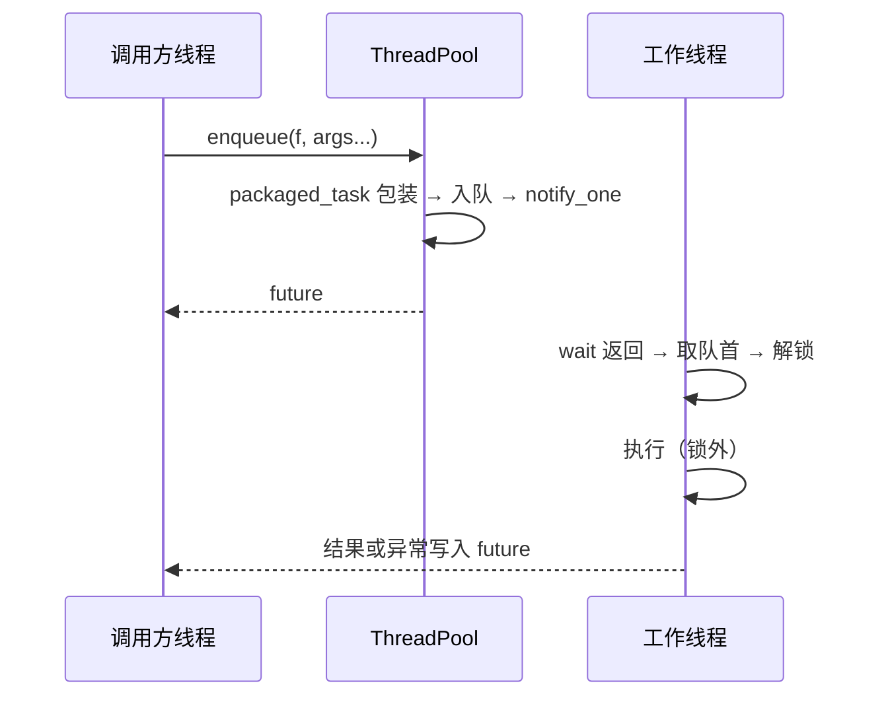
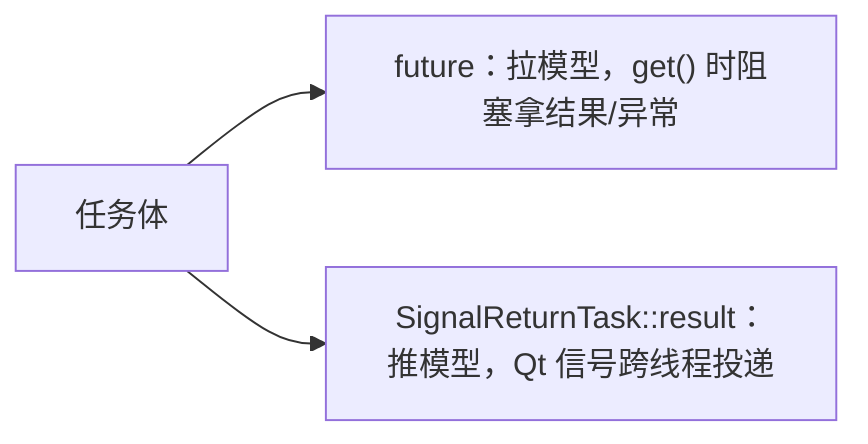
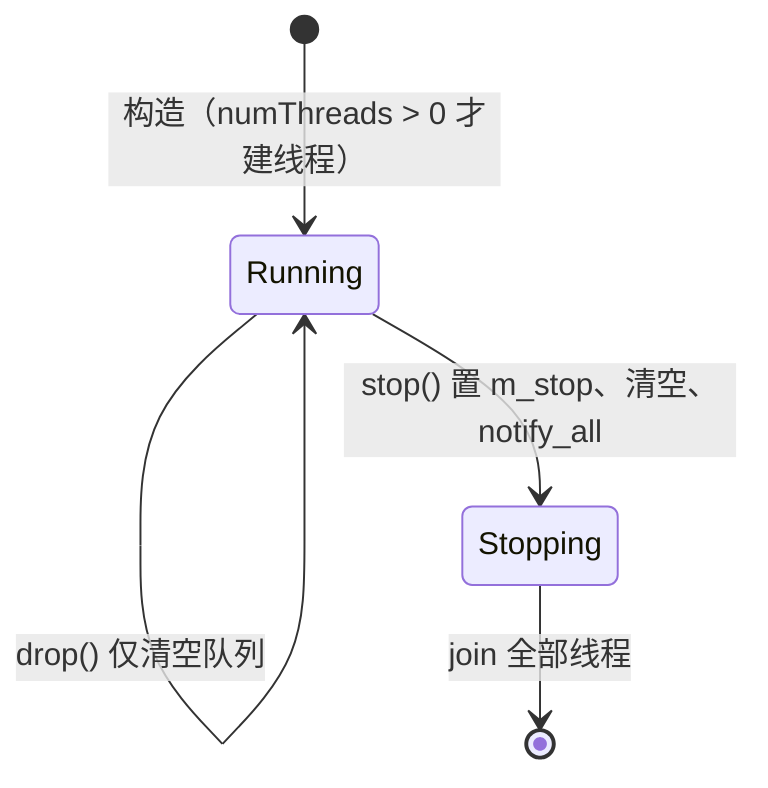

# ThreadPool 架构设计

提供两样东西：一是**通用定长线程池**——提交可调用对象、取回 `std::future`；二是**一组"以 Qt 信号返回结果"的 `Task` 类型**——让工作线程算出的结果安全回到接收对象所在线程。它不做任务优先级、不做动态扩缩容、不做取消语义、也不提供定时/周期任务；任务一旦入队就只能等它被执行或被丢弃。

> 静态库 `ThreadPool` · `sVanilla/src/ThreadPool` · 依赖 Qt Core（`Task.h` 用 `QObject`）、spdlog · 详细设计见 [`../detailed-design/threadpool.md`](../detailed-design/threadpool.md) · 用法见 [`../usage/threadpool.md`](../usage/threadpool.md)

## 一、总体架构

### 1.1 在仓库中的位置

**使用者只有 `ClientUi`**（`src/ClientUi/CMakeLists.txt` 是唯一链接本库的地方）：`SApplication` 持有一个默认构造的 `ThreadPool m_threadPool` 成员并通过 `threadPool()` 暴露；`Utils/RunTask.h` 的 `runTask()`、`DownloadWidget.cpp`、`VideoWidget.cpp`、`SettingsPage.cpp` 是主要调用点。依赖方面：`Task.h` include `<QObject>`（Qt Core），`ThreadPool.cpp` include `ThreadPoolLog.h`（spdlog）；本库**不链接 `Logger`**，但日志宏写死 `spdlog::get("ThreadPool")`，因此运行期依赖 Logger 已完成注册。



外部边界契约：`spdlog` 的 `"ThreadPool"` logger 必须已注册，否则构造/析构线程池的瞬间就会解引用空指针；`Task` 家族要求宿主进程存在 Qt 事件循环才能把信号投递回界面线程。

### 1.2 分层与职责

| 层 | 关键类型 | 职责 |
| --- | --- | --- |
| 调度层 | `ThreadPool` | 管理线程与队列：投递、唤醒、停止、清空；只认识 `std::function<void()>` |
| 任务层 | `Task`、`SignalReturnTask`、`TemplateSignalReturnTask<CallBack>` | 定义"什么是一个任务"，并提供用 Qt 信号回传结果的变体 |

调度层不知道任务层——队列里只有 `std::function<void()>`，`shared_ptr<Task>` 经重载被包成 lambda 后进入队列。两层可独立演化；`SignalReturnTask` 是唯一与 Qt 耦合的部分。

### 1.3 调用方向



方向严格单向：任务不持有池的引用，池不回调调用方（除 `future` 与 Qt 信号外）。

## 二、目录结构与文件职责

逐文件的行数与职责见 [详细设计](../detailed-design/threadpool.md) 第一节。

```text
sVanilla/src/ThreadPool
|-- ThreadPool.h/.cpp    # 池本体（两个 enqueue 模板留在头文件）
|-- Task.h               # Task 抽象基类与 Qt 信号变体
|-- ThreadPoolLog.h      # THEADPOOL_LOG_* 宏
`-- CMakeLists.txt
```

## 三、核心类设计

类型清单、成员与所有权见 [详细设计](../detailed-design/threadpool.md) 第二、三节；这里只保留类之间的关系。



## 四、核心数据流

### 4.1 一次投递的完整路径



关键在于**执行发生在锁外**：持锁区间只覆盖入队与出队。这样 N 个 worker 才能真并行；把任务执行放进临界区会让整个池退化成串行队列。

### 4.2 结果回流的两条路



`future` 是默认路径，适合"调用方在同一点等结果"；`SignalReturnTask` 适合"任务由 UI 触发、结果要回到 UI 线程显示"，避免阻塞调用线程。

## 五、关键机制详解

### 5.1 为什么用 `std::list` 而不是 `std::queue`

队列只在两端操作，而 `stop()` / `drop()` 需要一次性丢弃全部待执行任务——`list::clear()` 直接可用；`queue` 是容器适配器，清空得循环 pop。代价是每次入队一次堆分配，对当前任务粒度可忽略。

### 5.2 异常边界：为什么池不会因为一个任务挂掉

任务体被 `packaged_task` 包裹，抛出的异常被捕获并存入共享状态，调用方 `get()` 时重新抛出；`workLoop` 的循环体因此不会因为异常退出。这是"**异常属于调用方，不属于工作线程**"的约定：池只保证自己的线程存活，不代调用方处理错误。

### 5.3 停止语义：清空而非排空

`stop()` 的做法是置标志 → **清空队列** → 唤醒所有线程 → join，即停止时**丢弃**未执行任务而不是跑完。这个选择来自使用场景：池的生命周期与 UI 页面/下载会话绑定，关闭时继续跑后台任务没有意义；代价是被丢弃任务的 `future` 变成 broken_promise，调用方要 `get()` 才发现。

## 六、并发与生命周期模型



| 方面 | 约定 |
| --- | --- |
| 临界区 | 仅 `m_tasks` 的入队/出队/清空 |
| 停止标志 | `std::atomic_bool`，免锁读 |
| 线程 id 映射 | 构造期写、之后只读，`threadNumber()` 免锁 |
| 所有权 | 池拥有 `m_workers`；任务由 `future` 或 `shared_ptr<Task>` 管理 |
| 析构 | 析构即 `stop()`，幂等 |

生命周期约束：**池必须先于所有持有其 `future` 的对象析构**，否则可能拿到被丢弃任务的 broken_promise。

## 七、设计优点

- **接口极简、语义明确**：两个 `enqueue` 覆盖"函数"与"任务对象"，返回值统一是 `future`；停止语义（丢弃）与清空语义（`drop`）分离。
- **异常隔离**：任务异常不外泄到线程，池保持可用，已由 `ThreadSurvivesTaskException` 等用例固化。
- **锁粒度小**：执行在锁外，是真并行而非串行队列。
- **Qt 集成可选**：只有 `SignalReturnTask` 依赖 Qt，不用它就与 Qt 无关。

## 八、设计取舍

| 方案 | 优点 | 为什么没选 |
| --- | --- | --- |
| 当前：`list` + `packaged_task` + 固定 N 线程 | 实现短、行为可预测、异常语义清晰 | — |
| `QThreadPool` / `QtConcurrent` | 与 Qt 事件循环天然集成、有 `QRunnable` 体系 | 返回 `QFuture` 而非 `std::future`，异常语义弱；且把整个模块绑死在 Qt 上 |
| 动态伸缩线程池 | 负载波动时更省资源 | 当前任务量小且稳定，伸缩带来的调度复杂度不划算 |
| 用 `BaseQt::SenderForQt` 回传结果 | 复用既有投递器 | 那是"投到指定接收者线程"的通用设施；`SignalReturnTask` 直接连信号更短，代价是多一个任务类型 |
| 停止时排空队列 | 调用方不会拿到 broken_promise | 关闭期需要快速退出，且"跑完"会让关闭时间不可控 |

## 九、注意事项

| 标注 | 内容 |
| --- | --- |
| `[事实]` | 默认线程数取 `std::thread::hardware_concurrency()`；`numThreads()` 返回的是**构造参数**而非实际线程数 |
| `[事实]` | 任务队列是 `std::list<std::function<void()>>`，**任务执行在锁外**——持锁区间只覆盖入队/出队/清空 |
| `[事实]` | 任务内部抛出的异常**不会传播到工作线程**，而是封进 `future`，调用方 `get()` 时重新抛出；线程继续存活 |
| `[事实]` | `Task::Destroy()` 默认 `delete this`，与 `shared_ptr` 用法混用会双重释放；当前无调用点 |
| `[事实]` | 停止时**丢弃**未执行任务，其 `future` 变为 broken_promise，需 `get()` 才暴露 |
| `[事实]` | 日志宏名拼写为 `THEADPOOL_*`（R 与 E 换位），与 logger 名 `ThreadPool` 不一致 |
