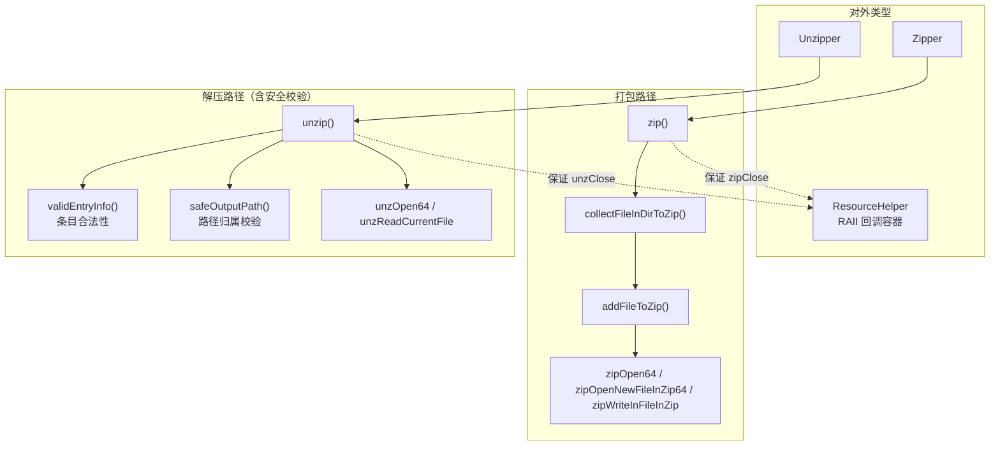
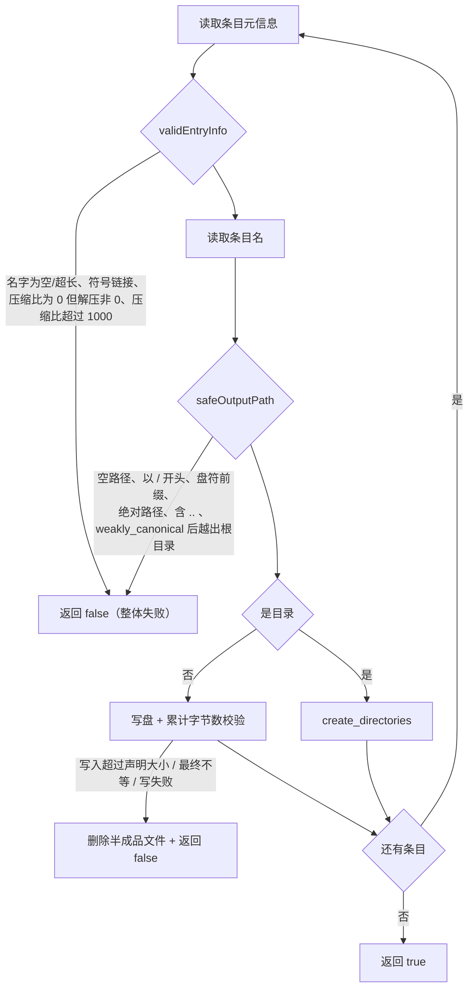

# Zipper 架构设计

对 minizip 的一层封装，做两件事：**打包**（`Zipper`，把目录递归打进 zip 或逐条写入）与**解压**（`Unzipper`，解压侧带完整的路径穿越防护）。打包是薄封装，解压是重点——所有来自外部归档的输入都被当作不可信数据。

> 静态库 `Zipper` · `sVanilla/src/Zipper` · 依赖 minizip（`unofficial::minizip::minizip`）、spdlog（链接了但源码未使用） · 详细设计见 [`../detailed-design/zipper.md`](../detailed-design/zipper.md) · 用法见 [`../usage/zipper.md`](../usage/zipper.md)

## 一、设计

**关键类型**

| 类型 | 职责 |
| --- | --- |
| `ResourceHelper` | RAII 回调容器：析构时**按加入顺序**依次执行回调（跳过空回调），确保 `zipClose` / `unzClose` 一定被调用 |
| `Zipper` | 打包。构造有目录模式与文件列表模式两种重载 |
| `Unzipper` | 解压。`Unzipper(archivePath, outputPath)` + `unzip()` |

`Zipper` 另暴露两个静态方法供自行持有多条目归档的场景使用：`addFileToZip(zipFile, nameInZip, srcFile)` 与 `collectFileInDirToZip(zipFile, filepath, parentdirName)`。

**编译期常量**（`Zipper.cpp` 匿名命名空间）

| 常量 | 值 | 用途 |
| --- | --- | --- |
| `zip64SizeThreshold` | `UINT32_MAX` = 4294967295 | 源文件 ≥ 该值时启用 ZIP64 |
| `maxCompressionRatio` | 1000 | 解压时拒绝压缩比超过此值的条目（zip bomb 防护） |
| `maxEntryNameSize` | 65535 | 条目名长度上限 |
| `readBufferSize` | 1 MiB | 解压读写缓冲 |

**解压安全校验（设计重点）** —— 对每个条目做纵深防御，任一检查不通过即整体失败：

三项关键机制：

1. **`validEntryInfo`**——条目名非空且不超长；**拒绝符号链接**（按 Unix 模式位 `external_fa >> 16` 判断）；`uncompressed_size == 0` 视为空文件放行；`compressed_size == 0` 但 `uncompressed_size > 0` 拒绝；压缩比 > 1000 拒绝。
2. **`safeOutputPath`**——反斜杠统一转 `/`；拒绝空路径、以 `/` 开头、Windows 盘符前缀（`C:`）、绝对路径，以及任何含 `..` 的路径；最后用 `weakly_canonical` 解析并在输出根目录内做归属校验。
3. **写盘后校验**——累计写入字节数与 `uncompressed_size` 一致才算成功，不一致则 `std::filesystem::remove` 删除该文件。

解压侧明显比打包侧严谨，这是有意的：解压处理**外部来源**的归档，是攻击面；打包处理的是**本进程自己的**文件。

## 二、注意事项

| 标注 | 内容 |
| --- | --- |
| `[陷阱]` | **`addFileToZip` 失败时会留下半成品条目。** 流程是先 `zipOpenNewFileInZip64` 打开条目、再打开源文件；若源文件打开失败直接 `return false`，**此前打开的条目没有 `zipCloseFileInZip`**。另外写入循环 `while (!stream.eof())` 中 `zipWriteInFileInZip` 的返回值未被检查；`collectFileInDirToZip` 现已累计 `addFileToZip` 的返回值并向上传递。 |
| `[事实]` | `collectFileInDirToZip` **不修改进程全局工作目录**：显式计算 `baseDir` 后调 `relative(entry.path(), baseDir)`，而非用 `current_path(...)` 设定基准（那样会污染插件目录、配置、日志等一切相对路径的解析，多线程下更是竞态）。 |
| `[事实]` | `m_strRelativePath` 是**只写不读**的成员（构造时赋值、`setZipFiles` 时清空，`zip()` / `collectFileInDirToZip()` 从未读取）。 |
| `[事实]` | 条目时间戳取自 `std::localtime` 后直接填入 `tm_zip`，`tm_mon`（0–11）与 `tm_year`（年 − 1900）未做额外换算，交由 minizip 解释。 |
| `[事实]` | **当前主仓库内 `Zipper` / `Unzipper` 没有任何调用方**，唯一的调用者是单元测试。改动此模块前请确认是否已有新调用点。 |
