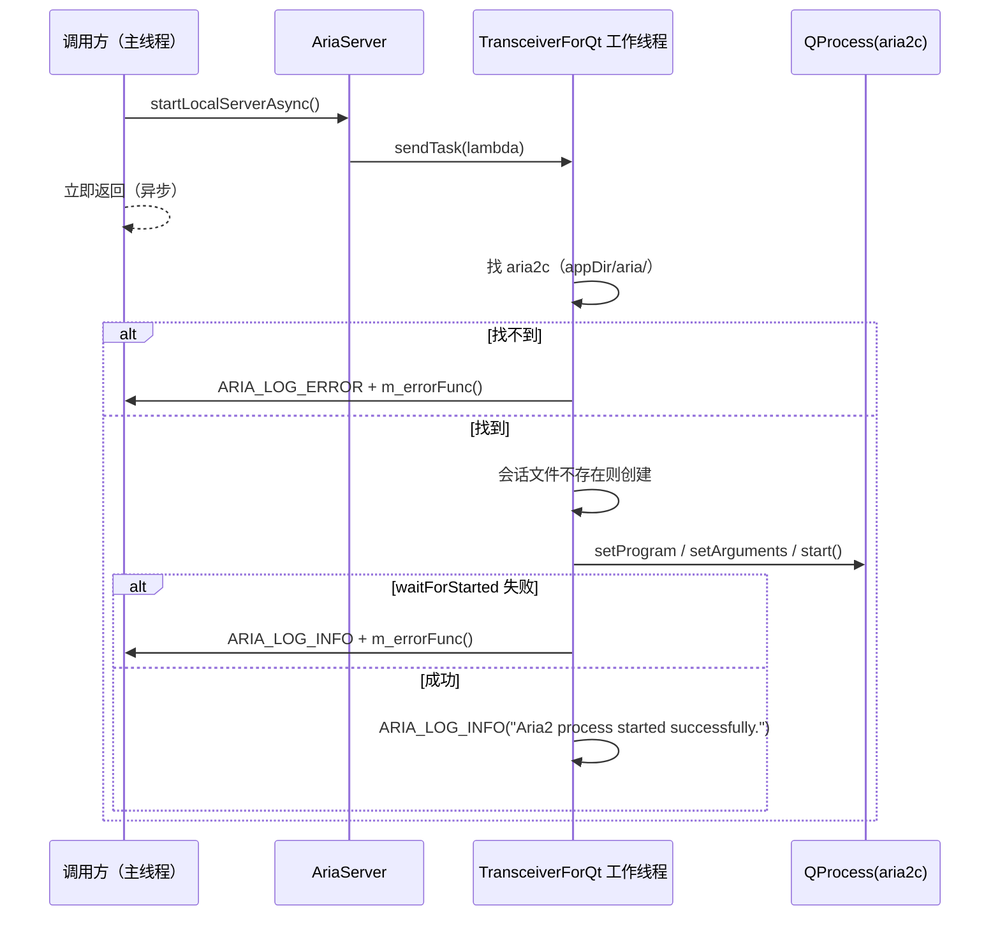

# Aria2Net 详细设计

启动并托管本地 aria2c 进程：所有对 `QProcess` 的操作都被投递到 `TransceiverForQt` 的专属线程执行，对外只暴露"异步启动 / 同步关闭"两个动作。本篇记录**进程启动参数的完整清单、线程投递与析构同步的实现、以及未接线的成员**；为什么用独立工作线程托管 `QProcess`、为什么不做 RPC 客户端见 [`../architecture/aria2net.md`](../architecture/aria2net.md)。

> 静态库 `Aria2Net` · `sVanilla/src/Aria2Net` · 依赖 `BaseQt`（`TransceiverForQt`）、Qt6 Core、spdlog · 测试：`test/Aria2Net/aria2net_test.cpp` · 唯一持有者：`SApplication::m_ariaServer`

## 一、文件清单

| 文件 | 职责 |
| --- | --- |
| `AriaServer.h` | `aria2net::AriaServer` 声明 |
| `AriaServer.cpp` | 匿名命名空间内 `trimmedWhitespace`；构造/析构、`startLocalServerAsync`、`closeServer` / `forceCloseServer`、`testServer`、三个 setter |
| `AriaLog.h` | 8 个 `ARIA_LOG_*` 宏 → `spdlog::get("Aria2Net")` |
| `CMakeLists.txt` | 静态库 |

## 二、状态与成员

| 成员 | 类型 | 位置 | 说明 |
| --- | --- | --- | --- |
| `m_future` | `std::future<bool>` | `AriaServer.h:31` | **从未被赋值** |
| `m_errorFunc` | `std::function<void()>` | `AriaServer.h:32` | 启动失败时回调 |
| `m_closeFunc` | `std::function<void()>` | `AriaServer.h:33` | 已连到 `QProcess::finished`，进程退出时调用；但 `setCloseFunc()` **仍无调用点**（默认空） |
| `m_aria2Process` | `std::unique_ptr<QProcess>` | `AriaServer.h:34` | aria2c 进程句柄 |
| `m_transceiver` | `std::unique_ptr<TransceiverForQt>` | `AriaServer.h:35` | 工作线程投递器（构造即建） |
| `m_dir` | `QString` | `AriaServer.h:36` | 日志/会话目录，由 `setLogDir` 写入 |

所有对 `m_aria2Process` 的读写都发生在 `m_transceiver` 的工作线程上（构造/析构/启动/关闭都走 `sendTask`），因此没有额外的锁。

## 三、接口与行为

| 接口 | 位置 | 行为 |
| --- | --- | --- |
| `AriaServer()` | `AriaServer.cpp:33` | 只初始化 `m_aria2Process(nullptr)` 与 `m_transceiver`；**不启动进程** |
| `~AriaServer()` | `AriaServer.cpp:39` | 用 `std::promise` + `sendTask` 投递 kill 任务后 `get()` **同步等待**完成，再打一行 "AriaServer exit" |
| `startLocalServerAsync()` | `AriaServer.cpp:56` | 投递 lambda 到工作线程：查找可执行文件 → 建会话文件 → 装配参数 → `start()` → `waitForStarted()`；失败调 `m_errorFunc()` 并返回 false |
| `closeServer()` | `AriaServer.cpp:135` | 投递 kill + `waitForFinished()` + `reset()`；**不等待完成** |
| `forceCloseServer()` | `AriaServer.cpp:148` | 与 `closeServer()` **实现逐字相同** |
| `testServer()` | `AriaServer.cpp:161` | 空函数体（注释 `// for getvirsion`） |
| `setErrorFunc` / `setCloseFunc` | `AriaServer.cpp:166,171` | 保存回调 |
| `setLogDir(dir)` | `AriaServer.cpp:176` | `m_dir = dir + "/aria"`；`QDir(m_dir).mkpath(m_dir)` |

### 3.1 可执行文件查找

```cpp
QString ariaPath = QApplication::applicationDirPath() + "/aria/";
QString ariaExecutable = QStandardPaths::findExecutable("aria2c", QStringList() << ariaPath);
```

即**只在 `<appDir>/aria/` 下查找** `aria2c`（Windows 下 `findExecutable` 会尝试带 `.exe` 等后缀）。找不到就记 ERROR 日志并回调 `m_errorFunc()`。

### 3.2 会话与日志文件

```cpp
QString sessionFile = m_dir + "/aira.session";
QString logFile = m_dir + "/aira.log";
```

文件名已修正为 `aria.session` / `aria.log`（旧版本遗留的 `aira.*` 不再被读取，可手工清理）。会话文件在启动前若不存在则**以 `WriteOnly` 打开后立即关闭**来创建空文件（返回值未检查）。

### 3.3 启动参数完整清单

| 类别 | 参数 |
| --- | --- |
| RPC | `--enable-rpc`、`--rpc-listen-all=false`、`--rpc-allow-origin-all=false`、`--rpc-listen-port=6800`、`--rpc-secret=sVanilla` |
| 会话 | `--input-file=<sessionFile>`、`--save-session=<sessionFile>`、`--save-session-interval=30` |
| 日志 | `--log=<logFile>`、`--log-level=debug` |
| 并发 | `--max-concurrent-downloads=6`、`--max-connection-per-server=16`、`--split=5`、`--min-split-size=10M` |
| 限速 | `--max-overall-download-limit=0`、`--max-download-limit=0`、`--max-overall-upload-limit=0`、`--max-upload-limit=0`（0 即不限） |
| 行为 | `--continue=true`、`--allow-overwrite=true`、`--auto-file-renaming=false`、`--file-allocation=none` |
| 伪装 | `--header=User-Agent: Mozilla/5.0 (Windows NT 10.0; Win64; x64) AppleWebKit/537.36 (KHTML, like Gecko) Chrome/130.0.0.0 Safari/537.36` |

进程通道模式为 `QProcess::SeparateChannels`；`readyReadStandardOutput` / `readyReadStandardError` 分别接到日志（先 `trimmedWhitespace` 判空，非空才打；ERROR 通道用 `ARIA_LOG_ERROR`）。

## 四、关键时序

### 4.1 启动



### 4.2 析构

```mermaid
sequenceDiagram
    participant App as 调用方
    participant A as AriaServer
    participant T as 工作线程
    participant P as QProcess
    App->>A: ~AriaServer()
    A->>T: sendTask([this, &promise]{ kill; waitForFinished; reset; promise.set_value(); })
    T->>P: kill() + waitForFinished()
    T->>A: promise.set_value()
    A->>A: promise.get_future().get()（同步阻塞直到完成）
    A->>A: ARIA_LOG_INFO("AriaServer exit")
```

析构是**同步**的：必须等工作线程把进程 kill 完才返回，避免 `QProcess` 在主线程被销毁。

## 五、边界与错误处理矩阵

| 场景 | 当前行为 | 依据 |
| --- | --- | --- |
| 构造后未启动 | 进程为空，析构安全 | `AriaServerTest.ConstructsAndDestructsWithoutStartingProcess` |
| `setLogDir` | 追加 `/aria` 子目录并创建 | `AriaServerTest.SetLogDirCreatesAriaSubdirectory` |
| 两个 setter | 接受任意 callable | `AriaServerTest.SetErrorFuncAndCloseFuncAcceptCallables` |
| 未启动就 `closeServer` | 安全（判空 + 判 Running） | `AriaServerTest.CloseServerOnNeverStartedServerIsSafe` |
| 未启动就 `forceCloseServer` | 安全 | `AriaServerTest.ForceCloseServerOnNeverStartedServerIsSafe` |
| 重复 `closeServer` | 安全（第二次 `m_aria2Process` 已 reset，判空跳过） | `AriaServerTest.RepeatedCloseCallsAreSafe` |
| `testServer()` | 什么都不做 | `AriaServerTest.TestServerIsCurrentlyNoOp` |
| 找不到 aria2c | ERROR 日志 + `m_errorFunc()`，无进程 | `AriaServer.cpp:73-81` |
| 启动失败 | INFO 日志（内容为 errorString）+ `m_errorFunc()` | `AriaServer.cpp:118-126` |
| 进程异常退出 | `m_closeFunc` 随 `QProcess::finished` 调用（未 `setCloseFunc` 则无动作）；进程对象仍在，状态非 Running | `AriaServer.cpp:103-108` |
| 未调 `setLogDir` 就启动 | `m_dir` 为空 → 会话/日志路径变成 `/aira.session`、`/aira.log`（**写到根目录**） | `AriaServer.cpp:63-64` |

## 六、测试映射

| 覆盖点 | 代表用例 |
| --- | --- |
| 构造/析构不启动进程 | `AriaServerTest.ConstructsAndDestructsWithoutStartingProcess` |
| 目录创建 | `SetLogDirCreatesAriaSubdirectory` |
| 回调 setter | `SetErrorFuncAndCloseFuncAcceptCallables` |
| 关闭幂等与空态安全 | `CloseServerOnNeverStartedServerIsSafe`、`ForceCloseServerOnNeverStartedServerIsSafe`、`RepeatedCloseCallsAreSafe` |
| 空实现占位 | `TestServerIsCurrentlyNoOp` |

测试**不真正启动 aria2c**（无可执行文件也能全绿），因此参数装配与进程交互没有被用例覆盖。

## 七、扩展步骤与验证

上层可调用 `setCloseFunc()` 感知进程退出：`startLocalServerAsync()` 已将回调连到 `QProcess::finished(int, ExitStatus)`，并显式指定该重载以兼容 Qt 5.15。回调在工作线程执行，若触达 UI 需投递到主线程；真实进程退出路径仍需集成测试。

要让 `startLocalServerAsync()` 真正返回结果：

1. 把 lambda 换成 `std::packaged_task<bool()>`，或在工作线程内 `promise.set_value()` 并把 future 存进 `m_future`；
2. 调用方 `m_future.get()` 前需确认已有值（当前 `m_future` 默认构造，`valid()` 为 false）。

手工验证：

```sh
cmake --build out/harness --config Debug --target Aria2Net_test
out/harness/test/Aria2Net/Debug/Aria2Net_test.exe
```

检查清单：升级后确认旧版本遗留的 `aira.session` 不会导致会话丢失；改关闭语义后回归 `closeServer` 相关测试；本机集成验证需把 `aria2c` 放进 `<appDir>/aria/` 后观察 `log/Aria2Net.log` 是否出现 "Aria2 process started successfully."。
