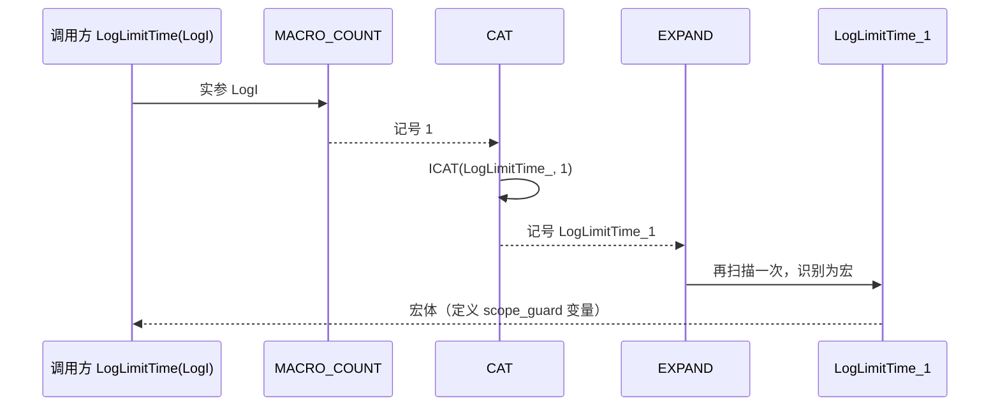

# Base 详细设计

`sVanilla/src/Base` 只有 `MacroTool.h` 一个文件、三条宏组，全部在预处理阶段生效。本篇记录每个宏的**展开规则、边界取值与已固化的行为**；为什么需要两级展开、为什么不用 Boost.Preprocessor 见 [`../architecture/base.md`](../architecture/base.md)。

> 仅头文件 · 无构建目标（`Base/` 下**没有 `CMakeLists.txt`**）· 测试：`test/Base/base_test.cpp`

## 一、文件清单

| 文件 | 职责 |
| --- | --- |
| `MacroTool.h` | `ISTR` / `STR` / `ICAT` / `CAT` / `EXPAND` / `HELPER_OF_MACRO_COUNT` / `MACRO_COUNT` 共 7 个宏；整段被 `// clang-format off`（第 3 行）与 `// clang-format on`（第 14 行）包裹 |

无 `.cpp`、无构建目标。引用方必须自己把 `sVanilla/src` 加入 include 路径：测试目标写 `${CMAKE_SOURCE_DIR}/sVanilla/src`，库目标写 `${CMAKE_CURRENT_SOURCE_DIR}/..`（`test/Base/CMakeLists.txt`、`sVanilla/src/Logger/CMakeLists.txt` 等各自的写法）。

## 二、宏清单与展开规则

| 宏 | 行 | 展开结果 | 语义 |
| --- | --- | --- | --- |
| `ISTR(x)` | 4 | `#x` | 直接字符串化，**不先展开**实参 |
| `STR(x)` | 5 | `ISTR(x)` | 实参先展开，再字符串化 |
| `ICAT(a, b)` | 7 | `a##b` | 直接拼接，**不先展开**实参 |
| `CAT(a, b)` | 8 | `ICAT(a, b)` | 实参先展开，再拼接 |
| `EXPAND(...)` | 10 | `__VA_ARGS__` | 原样转发，并额外引入一次宏扫描 |
| `HELPER_OF_MACRO_COUNT(_1.._9, N, ...)` | 12 | `N` | 靠形参错位把实参个数换算到 `N` |
| `MACRO_COUNT(...)` | 13 | `EXPAND(HELPER_OF_MACRO_COUNT(__VA_ARGS__, 9, 8, 7, 6, 5, 4, 3, 2, 1))` | 返回实参个数（1–9） |

```cpp
#define ISTR(x)  #x
#define STR(x)   ISTR(x)
#define ICAT(a, b) a##b
#define CAT(a, b)  ICAT(a, b)
```

两级结构不是冗余：函数式宏的实参在代入宏体前会先完整展开，**除非该实参紧邻 `#` 或 `##`**。`STR` 里的 `x` 不紧邻 `#`，所以先展开；`ISTR` 里的 `x` 紧邻 `#`，所以不展开。合并成一层会让"实参本身是宏"的场景退化成取到宏名字面量，已由 `MacroToolTest.IstrStringifiesWithoutExpanding`（得 `"SV_TEST_NUMBER"`）与 `MacroToolTest.StrExpandsBeforeStringifying`（得 `"42"`）分别钉住。

## 三、参数计数的错位算法

`MACRO_COUNT(a, b)` 的展开过程：

| 步骤 | 记号序列 | 落在 `N` 上的值 |
| --- | --- | --- |
| 实参代入 | `a, b, 9, 8, 7, 6, 5, 4, 3, 2, 1` | — |
| 按位对齐到 `_1…_9, N, ...` | `_1=a, _2=b, _3=9, _4=8, _5=7, _6=6, _7=5, _8=4, _9=3, N=2, ...=1` | `2` |
| 结果 | `2` | 实参个数 |

实参排在前面，补的倒序数字 `9…1` 被顶到后面的坑位；实参越少，落到 `N` 上的数字越大，正好等于实参个数。上层用 `CAT(Name_, n)` 把数字拼到宏名后完成"宏重载"（`LogUtil.h:58`、`BaseInfo.h` 的 `TABLESTRUCTINFO_COLUMN` 都是这个模式）。

`CAT` 刚拼出的记号不会自动被再次识别为宏，因此外面必须再包一层 `EXPAND(...)` 多引入一次扫描——否则拼出的 `LogLimitTime_2` 会以普通标识符留在代码里。这也是 MSVC 传统预处理器下可变参数宏行为与标准不一致时的常用兜底。

## 四、调用时序



## 五、边界与错误处理矩阵

| 场景 | 当前行为 | 依据 |
| --- | --- | --- |
| `STR(宏名)` | 得到展开后的值（如 `"42"`） | `MacroToolTest.StrExpandsBeforeStringifying` |
| `ISTR(宏名)` | 得到宏名字面量（如 `"SV_TEST_NUMBER"`） | `MacroToolTest.IstrStringifiesWithoutExpanding` |
| `CAT` 拼出的标识符可用 | 拼出的记号能作为变量名/类型名使用 | `MacroToolTest.CatBuildsUsableIdentifier` |
| `EXPAND(a, b)` 多实参 | 原样转发，逗号保留 | `MacroToolTest.ExpandForwardsArgumentsVerbatim` |
| `MACRO_COUNT` 取 1 个与 9 个实参 | 分别得 `1` 与 `9` | `MacroToolTest.MacroCountCountsArguments` |
| **零实参 `MACRO_COUNT()`** | 得 **`1` 而不是 0**——空实参被当成一个空参数 | `HELPER_OF_MACRO_COUNT` 形参错位机制（无用例覆盖） |
| 超过 9 个实参 | 不产生显式报错，展开为难以理解的错误（`<` 缺位导致形参被吃掉） | 同上（无用例覆盖） |
| 未 include 本文件 | 编译错误（宏未定义） | 无运行时实体 |
| 重复 include | 安全，`#pragma once`（第 1 行） | — |
| 多线程 / 静态初始化顺序 | 无影响：宏在预处理阶段即消失，不产生变量、类型、静态对象 | — |

## 六、测试映射

| 覆盖点 | 代表用例 |
| --- | --- |
| 单层字符串化不展开 | `MacroToolTest.IstrStringifiesWithoutExpanding` |
| 两层字符串化先展开 | `MacroToolTest.StrExpandsBeforeStringifying` |
| 拼接产出可用标识符 | `MacroToolTest.CatBuildsUsableIdentifier` |
| 变参原样转发 | `MacroToolTest.ExpandForwardsArgumentsVerbatim` |
| 参数计数（含 1 与 9 边界） | `MacroToolTest.MacroCountCountsArguments` |

`test/Base` 只链接 `GTest::gtest_main`，不链接任何项目库——这也间接验证了 Base 不产生构建目标。

## 七、扩展步骤与验证

新增"宏重载"分支（以 `Xxx` 宏需要 3 个实参为例）：

1. 在消费方头文件里定义 `Xxx_3(...)` 实现体；
2. 定义 `Xxx(...) EXPAND(CAT(Xxx_, MACRO_COUNT(__VA_ARGS__))(__VA_ARGS__))`；
3. 不要改 `MacroTool.h`——除非实参超过 9 个，那时要给 `HELPER_OF_MACRO_COUNT` 增加占位并同步倒序数字。

需要扩展计数上限时（>9）：

1. 在 `HELPER_OF_MACRO_COUNT` 形参列表末尾追加 `_10, _11…`；
2. 在 `MACRO_COUNT` 的倒序数字序列头部补 `11, 10`；
3. 用一个新的 `MacroToolTest` 用例断言边界值。

手工验证：

```sh
cmake --build out/harness --config Debug --target Base_test
out/harness/test/Base/Debug/Base_test.exe
```

检查清单：新增分支后，确认 1 个实参的旧调用点仍走 `_1`（回归 `MacroToolTest` 全绿）；确认拼出的宏名确实被展开（编译期若报"未声明的标识符 `Xxx_2`"，通常是漏了 `EXPAND`）。
