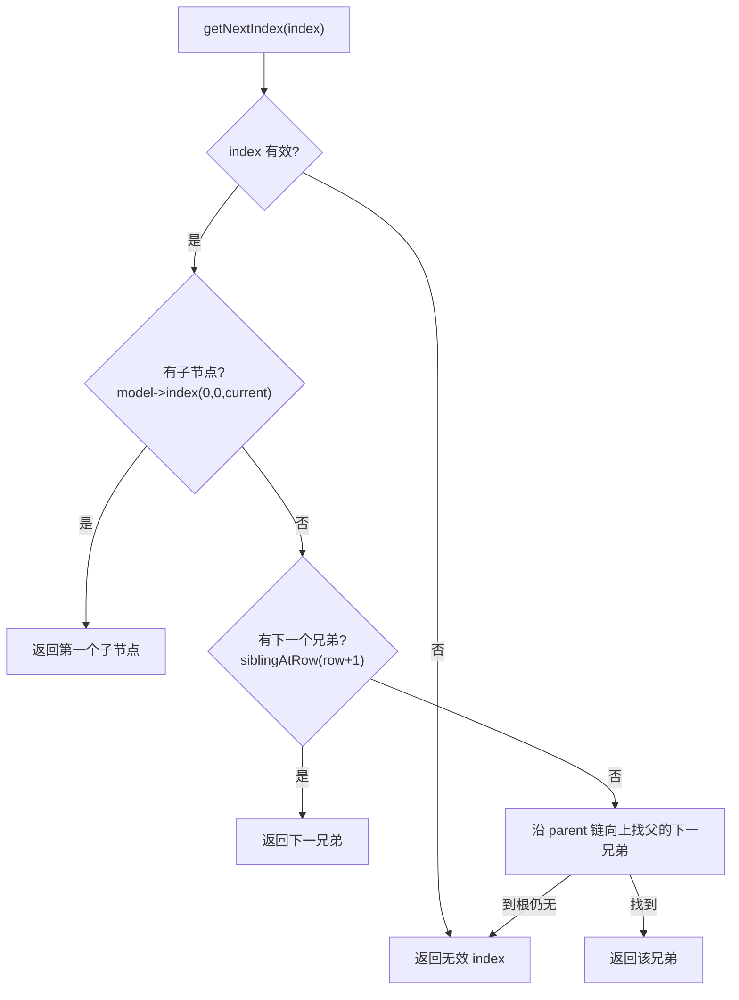

# BaseQt 详细设计

Qt 侧的四个小工具：跨线程投递（`SenderForQt`）、裸指针树（`TreeItem`）、模型遍历器（`TreeViewIterator`）、UI 与文件工具函数（`util::*`）。本篇记录**每个类型的成员语义、遍历算法的前序规则、跨线程投递的连接方式**；为什么需要两套投递器、为什么树用裸指针见 [`../architecture/baseqt.md`](../architecture/baseqt.md)。

> 静态库 `BaseQt` · `sVanilla/src/BaseQt` · 链接 Qt6（Core / Widgets） · 测试：`test/BaseQt/baseqt_test.cpp`

## 一、文件清单

| 文件 | 职责 |
| --- | --- |
| `SenderForQt.h` | `ActivateQbject`、`TransceiveThread`、`SenderForQt`、`TransceiverForQt` 声明（两个 `sendTask` 为模板，留在头文件） |
| `SenderForQt.cpp` | 上述类的非模板实现 |
| `TreeItem.h` | `TreeItem` 结构：父子裸指针 + `clone` / `text` 虚函数 |
| `TreeItem.cpp` | 树操作实现 |
| `TreeViewIterator.h` | 迭代器声明 + `operator*` / `data` 两个模板 |
| `TreeViewIterator.cpp` | 前序遍历的 `getNextIndex` / `getPreviousIndex` |
| `Utility.h` | `util` 命名空间：5 个自由函数 |
| `Utility.cpp` | 实现 |
| `CMakeLists.txt` | 静态库 |

## 二、`SenderForQt` / `TransceiverForQt`：跨线程投递

### 2.1 类型

| 类型 | 位置 | 说明 |
| --- | --- | --- |
| `ActivateQbject` | `SenderForQt.h:10` | `QObject` 派生（类名拼写如此）；信号 `sendTask(const std::function<void()>&)`，槽语义的 `runTask()` 直接 `f()` |
| `TransceiveThread` | `SenderForQt.h:22` | `QThread` 派生；构造里 `qRegisterMetaType`、`moveToThread(this)`、连 `sendTask → runTask`（`AutoConnection \| UniqueConnection`）、`start()`；`run()` 只调 `exec()` |
| `SenderForQt` | `SenderForQt.h:38` | 持 `unique_ptr<ActivateQbject> m_sender`，构造时连到**外部传入的接收者** |
| `TransceiverForQt` | `SenderForQt.h:58` | 持 `unique_ptr<TransceiveThread>`，任务投递到**自己的专属线程** |

`Q_DECLARE_METATYPE(std::function<void()>)` 在 `SenderForQt.h:8`，配合构造期 `qRegisterMetaType<std::function<void()>>("std::function<void()>")`（`SenderForQt.cpp:10,42`）使该类型可用于排队连接。

### 2.2 `sendTask` 模板

```cpp
template <typename Lambda>
void sendTask(Lambda&& lambda) const
{
    emit m_sender->sendTask([lambda = std::make_shared<std::remove_reference_t<Lambda>>(std::forward<Lambda>(lambda))]() {
        (*lambda)();
    });
}
```

lambda 被包进 `shared_ptr` 再拷进 `std::function`，使捕获的内容可拷贝（满足 `Q_DECLARE_METATYPE` 对可拷贝的要求），因此**捕获移动-only 对象会编译失败**。

### 2.3 两种投递的差别

| | `SenderForQt` | `TransceiverForQt` |
| --- | --- | --- |
| 任务在哪执行 | 接收者对象所在线程 | 自己创建的工作线程 |
| 构造参数 | 接收者 `ActivateQbject*`（非空） | 无 |
| 可用性判断 | `enable()` 返回 `!!m_sender` | 总是可用 |
| 用例 | `SenderForQtTest.SendTaskRunsOnReceiverInSameThread` | `TransceiverForQtTest.SendTaskRunsOnWorkerThread` |

## 三、`TreeItem`：裸指针树

| 成员 | 位置 | 行为 |
| --- | --- | --- |
| `TreeItem(parent = nullptr)` | `TreeItem.cpp:3` | 非空 parent 时把自己 `append` 进 `parent->m_children` |
| `~TreeItem()` | `TreeItem.cpp:12` | `clearChild(true)` 递归删除子树，再 `setParent(nullptr)` 把自己从父的列表摘掉 |
| `setParent(parent)` | `TreeItem.cpp:23` | 先从旧父 `removeAll(this)`，再挂到新父；传 nullptr 即脱离 |
| `addChild(pChild)` | `TreeItem.cpp:43` | **空指针直接忽略**；否则 `pChild->setParent(this)` |
| `addChildren(list)` | `TreeItem.cpp:69` | 逐个子节点调 `addChild` |
| `clearChild(isDelete)` | `TreeItem.cpp:51` | `isDelete` 为真时**先 `swap` 出子节点列表再逐个 `delete`**——若在 range-for 中直接 delete，子节点析构会回调 `setParent(nullptr)` 并修改正在遍历的 `m_children`，导致迭代器失效 |
| `clone()` | `TreeItem.cpp:77` | `new TreeItem(*this)`（protected 拷贝构造），parent 置空、children 清空，再递归 `clone()` 子节点并 `setParent` |
| `text(col)` | `TreeItem.cpp:90` | 基类返回空串，供派生类覆盖 |

所有权约定：**父拥有子**（析构时递归删除），外部只持有裸指针，不共享、不引用计数。

## 四、`TreeViewIterator`：模型前序遍历

### 4.1 状态与接口

| 成员 | 说明 |
| --- | --- |
| `m_model` | `const QAbstractItemModel*`，可为 `nullptr` |
| `m_currentIndex` | 当前 `QModelIndex` |

| 接口 | 位置 | 行为 |
| --- | --- | --- |
| `TreeViewIterator(model)` | `TreeViewIterator.cpp:9` | 非空则用 `model->index(0, 0)` 定位到根下第一行 |
| `TreeViewIterator(treeView)` | `TreeViewIterator.cpp:18` | 委托给上一构造；`treeView` 为空则 model 为空 |
| `hasNext()` | `TreeViewIterator.cpp:90` | `m_currentIndex.isValid()` |
| `currentIndex()` | `TreeViewIterator.cpp:95` | 返回当前 index |
| `operator++` / `operator--` | `TreeViewIterator.cpp:34,62` | 调 `getNextIndex` / `getPreviousIndex` |
| `operator+=(n)` / `operator-=(n)` | `TreeViewIterator.cpp:47,75` | 负值时转调反向；循环条件为 `hasNext() && n--` |
| `operator*` / `data<T>()` | `TreeViewIterator.h:44,50` | **两者实现完全相同**：`reinterpret_cast<T*>(m_currentIndex.internalPointer())` |

### 4.2 前序规则



`getPreviousIndex` 则是：先看 `siblingAtRow(row - 1)`，存在就一路钻到它的**最后一个子节点**；不存在则回退到 parent；根之前返回无效 index。

## 五、`util` 工具函数

| 函数 | 位置 | 行为 |
| --- | --- | --- |
| `showInFileExplorer(path)` | `Utility.cpp:18` | 按平台拼命令：`explorer /select,<native>` / `nautilus <path>` / `open -R <path>`；`QProcess::startDetached` 不检查返回值 |
| `createMenu(menu, width, history, cb)` | `Utility.cpp:36` | 每条历史建一个 `QAction`；文案超 `width` 用 `QFontMetrics::elidedText(..., Qt::ElideRight, width)`；`setToolTip` 保留**完整文本**；`triggered` 回调传的也是完整文本 |
| `animate(obj, change, propertyName = "pos", cb = {}, duration = 300)` | `Utility.cpp:56` | `new QPropertyAnimation(obj, propertyName)`（以 `obj` 为父），Linear 曲线，`DeleteWhenStopped` 启动；有回调则连 `finished` |
| `binToImage(bin, size)` | `Utility.cpp:70` | `QBuffer` 灌数据后 `QMimeDatabase::mimeTypeForData`；`image/svg+xml` 走 `QSvgRenderer` 渲染到透明 `QPixmap`，否则 `QImageReader` 读图并 `scaled(size, KeepAspectRatio, SmoothTransformation)`；失败返回空 `QPixmap` |
| `readFileToVector(path)` | `Utility.cpp:99` | `ios::binary \| ios::ate` 打开，失败**抛 `std::runtime_error("Cannot open file")`**；`tellg` 定大小后整读 |

## 六、边界与错误处理矩阵

| 场景 | 当前行为 | 依据 |
| --- | --- | --- |
| `TreeItem(parent)` 构造 | 自动挂到 parent | `TreeItemTest.ParentConstructorRegistersItself` |
| `setParent` 换父 | 从旧父摘除并挂到新父 | `TreeItemTest.SetParentReparentsBetweenNodes` |
| `addChild(nullptr)` | 忽略 | `TreeItemTest.AddChildIgnoresNull` |
| `addChildren` 多个 | 全部挂上 | `TreeItemTest.AddChildrenAcceptsMultipleNodes` |
| `clearChild(false)` | 只解链，节点仍存活 | `TreeItemTest.ClearChildWithoutDeleteKeepsNodesAlive` |
| `clearChild(true)` | 递归删除整棵子树 | `TreeItemTest.ClearChildWithDeleteDestroysWholeSubtree` |
| `clone()` | 深拷贝子树，克隆体 parent 为空 | `TreeItemTest.CloneDeepCopiesSubtreeWithoutParent` |
| 基类 `text(col)` | 空串 | `TreeItemTest.BaseTextIsEmpty` |
| 遍历顺序 | 深度优先前序 | `TreeViewIteratorTest.WalksDepthFirstPreOrder` |
| 空模型 | `hasNext()` 为 false | `TreeViewIteratorTest.EmptyModelHasNoNext` |
| 模型为 `nullptr` | 构造安全，`hasNext()` 为 false | `TreeViewIteratorTest.NullModelIsSafe` |
| 后置 `++` | 返回递增前的位置 | `TreeViewIteratorTest.PostIncrementReturnsPreviousPosition` |
| `readFileToVector` 正常 | 返回二进制内容 | `UtilityTest.ReadFileToVectorReadsBinaryContent` |
| `readFileToVector` 文件缺失 | 抛 `std::runtime_error` | `UtilityTest.ReadFileToVectorThrowsForMissingFile` |
| `binToImage` 传 SVG | 走 `QSvgRenderer` 分支 | `UtilityTest.BinToImageRendersSvgBranch` |
| `binToImage` 传位图 | 走 `QImageReader` 分支 | `UtilityTest.BinToImageRendersRasterBranch` |
| `binToImage` 传非图 | 返回空 `QPixmap` | `UtilityTest.BinToImageReturnsNullForNonImage` |
| `createMenu` 每项一 action | action 数与历史条数一致 | `UtilityTest.CreateMenuAddsOneActionPerHistoryEntry` |
| `createMenu` 回调文本 | 传完整文本（非省略文本） | `UtilityTest.CreateMenuInvokesCallbackWithFullText` |
| 超长文本 | 显示省略、tooltip 保留全文 | `UtilityTest.CreateMenuElidesLongTextButKeepsFullToolTip` |
| 空历史 | 不加任何 action | `UtilityTest.CreateMenuHandlesEmptyHistory` |
| 同线程投递 | 任务在接收者线程执行 | `SenderForQtTest.SendTaskRunsOnReceiverInSameThread` |
| 跨线程投递 | 任务在工作线程执行 | `TransceiverForQtTest.SendTaskRunsOnWorkerThread` |

## 七、测试映射

| 覆盖点 | 代表用例 |
| --- | --- |
| 树的父子关系与生命周期 | `TreeItemTest.*`（7 个） |
| 遍历顺序与边界 | `TreeViewIteratorTest.*`（4 个） |
| 文件读取与图像解码 | `UtilityTest.ReadFileToVector*`、`BinToImage*` |
| 菜单构造与省略 | `UtilityTest.CreateMenu*`（4 个） |
| 跨线程投递 | `SenderForQtTest.SendTaskRunsOnReceiverInSameThread`、`TransceiverForQtTest.SendTaskRunsOnWorkerThread` |

`TreeItem` 的 `clone()` 与 `clearChild(true)` 是内存安全敏感区，改动务必回归 `CloneDeepCopiesSubtreeWithoutParent` 与 `ClearChildWithDeleteDestroysWholeSubtree`。

## 八、扩展步骤与验证

新增一个 `util` 函数：

1. 在 `Utility.h` 的 `namespace util` 里加声明（`<vector>` / `<functional>` / `<string>` 已 include）；
2. 在 `Utility.cpp` 实现；
3. 若涉及 UI，测试里需要 `QApplication` 实例——参照 `test/BaseQt` 现有用例的写法。

给 `TreeItem` 派生一个业务节点：

1. 覆盖 `text(int col)`；
2. **必须同时覆盖 `clone()`**；
3. 不要依赖移动语义。

手工验证：

```sh
cmake --build out/harness --config Debug --target BaseQt_test
out/harness/test/BaseQt/Debug/BaseQt_test.exe
```

检查清单：改动 `clearChild` 后回归 `ClearChildWithDeleteDestroysWholeSubtree`（建议在本机用 ASan 跑一次确认无迭代器失效）；改动 `getNextIndex` 后回归 `WalksDepthFirstPreOrder` 与 `PostIncrementReturnsPreviousPosition`。
