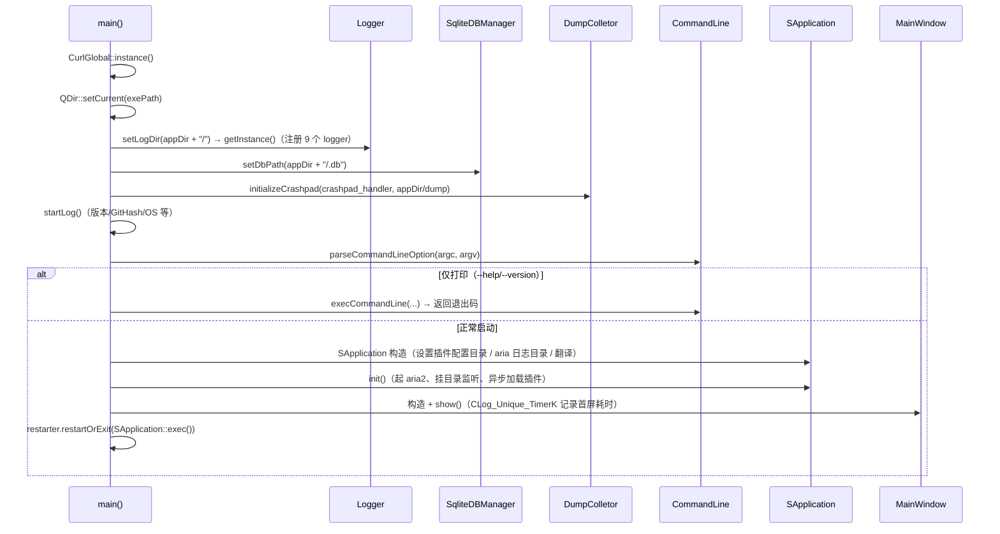

# ClientUi 详细设计

主程序：把 Logger / Sqlite / Aria2Net / Download / Plugin / SUI / ThreadPool 装配成一个应用，并实现页面、设置、登录、下载 UI 与命令行模式。本篇记录**启动时序、装配中心的成员与所有权、配置落盘结构、以及被测试覆盖的纯逻辑工具**；分层与模块职责见 [`../architecture/clientui.md`](../architecture/clientui.md)。

> 可执行程序 `sVanilla` · `sVanilla/src/ClientUi` · 测试：`test/ClientUi/clientui_test.cpp`（覆盖 `Utils` 下的纯逻辑组件）

由于 UI 层无法在单元测试里稳定断言，本篇**不逐个控件展开**，只写：装配与生命周期（第二～五节）、配置与存储（第四、六节）、可测的纯逻辑（第七节）、各 UI 分区的职责与调用入口（第八节）。

## 一、文件清单（按分区）

| 分区 | 文件 | 职责 |
| --- | ---: | ---: | --- |
| 根 | `main.cpp`、`const_string.h`、`ClientLog.h` | 进程入口；模块名常量；`CLINET_LOG_*` 与 `MLog*` 两族日志宏 |
| `MainWindow/` | `SApplication`（装配中心）、`MainWindow`、`WindowBar`、`Translater`、`Restarter`、`SingleAppHelper` |
| `Download/` | 下载 UI：`DownloadManager`、`DownloadWidget`、下载中/已完成列表与详情、`UiDownloader`、`DownloadNumber` |
| `VideoList/` | 视频列表：`VideoListWidget`、`VideoGridWidget`、`VideoWidget`、`VideoInfoWidget`、`VideoData`、`DownloadTip` |
| `Setting/` | 设置页：`SettingsPage`、`DefaultSettings`、`AdvanceSettings`、`Aria2AdvanceSettings`、`AccountsInfo`、`PluginsInfo`、`About`、License 与 Authors |
| `Login/` | 登录：`LoginDialog`、`LoginWebDialog`（WebEngine 登录）、`LoginBubble`、`LoginMonitor`、`SetCookieDialog` |
| `CommandLine/` | 命令行参数解析与执行（`--url`、无 GUI 模式等） |
| `Storage/` | 业务存储适配（详见 [`sqlite.md`](sqlite.md) 第六节） |
| `Utils/` | 纯逻辑与 UI 辅助：`SpeedUtil`、`SortItems`、`UrlProcess`、`Setting`、`RunTask`、`CoverUtil`、`MenuEventFilter`、`InfoPanelVisibleHelper` |
| `Config/` | `SingleConfig`（`QSettings` 封装）、`GlobalData` |
| `Home/` | `HomePage`：URL 输入与插件导入入口 |
| `PlatformInitializer/` | 平台初始化：`AppInitializer` + Win/Linux/Mac 三个实现 |
| `Plugin/` | `PluginInterface`：插件查询、URL 归属判定、Cookie 下发 |
| `Dump/` | crashpad 崩溃转储初始化 |

## 二、启动时序（`main.cpp`）



关键顺序（错序会出问题）：

1. `Logger::setLogDir()` 必须在 `getInstance()` 之前（`main.cpp:97-98`）；
2. `SqliteDBManager::setDbPath()` 在任何 Storage 使用之前（`:104`）；
3. `QDir::setCurrent(exePath)`（`:95`）保证后续相对路径（如 `plugin/`、`config/`）基于程序目录。

Qt 日志在非 Debug 构建下被 `qInstallMessageHandler(myMessageHandler)` 接管（`:100-102`），按级别映射到 `Logger::defaultName` 这一个 logger，输出前缀 `[Qt:<category>]`；`QtFatalMsg` 后强制 flush。

单实例由 `SingleAppHelper` 判断（`isHaveInstance()`），已运行则直接返回 0；**仅 `commandLine.showGui` 为真时启用**（`:140-151`）。

## 三、`SApplication`：装配中心

| 成员 | 类型 | 说明 |
| --- | --- | --- |
| `m_ariaServer` | `aria2net::AriaServer` | 值成员，构造里 `setLogDir(appDir())` |
| `m_pluginInterface` | `PluginInterface` | 内含 `plugin::PluginManager m_pluginManager` |
| `m_downloadThread` | `download::DownloadStatusThread` | 构造即启动轮询线程 |
| `m_threadPool` | `ThreadPool` | 默认线程数（`hardware_concurrency`） |
| `m_translater` | `Translater` | 翻译目录 `applicationDirPath()/translations` |
| `m_watcher` | `QFileSystemWatcher` | 监听 `plugin/` 目录 |
| `m_loadPluginFuture` | `std::future<void>` | 异步加载插件 |
| `m_isLoadingPlugins` | `std::atomic_bool` | 加载中标志 |

| 方法 | 位置 | 行为 |
| --- | --- | --- |
| `init()` | `SApplication.cpp:26` | 加监听 → `startServer()` → `signalsAndSlots()` → `std::async` 异步 `loadPlugins()` + `setCookiesForPlugins()`，异常记 `MLogE`，结束 `emit pluginsLoaded(succeeded)` |
| `waitForPluginLoadTask()` | `:60` | 析构里调用：`future.valid()` 才 `get()`，异常捕获后记日志 |
| `startServer()` | `:137` | 若 `SingleConfig::ariaConfig().isRemote` 为 false 才启动本地 aria2c（先 `setErrorFunc([]{})`） |
| `appDir()` | `:113` | 存在安装标记文件时用 `GenericDataLocation/<softwareName>`（不存在则 `mkpath`），否则用 `applicationDirPath()` |
| `signalsAndSlots()` | `:147` | `directoryChanged` → `pluginManager().pluginDirFileAdded()`（热加载） |

构造顺序要点：`SApplication` 构造函数里就调用了 `SingleConfig::instance()`（读语言设置），因此配置单例必须先于 `SApplication` 可用（它是惰性单例，实际安全）。

## 四、配置层

### 4.1 `SingleConfig`

`QSettings` 封装，四个 `shared_ptr<QSettings>`：

| 成员 | 对应文件 |
| --- | --- |
| `m_appSettings` | `config/config.ini`（应用设置） |
| `m_aria2Settings` / `m_aria2DefaultSettings` / `m_aria2CustomSettings` | `config/aria2.conf`、`config/mergeAria2Config.conf` 等（`SingleConfig.cpp:187,232,243`） |

配置结构：

| 结构 | 字段 |
| --- | --- |
| `Aria2Config` | `url`、`token`、`port = -1`、`isRemote = false`、`enableAdvancedSetting = false` |
| `SystemTrayConfig` | `enable = true`、`minimize = false` |
| `StartUpConfig` | `autoStart`、`keepMainWindow`、`autoRemuseUnfinishedTask` |
| `VideoWidgetConfig` | `order`、`orderBy`、`isNoParseList`、`widgetLayout` |
| `DownloadConfig` | 见 `Config/GlobalData.h` |

另外还有 `theme()` / `language()` / `downloadThreadNum()` 等标量项。

### 4.2 路径约定

| 内容 | 路径 | 来源 |
| --- | --- | --- |
| 日志 | `<appDir>/log/<name>.log` | `Logger::registerLogger` |
| 数据库 | `<appDir>/.db` | `main.cpp:104` |
| 插件目录 | `<appDir>/plugin/` | `PluginManager::m_pluginDir` |
| 插件配置 | `<appDir>/config/plugin_config.json` | `PluginManager::configFilePath` |
| aria2 会话/日志 | `<appDir>/aria/aira.session`、`aira.log` | `AriaServer::setLogDir` |
| 崩溃转储 | `<appDir>/dump` | `main.cpp:108-112` |
| 翻译 | `<applicationDirPath>/translations` | `SApplication.cpp:17` |

## 五、插件接入层 `PluginInterface`

| 方法 | 行为 |
| --- | --- |
| `pluginManager()` | 返回内部 `m_pluginManager` |
| `getPlugin(pluginId)` | 直接转发 `PluginManager::getPlugin` |
| `parseUrl(url, locationUrl, pluginId = -1)` | 指定 id 时取该插件；否则遍历 `orderedPluginsSnapshot()` 找第一个 `canParseUrl` 为真的插件；用 `m_parseDurations` 记录解析耗时（`m_parseDurationMutex` 保护） |
| `setCookiesForPlugins()` / `setCookiesForPlugin(plugin)` | 把本地保存的 cookie 下发给插件登录态 |

`orderedPluginsSnapshot()` 保证遍历顺序稳定（不依赖 `unordered_map` 的随机序）。

## 六、存储层

`Storage/` 下 4 张表 4 个 Storage + `StorageManager`，实现细节（表结构、SQL 模板、锁约定）全部记录在 [`sqlite.md` 第六节](sqlite.md)；`StorageManager` 的初始化与读写连接分配见同一篇 3.10 / 4.1。

## 七、被测试覆盖的纯逻辑（`Utils/`）

### 7.1 `util::removeSpecialChar`（`UrlProcess.h/.cpp`）

黑名单 `static constexpr char specialChars[] = "?/\"\\<>*|:•"`（`UrlProcess.h:8`），对每个字符逐个 `QString::remove`。提供 `QString` 与 `std::string` 两个重载（后者转 `QString` 再转回）。

注意黑名单**包含 `/` 与 `\`**，因此传入完整路径会把目录分隔符一并删掉——用于**文件名**而非路径。

### 7.2 `formatSize` / `formatSpeed`（`SpeedUtil.h`）

| 区间 | 分支 | 实际输出 |
| --- | --- | --- |
| `>= 1 GiB`（1073741824） | 第 1 个 if | `x.xx GiB` |
| `>= 1 MiB`（1048576） | 第 2 个 if | `x.xx Mib` |
| `>= 1 KiB`（1024） | 第 3 个 if | `x.xx Kib`（除以 `Kib`） |
| `< 1 KiB` | 兜底 | `x.xxx B` |

`formatSpeed` = `formatSize + "/s"`。

### 7.3 `sortInitialsItems`（`SortItems.h`）

```cpp
template <typename Iterable, typename QueryType, typename Sentence = typename Iterable::value_type>
void sortInitialsItems(Iterable& items, const std::function<QueryType(Sentence)>& dataExtractor, Qt::SortOrder order);
```

`std::sort` + 按 `order` 选比较式：`AscendingOrder` → `dataExtractor(b) > dataExtractor(a)`（小的在前）；`DescendingOrder` → `dataExtractor(a) > dataExtractor(b)`。默认分支返回 false（`Qt::SortOrder` 只有两个值，实际不可达）。

文件顶部有 `#undef max` / `#undef min`（`SortItems.h:2-3`），用于规避 `windows.h` 的宏污染——代价是**会取消掉其它头合法定义的同名宏**。

### 7.4 其余 `Utils/`

| 文件 | 职责 |
| --- | --- |
| `Setting.h/.cpp` | UI 设置项的读写辅助（与 `SingleConfig` 配合） |
| `RunTask.h` | 把任务投递到线程池/Qt 事件循环的辅助模板 |
| `CoverUtil.h/.cpp` | 封面图处理 |
| `MenuEventFilter.h/.cpp` | 菜单事件过滤 |
| `InfoPanelVisibleHelper.h` | 信息面板显隐控制 |

## 八、UI 分区职责与入口

| 分区 | 入口 | 与外部模块的连接 |
| --- | --- | --- |
| `Home/HomePage` | 粘贴 URL → `PluginInterface::parseUrl` → 进入 `VideoList`；插件导入按钮（`:159-161`）用 `PluginManager::m_pluginDir` 与 `m_dynamicExtension` 过滤文件对话框 | Plugin |
| `VideoList/*` | 列表/网格两种布局（`VideoWidgetConfig::widgetLayout`）、排序（`order` / `orderBy`）、`VideoData` 承载解析结果、`DownloadTip` 触发下载 | Plugin、`DownloadManager` |
| `Download/*` | `DownloadManager::addItem(downloader)` → `sApp->downloadThread().addTask(downloader)`（`DownloadManager.cpp:15`）；列表与详情按状态刷新 | Download、Sqlite（Storage） |
| `Login/*` | `LoginWebDialog` 用 SUI 的 `WebFrame` + `WebBridge` 承载网页登录；`LoginMonitor` 轮询登录态；`SetCookieDialog` 手动设置 cookie | SUI/WebEngine、Sqlite（`CookiesInfoStorage`） |
| `Setting/*` | 设置页与子页；`PluginsInfo` 展示插件配置、`Aria2AdvanceSettings` 编辑 aria2 高级项 | Plugin、Config |
| `MainWindow/*` | 主窗口与标题栏、托盘、重启（`Restarter`）、单实例（`SingleAppHelper`）、翻译（`Translater`） | 全部 |
| `PlatformInitializer/*` | 按平台初始化（`WindowInitializer` / `LinuxInitializer` / `MacInitializer`），`AppInitializer` 负责选择 | Qt |
| `Dump/*` | crashpad handler 初始化 | — |

## 九、边界与错误处理矩阵

| 场景 | 当前行为 | 依据 |
| --- | --- | --- |
| `removeSpecialChar` 含全部黑名单字符 | 全部移除 | `RemoveSpecialCharTest.StripsEveryCharacterInTheBlacklist` |
| 普通字符 | 保留 | `KeepsOrdinaryCharacters` |
| 只含黑名单字符 | 只删这些 | `RemovesOnlyBlacklistedCharacters` |
| `std::string` 重载 | 与 `QString` 重载结果一致 | `StdStringOverloadMatchesQStringOverload` |
| 空输入 | 仍为空 | `EmptyInputStaysEmpty` |
| GiB 量级速度 | `x.xx GiB` | `SpeedUtilTest.FormatsGigabytes` |
| MiB 量级 | `x.xx Mib` | `FormatsMebibytes` |
| KiB 量级 | `x.xx Kib` | `FormatsKibibytes` |
| < 1 KiB | `x.xxx B` | `FormatsRawBytesBelowKibibyte` |
| `formatSpeed` | 追加 `/s` | `FormatSpeedAppendsPerSecondSuffix` |
| 升序 / 降序 | 分别得到从小到大 / 从大到小 | `SortItemsTest.SortsAscending`、`SortsDescending` |
| 自定义提取器 | 按提取键排序 | `UsesPrebuiltTaskExtractor`、`SortsByExtractedKeyNotByElement` |
| 空集合 / 单元素 | 安全 | `EmptyCollectionIsSafe`、`SingleElementIsSafe` |
| 插件加载抛异常 | `MLogE` 记录，`pluginsLoaded(false)` | `SApplication.cpp:39-48` |
| 析构时插件仍在加载 | `waitForPluginLoadTask()` 等待并捕获异常 | `SApplication.cpp:60-81` |
| 已有一个实例在运行 | 日志告警后返回 0 | `main.cpp:143-150` |
| `isRemote` 为真 | 不启动本地 aria2c | `SApplication.cpp:139-144` |

## 十、测试映射

| 覆盖点 | 代表用例 |
| --- | --- |
| 文件名清洗 | `RemoveSpecialCharTest.*`（5 个） |
| 速度格式化（含已知错误行为） | `SpeedUtilTest.*`（5 个） |
| 排序 | `SortItemsTest.*`（6 个） |

UI、配置、插件装配、下载流程**均无单元测试**；相关回归依赖手工验证与日志。

## 十一、扩展步骤与验证

新增一个设置项：

1. 在对应配置结构（`SingleConfig.h`）加字段与默认值；
2. 在 `SingleConfig.cpp` 的读写路径加 `QSettings` 键值（注意 `config.ini` 的分组名与既有键保持一致）；
3. 在 `Setting/` 下对应页面加控件并连 `SingleConfig::instance()` 的 setter；
4. 若该设置影响 aria2，需同时考虑 `m_aria2CustomSettings` 与 merge 逻辑（`SingleConfig.cpp:232-243`）。

新增一个命令行选项：

1. 在 `CommandLine/CommandLine.h/.cpp` 加解析分支（注意 `isOnlyPrint()` 的语义：为真时不会创建 `SApplication`）；
2. 若需要 GUI，走 `commandLine.showGui` 分支并在 `MainWindow` 里消费（参考 `:163-166` 的 `setUrl`）。

手工验证：

```sh
cmake --build out/harness --config Debug --target ClientUi_test
out/harness/test/ClientUi/Debug/ClientUi_test.exe
```

检查清单：改动单位换算时须同步更新 `SpeedUtilTest.FormatsKibibytes`；改动 `main.cpp` 初始化顺序后确认 `log/` 与 `.db` 都落在 `<appDir>` 下；改动插件加载流程后确认 `log/Client.log` 出现插件加载结果、`config/plugin_config.json` 被正确写入。
