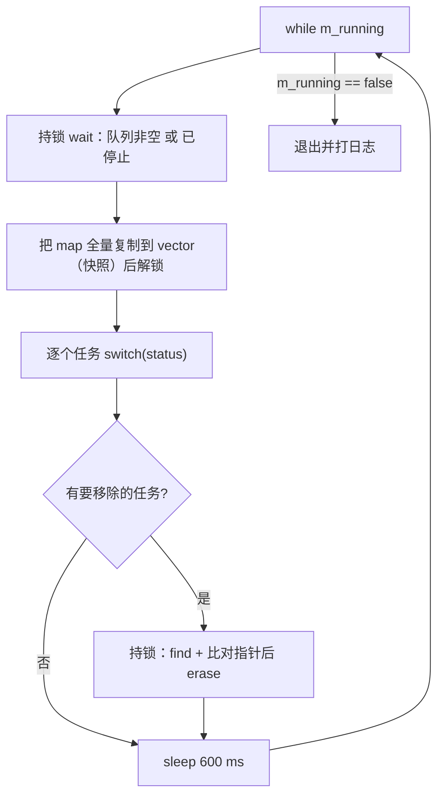

# Download 详细设计

一个状态轮询线程：每 600 ms 把任务表快照一遍，按 `AbstractDownloader::Status` 分派到对应回调，并把终态任务移出表。本篇记录**轮询循环的分派表、加锁区间、异常兜底规则**；为什么用轮询而不是事件驱动、为什么状态机放在插件侧见 [`../architecture/download.md`](../architecture/download.md)。

> 静态库 `Download` · `sVanilla/src/Download` · 依赖 `sVanillaPluginCommon`（`AbstractDownloader` 头文件）、spdlog · 测试：`test/Download/download_test.cpp` · 唯一持有者：`SApplication::m_downloadThread`

## 一、文件清单

| 文件 | 职责 |
| --- | --- |
| `DownloadStatusThread.h` | 类声明；前置声明 `AbstractDownloader`（不含其头文件） |
| `DownloadStatusThread.cpp` | 构造/析构、`addTask`、`stop`、`empty`、`downloadThread` 轮询循环 |
| `DownloadLog.h` | 8 个 `DOWNLOAD_LOG_*` 宏 → `spdlog::get("Download")` |
| `CMakeLists.txt` | 静态库 |

## 二、数据结构

| 成员 | 类型 | 位置 | 说明 |
| --- | --- | --- | --- |
| `m_running` | `std::atomic_bool` | `DownloadStatusThread.h:30` | 运行标志，构造置 true |
| `m_mutex` | `mutable std::mutex` | `DownloadStatusThread.h:31` | 保护 `m_downloadTasks` |
| `m_condition` | `std::condition_variable` | `DownloadStatusThread.h:32` | 有任务到来 / 停止时唤醒 |
| `m_downloadTasks` | `unordered_map<string, shared_ptr<AbstractDownloader>>` | `DownloadStatusThread.h:33` | 以 `guid()` 为键 |
| `m_thread` | `std::thread` | `DownloadStatusThread.h:34` | 构造即启动 |

## 三、接口与行为

| 接口 | 位置 | 行为 |
| --- | --- | --- |
| `DownloadStatusThread()` | `DownloadStatusThread.cpp:12` | `m_running(true)` 后**在成员初始化列表里启动线程**（`m_thread(&DownloadStatusThread::downloadThread, this)`） |
| `~DownloadStatusThread()` | `DownloadStatusThread.cpp:19` | `stop()` → `m_thread.join()` |
| `addTask(downloader)` | `DownloadStatusThread.cpp:31` | 持锁 `insert({downloader->guid(), downloader})`，返回 `inserted`（**重复 guid 返回 false**）；插入后若表非空则 `notify_one()` |
| `stop()` | `DownloadStatusThread.cpp:42` | `m_running = false` + `notify_all()`；**不 join**（join 在析构） |
| `empty()` | `DownloadStatusThread.cpp:25` | 持锁判空 |
| `downloadThread()` | `DownloadStatusThread.cpp:48` | 见下 |

### 3.1 轮询循环



设计要点：**回调在锁外执行**。先复制快照（`DownloadStatusThread.cpp:60-64`），再逐个调用插件回调，把持锁时间压到最低，同时避免回调里反向调 `addTask` 造成死锁。移除时还要 `iter->second == value` 比对指针，防止这期间同 guid 被换成了另一个任务。

### 3.2 状态分派表

| `AbstractDownloader::Status` | 动作 | 是否移出表 | 位置 |
| --- | --- | --- | --- |
| `Ready` | `start()` | 否 | `DownloadStatusThread.cpp:74-76` |
| `Downloading` | `downloadStatus()` | 否 | `:77-79` |
| `Pause` | `pause()` | 否 | `:80-82` |
| `Resumed` | `resume()` | 否 | `:83-85` |
| `Stopped` | `stop()` | **是** | `:86-89` |
| `Finished` | `finish()` | **是** | `:90-93` |
| `Error` | 不调任何回调 | **是** | `:94-96` |
| `Waiting` / `Paused`（`default`） | 忽略 | 否 | `:97-98` |

注意 `Pause` 与 `Paused` 是两个不同枚举值：`Pause` 会触发 `pause()`，`Paused`（已暂停）落进 `default` 被忽略；`Waiting` 同样被忽略。已由 `DownloadStatusThreadTest.WaitingAndPausedStatusesAreIgnored` 固化。

### 3.3 异常兜底

```cpp
catch (const std::exception& e) { DOWNLOAD_LOG_ERROR(...); value->setStatus(AbstractDownloader::Error); removeTasks.emplace_back(key, value); }
catch (...) { DOWNLOAD_LOG_ERROR(...); value->setStatus(AbstractDownloader::Error); removeTasks.emplace_back(key, value); }
```

任一回调抛出 → 记日志 → **强制置为 `Error`** → 移出表。线程不因此退出。已由 `DownloadStatusThreadTest.ThrowingDownloaderBecomesErrorAndIsRemoved` 与 `ThreadSurvivesTaskException` 固化。

## 四、边界与错误处理矩阵

| 场景 | 当前行为 | 依据 |
| --- | --- | --- |
| 初始状态 | 表为空 | `DownloadStatusThreadTest.StartsEmpty` |
| 重复 guid | 第二次 `addTask` 返回 false，原任务不动 | `AddTaskRejectsDuplicateGuid` |
| 不同 guid | 共存 | `AddTaskDistinctGuidsCoexist` |
| `Ready` | 调 `start()` 且任务保留 | `ReadyDispatchesStartAndKeepsTask` |
| `Downloading` | 调 `downloadStatus()` 且任务保留 | `DownloadingDispatchesStatusAndKeepsTask` |
| `Pause` / `Resumed` | 各自回调 | `PauseAndResumedDispatchTheirOwnCallbacks` |
| `Waiting` / `Paused` | 忽略 | `WaitingAndPausedStatusesAreIgnored` |
| `Stopped` / `Finished` / `Error` | 移出表（`Stopped`/`Finished` 先回调） | `StoppedFinishedAndErrorAreRemoved` |
| 回调抛异常 | 置 Error 并移出 | `ThrowingDownloaderBecomesErrorAndIsRemoved`、`ThreadSurvivesTaskException` |
| 重复 `stop()` | 幂等（只置标志 + notify） | `StopIsIdempotent` |
| 析构 | 停止并 join | `DestructionJoinsPollingThread` |
| `addTask(nullptr)` | 判空后返回 `false`，任务不入队 | `DownloadStatusThread.cpp:33-37` |
| 刚 `addTask` 就期望立即调度 | 最多 600 ms 后才第一次分派（`sleep_for` 在循环末尾） | `DownloadStatusThread.cpp:128` |
| `stop()` 后剩余任务 | 线程在下一轮 wait 返回后**还会处理一次**再退出（wait 谓词含 `!m_running`），随后循环条件失败退出；未进入终态的任务不会被 `finish()` | `DownloadStatusThread.cpp:51-58` |

## 五、测试映射

| 覆盖点 | 代表用例 |
| --- | --- |
| 任务表增删 | `StartsEmpty`、`AddTaskRejectsDuplicateGuid`、`AddTaskDistinctGuidsCoexist` |
| 状态分派 | `ReadyDispatchesStartAndKeepsTask`、`DownloadingDispatchesStatusAndKeepsTask`、`PauseAndResumedDispatchTheirOwnCallbacks`、`WaitingAndPausedStatusesAreIgnored` |
| 终态移除 | `StoppedFinishedAndErrorAreRemoved` |
| 异常兜底 | `ThrowingDownloaderBecomesErrorAndIsRemoved`、`ThreadSurvivesTaskException` |
| 生命周期 | `StopIsIdempotent`、`DestructionJoinsPollingThread` |

测试用 FakeDownloader 记录被调用的方法与状态变化，**不启动真实下载**。

## 六、扩展步骤与验证

新增一个状态分派分支：

1. 确认子模块 `sVanillaPluginCommon/Download/AbstractDownloader.h` 的 `Status` 枚举已加值（跨仓库改动）；
2. 在 `downloadThread()` 的 `switch` 里加 `case`（`DownloadStatusThread.cpp:72-99`），明确是否 `removeTasks.emplace_back(...)`；
3. 在 `test/Download/download_test.cpp` 的 FakeDownloader 上加对应状态与断言。

调整轮询节奏：

1. 改 `std::this_thread::sleep_for(std::chrono::milliseconds(600))`（`DownloadStatusThread.cpp:128`）；
2. 注意测试用真实时间等待，间隔调大会拖慢用例。

手工验证：

```sh
cmake --build out/harness --config Debug --target Download_test
out/harness/test/Download/Debug/Download_test.exe
```

检查清单：改 `switch` 后必须回归 `WaitingAndPausedStatusesAreIgnored`（确认 default 分支没被误吞）；改异常处理后回归 `ThreadSurvivesTaskException`（确认线程仍存活）；改生命周期后回归 `DestructionJoinsPollingThread`。
