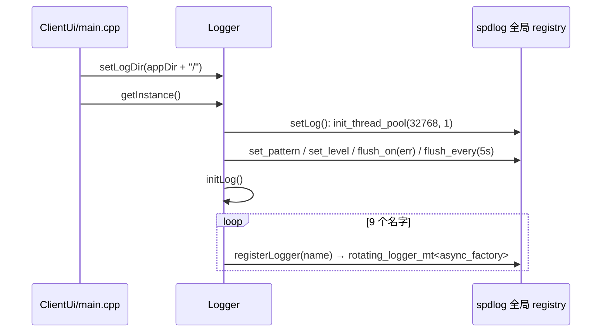
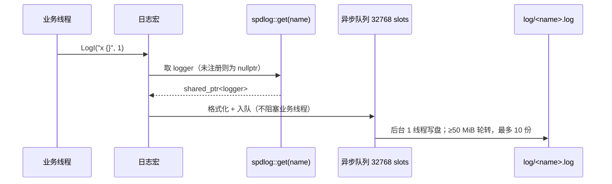

# Logger 详细设计

spdlog 的薄封装：进程启动时一次性完成全局配置与具名 logger 注册，之后各模块通过宏写进自己的轮转文件。本篇记录**注册路径拼法、各宏组的实际展开目标、异步与刷盘参数、以及名字契约的失效模式**；为什么选具名 logger + 宏、为什么不做运行期配置见 [`../architecture/logger.md`](../architecture/logger.md)。

> 静态库 `Logger` · `sVanilla/src/Logger` · 链接 `spdlog::spdlog` · 测试：`test/Logger/logger_test.cpp`

## 一、文件清单

| 文件 | 职责 |
| --- | --- |
| `Logger.h` | 门面类声明：全静态接口、构造析构私有、拷贝移动 `delete`、`defaultName = "log"` |
| `Logger.cpp` | Meyers 单例、`setLog()` 全局配置、`initLog()` 注册 9 个具名 logger、`registerLogger()` 拼路径 |
| `LogUtil.h` | 7 个通用日志宏、`scope_guard` + 推导指引、`LogLimitTime` / `LogTimer` / `Log_Unique_Timer` / `LogFuncT` 四组计时宏 |
| `LoggerConfig.h` | `LOGGER_CALL`（`__stdcall`）、`LOGGER_DLL_*`、`LOGGER_PORT`、`LOGGER_API`——**仓库内无任何使用点** |
| `CMakeLists.txt` | `STATIC` 库，PRIVATE 链接 `spdlog::spdlog`；`CMAKE_POSITION_INDEPENDENT_CODE ON` |

## 二、门面层：`Logger`

| 成员 | 位置 | 行为 |
| --- | --- | --- |
| `getInstance()` | `Logger.cpp:17` | 函数内静态对象（Meyers 单例），首次调用触发构造 |
| `Logger()` | `Logger.cpp:41` | 依次 `setLog()` → `initLog()` |
| `~Logger()` | `Logger.cpp:47` | `spdlog::shutdown()` |
| `setLogDir(dir)` | `Logger.cpp:23` | 写入静态 `std::string m_dir`，**无锁** |
| `registerLogger(name)` | `Logger.cpp:52` | `rotating_logger_mt<async_factory>(name, m_dir + "log/" + name + ".log", 50MiB, 10)` |
| `get(name)` | `Logger.cpp:57` | 转发 `spdlog::get(name)`；未注册返回**空 `shared_ptr`，不抛异常** |
| `m_dir` | `Logger.cpp:15` | 静态成员，唯一可变全局状态 |
| `logFileMaxSize` / `logRotatedFileCount` | `Logger.cpp:11-12` | 匿名命名空间常量：`50 * 1024 * 1024` / `10` |

路径拼法是 `m_dir + "log/" + name + ".log"`，因此 **`setLogDir()` 传入值必须自带尾部分隔符**（`main.cpp` 用三元判断补 `/`），且必须在首次 `getInstance()` 之前调用——`m_dir` 只在注册时被读取一次。

`initLog()`（`Logger.cpp:28`）注册的名字共 9 个，顺序即代码顺序：

| # | 名字 | 来源 | 有无使用点 |
| --- | ---: | --- | --- |
| 1 | `log` | `defaultName` | 有（`LogUtil.h` 通用宏） |
| 2 | `Client` | 字面量 | 有（`ClientLog.h`） |
| 3 | `Network` | 字面量 | **无** |
| 4 | `Aria2Net` | 字面量 | 有（`AriaLog.h`） |
| 5 | `FFmpeg` | 字面量 | **无** |
| 6 | `SQLite` | 字面量 | 有（`SQLiteLog.h`） |
| 7 | `ThreadPool` | 字面量 | 有（`ThreadPoolLog.h`） |
| 8 | `Download` | 字面量 | 有（`DownloadLog.h`） |
| 9 | `Plugin` | 字面量 | 有（`PluginLog.h`） |

## 三、宏层：路由与展开目标

通用宏（`LogUtil.h:10-16`）一律写往 `Logger::defaultName`（`log`），与模块无关：

| 宏 | 级别 | 展开 |
| --- | --- | --- |
| `LogT` / `LogD` / `LogI` / `LogW` / `LogE` / `LogC` / `LogO` | trace / debug / info / warn / error / critical / off | `SPDLOG_LOGGER_<LEVEL>(spdlog::get(Logger::defaultName), ...)` |

模块宏在各模块自己的 `*Log.h` 里，形式为 `SPDLOG_LOGGER_CALL(spdlog::get("<名字>"), spdlog::level::<lvl>, ...)`：

| 头文件 | 宏前缀 | 目标 logger |
| --- | --- | --- |
| `SUI` 无 / `ClientUi/ClientLog.h` | `CLINET_LOG_*` | `Client` |
| `ThreadPool/ThreadPoolLog.h` | `THEADPOOL_LOG_*` | `ThreadPool` |
| `Sqlite/SQLiteLog.h` | `SQLITE_LOG_*` | `SQLite` |
| `Download/DownloadLog.h` | `DOWNLOAD_LOG_*` | `Download` |
| `Plugin/PluginLog.h` | `PLUGIN_LOG_*` | `Plugin` |
| `Aria2Net/AriaLog.h` | `ARIA_LOG_*` | `Aria2Net` |

`CLINET`（少一个 R）与 `THEADPOOL`（R 与 E 换位）是既有拼写，改名需要同时改调用点。

### 3.1 `scope_guard`

`LogUtil.h:18-42`：构造存回调，析构执行一次；`isReleased` 防重入；带推导指引 `scope_guard(Lambda&&) -> scope_guard<std::remove_reference_t<Lambda>>`。计时宏用 `CAT(scope_, __COUNTER__)` 命名变量（`LogUtil.h:46`），`__COUNTER__` 保证同一作用域可放多个计时宏而不重名。

### 3.2 计时宏族的实际展开

| 宏 | 行 | 实际展开到 | 与名称是否一致 |
| --- | --- | --- | --- |
| `LogLimitTime(LOG)` | `LogUtil.h:62-63` | `LogLimitTime_1(LOG)` → `LogLimitTime_2(LOG, 100000000)` | 一致（默认 100 ms 阈值，超时才输出） |
| `LogLimitTime(LOG, ns)` | `LogUtil.h:50,63` | `LogLimitTime_2(LOG, ns)` | 一致 |
| `LogTimer(LOG)` | `LogUtil.h:73` | `LogTimer_1(LOG)` | 一致：作用域退出时无条件输出耗时 |
| `LogTimerI()` | `LogUtil.h:74` | `LogTimer_1(LogI)` | 一致 |
| `Log_Unique_Timer(KEY)` | `LogUtil.h:88-89` | `Log_Unique_Timer_2(KEY, LogI)` | 一致 |
| `Log_Unique_Timer(KEY, LOG)` | `LogUtil.h:76,89` | `Log_Unique_Timer_2(KEY, LOG)` | 一致 |
| `Log_Unique_TimerI()` | `LogUtil.h:90` | `Log_Unique_Timer(KEY_Start)` → `_2(KEY_Start, LogI)` | 一致（曾多一个右括号，已修） |
| `Log_Unique_Timer_END(KEY)` | `LogUtil.h:91` | `CAT(KEY, _Unique_Log).release();` | 回调立即执行一次，析构不重复执行 |
| `LogFuncT(LOG)` | `LogUtil.h:94-97` | 先 `LOG("enter function: {}", __FUNCTION__)`，再 `LogTimer(LOG)` | 退出时无条件输出耗时 |

`Log_Unique_Timer_2` 里 `STR(KEY) == std::string("KEY_Start")`（`LogUtil.h:80`）是**运行期字符串比较**，用于区分默认 KEY 与具名 KEY 的日志文案，要求使用方已包含 `<string>`。

## 四、关键时序

### 4.1 进程启动



顺序不可交换：`setLogDir()` 在 `getInstance()` 之前（`main.cpp:97-98`）。

### 4.2 一次日志调用



宏体**无条件解引用**，链路上没有任何判空——未注册即段错误。

## 五、并发与生命周期

| 方面 | 实现 | 位置 |
| --- | --- | --- |
| 写盘线程 | spdlog 异步线程池，`init_thread_pool(32768, 1)`（**1 个线程**） | `Logger.cpp:64` |
| 锁 | Logger 自身不加锁；并发保护交给 spdlog（异步队列锁 + `rotating_file_sink_mt` 内部互斥量） | — |
| 格式 | `[%Y-%m-%d %H:%M:%S.%e][thread %t][%g:%#,%!][%l] %v`（`%g` 文件名、`%#` 行号、`%!` 函数名） | `Logger.cpp:65` |
| 级别 | `_DEBUG` 下 `trace`，否则 `info` | `Logger.cpp:66-70` |
| 刷盘 | `flush_on(level::err)` + `flush_every(5s)` | `Logger.cpp:71-72` |
| 所有权 | logger 由 spdlog 全局 registry 持 `shared_ptr`；`get()` 返回副本 | — |
| 析构 | `Logger` 是函数内静态对象，退出时 `spdlog::shutdown()` 排空队列并关 sink | `Logger.cpp:47-50` |

## 六、边界与错误处理矩阵

| 场景 | 当前行为 | 依据 |
| --- | --- | --- |
| `get()` 未注册名字 | 返回空 `shared_ptr`，**不抛异常** | `LoggerTest.GetReturnsNullForUnregisteredName` |
| 重复注册同名 logger | spdlog 抛 `spdlog::spdlog_ex` | `LoggerFacadeTest.RegisteringSameNameTwiceThrows` |
| 注册后可取回 | `get()` 返回非空 | `LoggerFacadeTest.RegisterLoggerMakesItRetrievable` |
| `defaultName` 取值 | 等于 `"log"` | `LoggerTest.DefaultNameIsLog` |
| 未注册就打日志 | 宏无条件解引用空 `shared_ptr` → 未定义行为（段错误） | 宏体 `SPDLOG_LOGGER_CALL(spdlog::get(...))`，无判空 |
| 测试环境 | `logger_test.cpp` / `threadpool_test.cpp` 各自定义 `NullLoggerEnvironment`（gtest `Environment`）注册到 `null_sink`，测试期不产生日志文件 | `logger_test.cpp:131` 附近 |
| 在其它静态对象析构函数里打日志 | 不安全：`spdlog::shutdown()` 可能已清空 registry | `Logger.cpp:47-50` |
| `setLogDir()` 晚于首次 `getInstance()` | 已注册的 logger 路径不会变（空 `m_dir` 时拼出相对路径 `log/<name>.log`） | `Logger.cpp:54` |
| 高频日志 | 异步队列 32768 slots 满后按 spdlog 默认策略阻塞/丢弃；写盘仅 1 线程 | `Logger.cpp:64` |

## 七、测试映射

| 覆盖点 | 代表用例 |
| --- | --- |
| `scope_guard` 析构执行回调 | `ScopeGuardTest.RunsReleaseOnScopeExit` |
| 多个 guard 互不干扰 | `ScopeGuardTest.MultipleGuardsAreIndependent` |
| 捕获按引用修改外部状态 | `ScopeGuardTest.MutatesCapturedStateByReference` |
| `defaultName` 常量 | `LoggerTest.DefaultNameIsLog` |
| 未注册返回空 | `LoggerTest.GetReturnsNullForUnregisteredName` |
| 注册后可取回 / 重复注册抛异常 | `LoggerFacadeTest.RegisterLoggerMakesItRetrievable` / `RegisteringSameNameTwiceThrows` |
| 通用宏不抛异常 | `LogMacroTest.GeneralMacrosDoNotThrowWhenDefaultLoggerRegistered` |
| 模块宏写往自己的 logger | `LogMacroTest.ModuleMacrosTargetTheirOwnLogger` |
| 计时宏在作用域退出时执行 | `LogMacroTest.TimerMacrosRunAtScopeExitWithoutThrowing` |
| 具名计时（显式两个实参） | `LogMacroTest.UniqueTimerWithExplicitKeyRuns` |

## 八、扩展步骤与验证

新增一个模块的日志宏：

1. 在 `Logger::initLog()`（`Logger.cpp:28`）追加 `registerLogger("<Name>")`；
2. 在该模块新建 `<Name>Log.h`，按 `ThreadPoolLog.h` 的模板写 8 个 `SPDLOG_LOGGER_CALL(spdlog::get("<Name>"), spdlog::level::<lvl>, ...)`；
3. 名字字符串必须与第 1 步**逐字符一致**；
4. 若该模块当前不链接 spdlog，在 `CMakeLists.txt` 里 PRIVATE 加 `spdlog::spdlog`。

手工验证：

```sh
cmake --build out/harness --config Debug --target Logger_test
out/harness/test/Logger/Debug/Logger_test.exe
```

检查清单：新增名字后确认启动目录下的 `log/<Name>.log` 被创建且有内容；确认新增宏与 `initLog()` 的名字拼写一致（大小写敏感）；若改了 `LogUtil.h` 的分发前缀，须回归 `LogMacroTest` 全部用例。
