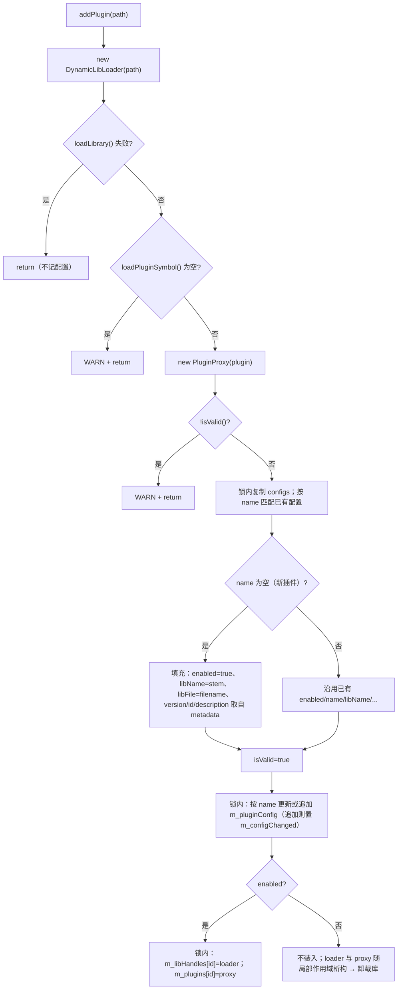

# Plugin 详细设计

插件动态库的加载、元数据缓存、异常隔离与配置持久化。对外只暴露 `PluginManager`；`PluginProxy` 把插件的每个调用都包进 try/catch，`DynamicLibLoader` 负责句柄与符号。本篇记录**四个导出符号的约定、加载时的配置匹配算法、配置读写的落盘条件**；为什么用代理层隔离、为什么按 id 而不是按路径索引见 [`../architecture/plugin.md`](../architecture/plugin.md)。

> 静态库 `Plugin` · `sVanilla/src/Plugin` · 依赖 `sVanillaPluginCommon`（`IPlugin.h`）、`nlohmann::json`、spdlog · 测试：`test/Plugin/plugin_test.cpp` · 持有者：`PluginInterface::m_pluginManager`

## 一、文件清单

| 文件 | 职责 |
| --- | --- |
| `DynamicLibLoader.h` | 动态库句柄 + 四个符号的加载；静态工具函数 |
| `DynamicLibLoader.cpp` | 平台分支（Win32 `LoadLibrary` / POSIX `dlopen`）、编码转换、符号加载与日志 |
| `PluginManager.h` | `PluginProxy`、`PluginConfig`、`PluginManager`、`std::hash` 特化 |
| `PluginManager.cpp` | `EmptyLoginApi`、`PluginProxy` 实现、`PluginManager` 全部方法、路径常量定义 |
| `PluginLog.h` | 8 个 `PLUGIN_LOG_*` 宏 → `spdlog::get("Plugin")` |
| `CMakeLists.txt` | 静态库 |

## 二、`DynamicLibLoader`

### 2.1 状态与接口

| 成员 / 接口 | 位置 | 行为 |
| --- | --- | --- |
| `m_libPath` / `m_libHandle` / `m_loaded` / `m_deinit` | `DynamicLibLoader.h:33-36` | 路径、平台句柄、加载标志、"deinit" 符号 |
| `loadLibrary()` | `DynamicLibLoader.cpp:60` | 已加载则直接 true；路径空则 false；否则加载并置标志 |
| `loadPluginSymbol()` | `DynamicLibLoader.cpp:77` | 取四个符号 → 调 `initDir` → `pluginInit()` 构造实例 |
| `unloadLibrary()` | `DynamicLibLoader.cpp:108` | 先调 `m_deinit()`，再 `FreeLibrary` / `dlclose`，清标志 |
| 静态 `loadLibrary` / `loadSymbol` / `unloadLibrary` | `:144,154,190` | 平台封装；`loadSymbol` 失败时取系统错误信息并打 WARN |

### 2.2 四个导出符号

| 符号 | 签名 | 是否必需 | 用途 |
| --- | --- | --- | --- |
| `pluginInit` | `IPlugin* (*)()` | **是**（为 null 则返回空指针，加载失败） | 创建插件实例 |
| `pluginDeinit` | `void (*)(IPlugin*)` | 作为 `shared_ptr` 的**删除器**传入 | 销毁实例 |
| `initDir` | `void (*)(const char*)` | 否 | 告知插件配置目录（末尾补 `/`） |
| `deinit` | `void (*)()` | 否 | 卸载库前的全局清理 |

```cpp
res.reset(pluginInit(), pluginDeinit);
```

`shared_ptr` 的删除器是**函数指针**，`pluginDeinit` 为 null 时 `reset(p, nullptr)` 会在析构时调用空指针。

### 2.3 平台与编码

Windows 分支用 `GetACP()` 做 ANSI↔UTF-16 转换（`stringToWideString` / `utf16ToString`，`DynamicLibLoader.cpp:22-41`）；POSIX 分支直接 `dlopen(path, RTLD_LAZY | RTLD_LOCAL)`。因此 **Windows 下含非本机代码页字符的路径可能加载失败**。

## 三、`PluginProxy`：异常隔离

| 方法 | 成功 | 失败时返回 | 位置 |
| --- | --- | --- | --- |
| 构造 | 调 `pluginMessage()` 成功 → `m_valid = true` | `m_valid = false`，记 WARN | `PluginManager.cpp:104` |
| `pluginMessage()` | 返回**构造期缓存**的 `m_pluginMessage` | 返回缓存（可能为空对象） | `:127` |
| `websiteIcon()` | 转发 | 静态空 `vector<uint8_t>` | `:132` |
| `canParseUrl(url)` | 转发 | `false` | `:152` |
| `getVideoView(url)` | 转发 | 空 `VideoView` | `:170` |
| `getDownloader(videoInfo)` | 转发 | 空 `shared_ptr` | `:188` |
| `loginer()` | 转发 | `LoginProxy(static EmptyLoginApi)` | `:206` |

每个方法都是 `try { ... } catch (const std::exception&) { WARN } catch (...) { WARN }` 双捕获，日志带 `pluginId`。已由 `PluginProxyTest.SwallowsExceptionsAndReturnsDefaults`、`DelegatesCallbacksToRealPlugin`、`IsInvalidWhenInitialMetadataThrows`、`DoesNotCallPluginMetadataFromCallbackCatch` 固化。

`EmptyLoginApi`（`PluginManager.cpp:22`）是 `AbstractLoginApi` 的空实现；`loginer()` 返回的是**静态局部对象**的 `LoginProxy`（`:222`），多线程共享同一实例。

## 四、`PluginConfig`

| 字段 | 类型 | 默认 | 说明 |
| --- | --- | --- | --- |
| `name` / `version` / `libName` / `description` / `libFile` | `string` | 空 | 展示与定位 |
| `id` | `int` | 0 | 与 `PluginMessage::pluginId` 对应 |
| `enabled` | `bool` | `false` | 是否真正加载进 `m_plugins` |
| `isValid` | `bool` | `false` | 本次运行中该插件是否成功加载 |

序列化宏为 `NLOHMANN_DEFINE_TYPE_INTRUSIVE_WITH_DEFAULT(PluginConfig, name, version, libName, id, description, libFile, enabled)`（`PluginManager.h:51`）——**不含 `isValid`**，因此 `isValid` 不落盘、重启后恒为 false。已由 `PluginConfigTest.JsonRoundTripKeepsSerialisedFieldsButNotIsValid`、`JsonDeserialisationFillsMissingFieldsWithDefaults` 固化。

排序与哈希都只看 `id`：`operator<=>` 比较 `id`（`:53`），`std::hash` 特化返回 `hash<int>()(id)`（`:112-119`）。

## 五、`PluginManager`

### 5.1 路径常量

| 常量 | 值 | 位置 |
| --- | --- | --- |
| `m_pluginDir` | `"plugin/"` | `PluginManager.cpp:10` |
| `m_configPath` | `"config/plugin_config.json"` | `:11` |
| `m_dynamicExtension` | `.dll` / `.so` / `.dylib` | `:14-20` |
| `m_dir`（可变静态） | 由 `setPluginConfigDir()` 设置 | `:12,246` |

`configFilePath()`（`:480`）：`m_dir` 为空时返回 `m_configPath`（相对当前工作目录），否则拼 `m_dir + "/" + m_configPath`。生产侧由 `SApplication.cpp:15` 设为 `appDir()`。

### 5.2 状态与加锁

| 成员 | 类型 | 说明 |
| --- | --- | --- |
| `m_libHandles` | `unordered_map<int, shared_ptr<DynamicLibLoader>>` | 按 pluginId 保存句柄，保证库生命周期不短于插件 |
| `m_plugins` | `unordered_map<int, shared_ptr<IPlugin>>` | 已启用的插件（实际是 `PluginProxy`） |
| `m_pluginsPaths` | `unordered_set<string>` | 发现过的插件路径（**只增不减**） |
| `m_pluginsMutex` | `std::recursive_mutex` | 保护上述三者与 `m_pluginConfig` |
| `m_configChanged` | `mutable std::atomic_bool` | 是否需要落盘 |
| `m_pluginConfig` | `vector<PluginConfig>` | 配置列表 |

### 5.3 `addPlugin` 流程



要点：

- **按 name 而非 path 匹配配置**：插件文件名变了但 `PluginMessage::name` 不变时，enable 状态能保留；反之换个同名插件会误继承配置。
- 新插件默认 `enabled = true`（`PluginManager.cpp:315`）。
- 只有 `enabled` 的插件才进 `m_plugins`；被禁用的插件其 `DynamicLibLoader` 在函数末尾析构即卸载（顺序正确：`plugin` 先于 `pLoader` 析构，因为声明顺序相反）。

### 5.4 配置读写

| 方法 | 位置 | 行为 |
| --- | --- | --- |
| `loadConfig()` | `:414` | `ifstream` + `json::parse`；异常记 WARN；**若结果为空则置 `m_configChanged` 并立即 `saveConfig()`** |
| `saveConfig()` | `:434` | `m_configChanged` 为 false 则**直接返回**；否则 `ofstream` 写 `dump(4)` 并清除标志 |
| `setPluginConfig(vector)` | `:407` | 整体替换 + 置 `m_configChanged` |
| `getPluginConfig()` | `:401` | 返回 `std::set<PluginConfig>`（按 id 升序） |

构造顺序（`PluginManager.cpp:227`）：`createPluginDir()` → `loadConfig()` → `initPluginPaths()`；析构：`saveConfig()`（`:234`）。已由 `PluginManagerTest.DestructorPersistsConfigToDisk`、`SetAndGetConfigReturnsSortedById`、`QueriesReturnEmptyOnFreshManager` 固化。

`createPluginDir()`（`:454`）只创建 `plugin/` 一级目录；`config/` 目录由外部保证存在（生产侧 `SApplication::appDir()/config`）。

### 5.5 目录扫描

`pluginDirHaving()`（`:462`）用**非递归** `directory_iterator` 遍历 `m_pluginDir`，按 `extension() == m_dynamicExtension` 过滤（大小写敏感），返回绝对路径。`pluginDirFileAdded()`（`:384`）对每条新路径（集合插入成功者）调 `addPlugin`——配合 `SApplication` 的 `QFileSystemWatcher`（`SApplication.cpp:28`）实现热加载。

## 六、边界与错误处理矩阵

| 场景 | 当前行为 | 依据 |
| --- | --- | --- |
| 默认构造 `DynamicLibLoader` | 未加载 | `DynamicLibLoaderTest.DefaultConstructedIsNotLoaded` |
| 空路径加载 | false | `LoadLibraryFailsForEmptyPath` |
| 文件不存在 | false | `LoadLibraryFailsForMissingFile` |
| 未加载就取符号 | 返回空 `shared_ptr` | `LoadPluginSymbolReturnsNullWhenNotLoaded` |
| 路径可改 | `setLibraryPath` 生效 | `LibraryPathIsSettable` |
| 空句柄取符号 / 卸载 | 安全（返回 null / 跳过） | `StaticLoadSymbolHandlesNullHandle`、`StaticUnloadHandlesNullHandle` |
| 真实系统库 | 能加载并解析符号 | `LoadsRealSystemLibraryAndResolvesSymbol` |
| 重复卸载 | 安全 | `UnloadTwiceIsSafe` |
| 重复加载 | 幂等（已加载直接 true） | `LoadLibraryIsIdempotent` |
| 元数据正常 | 构造期缓存，`isValid` 为真 | `PluginProxyTest.ValidPluginCachesMetadataAtConstruction` |
| 元数据抛异常 | `isValid` 为假 | `IsInvalidWhenInitialMetadataThrows` |
| 回调转发 | 调真实插件 | `DelegatesCallbacksToRealPlugin` |
| 回调抛异常 | 吞掉并返回默认值 | `SwallowsExceptionsAndReturnsDefaults` |
| 配置默认值 | `enabled=false`、`isValid=false` | `PluginConfigTest.DefaultsAreDisabledAndInvalid` |
| JSON 缺字段 | 填默认值 | `JsonDeserialisationFillsMissingFieldsWithDefaults` |
| 排序 | 只比 id | `OrderingComparesIdOnly` |
| JSON 往返 | `isValid` 丢失 | `JsonRoundTripKeepsSerialisedFieldsButNotIsValid` |
| 路径常量 | 与代码一致 | `PluginManagerTest.StaticPathConstants` |
| 配置目录可设/可恢复 | 生效 | `ConfigDirIsSettableAndRestorable` |
| 配置排序返回 | 按 id 升序 | `SetAndGetConfigReturnsSortedById` |
| 析构落盘 | 写文件 | `DestructorPersistsConfigToDisk` |
| 全新管理器查询 | 返回空 | `QueriesReturnEmptyOnFreshManager` |
| 插件库符号缺失 | WARN 日志（含系统错误信息） | `DynamicLibLoader.cpp:179` |

## 七、测试映射

| 覆盖点 | 代表用例 |
| --- | --- |
| 库加载与符号解析 | `DynamicLibLoaderTest.*`（10 个） |
| 代理缓存与异常隔离 | `PluginProxyTest.*`（5 个） |
| 配置结构与序列化 | `PluginConfigTest.*`（4 个） |
| 管理器路径与配置 | `PluginManagerTest.*`（5 个） |

## 八、扩展步骤与验证

新增一个插件需要导出的符号（例如 `getVersion`）：

1. 在 `DynamicLibLoader::loadPluginSymbol()`（`DynamicLibLoader.cpp:77`）里 `reinterpret_cast` 出新签名并取符号；
2. **判空后再调用**（`initDir` 就是这么处理的）；
3. 在子模块 `sVanillaPluginCommon` 的模板插件里同步加导出——两边必须一致，否则加载时该符号为 null。

调整配置匹配键：

1. 改 `PluginManager.cpp:303-322` 的匹配条件（如改用 `libFile`）；
2. 注意老配置文件的兼容（旧文件没有新键时 `WITH_DEFAULT` 会填默认值，不会报错）；
3. 回归 `PluginManagerTest.DestructorPersistsConfigToDisk` 与 `SetAndGetConfigReturnsSortedById`。

手工验证：

```sh
cmake --build out/harness --config Debug --target Plugin_test
out/harness/test/Plugin/Debug/Plugin_test.exe
```

检查清单：改动 `loadPluginSymbol` 后确认"插件库缺少某符号"仍能加载（不要因新符号缺失直接失败）；改动 `addPlugin` 后回归 `PluginManagerTest.QueriesReturnEmptyOnFreshManager`（确认无插件时不误插入配置）；本机集成验证可把编译好的插件 `.dll` 放进 `<appDir>/plugin/` 并观察 `log/Plugin.log` 与 `config/plugin_config.json`。
