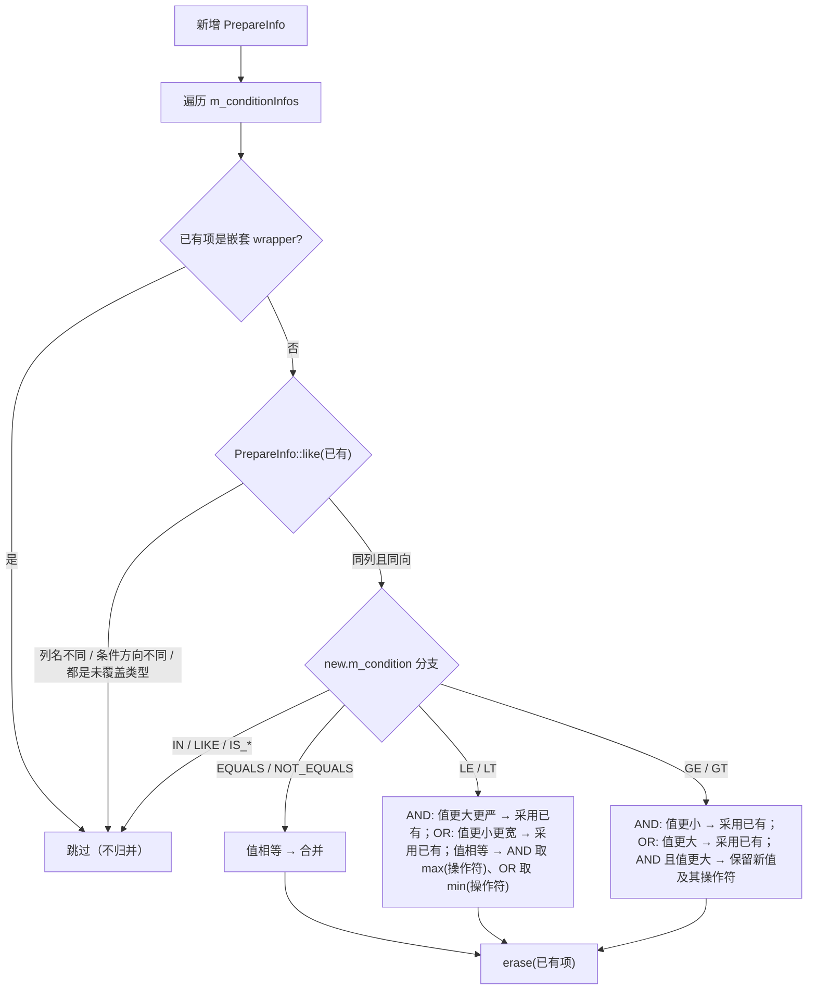
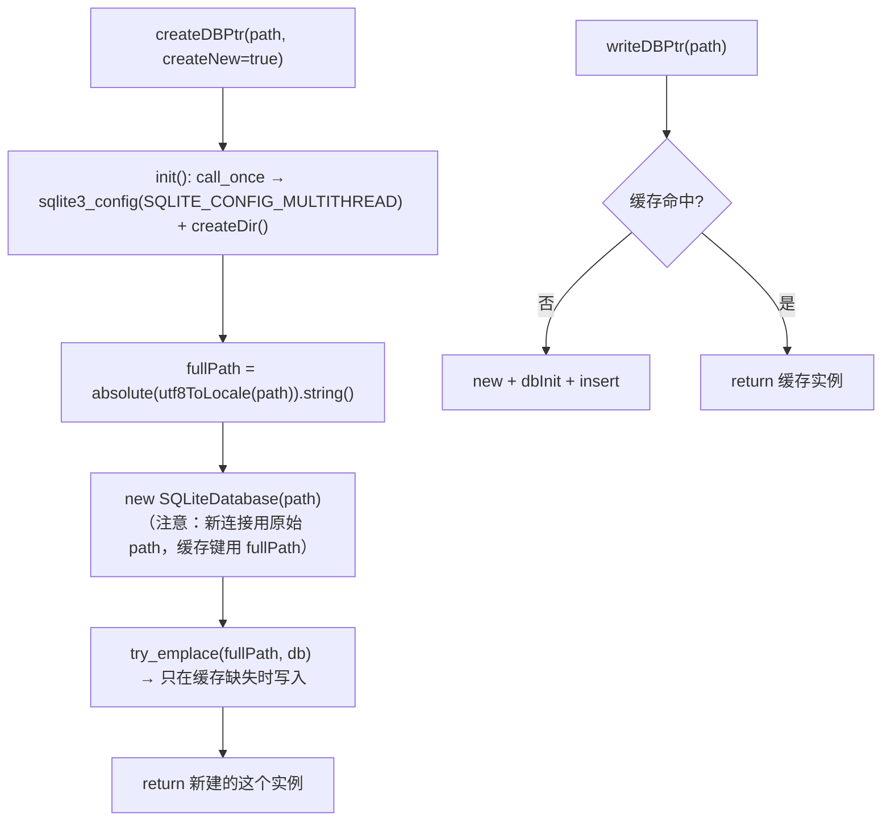
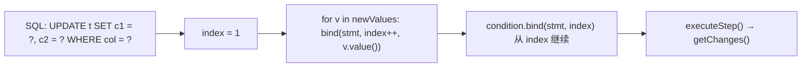
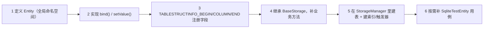

# Sqlite 详细设计

`sqlite` 模块的**实现级**说明：文件与符号清单、SQL 的生成规则、数据结构与算法、调用时序、边界与错误处理。

> 分层、依赖方向与设计取舍见 [`../architecture/sqlite.md`](../architecture/sqlite.md)；调用约定、最小示例与踩坑清单见 [`../usage/sqlite.md`](../usage/sqlite.md)。
>
> 本文所有结论均以 `sVanilla/src/Sqlite`、`sVanilla/src/ClientUi/Storage` 的当前代码与 `test/SQLite` 的用例为准；涉及行为判断的地方都标注了对应文件或用例。

## 一、文件清单


| 文件 | 职责 |
| --- | --- |
| `Database/SQLiteDatabase.h/.cpp` | 连接 RAII、`sqlite3_exec` 封装、表/视图列举、事务语句 |
| `Database/SQLiteStatement.h/.cpp` | 预处理语句：prepare、bind 全类型重载、step/reset、列取值 |
| `Database/SQLiteColumn.h/.cpp` | 结果列的值容器：类型判定、数值/文本/BLOB 取值、转换运算符 |
| `Database/SQLiteException.h/.cpp` | 携带错误码与扩展错误码的运行时异常 |
| `SqlComposer/BaseInfo.h/.cpp` | 类型→索引映射、`ColumnInfo`、`BaseTableStructInfo`、`IndexColInfo`、`TABLESTRUCTINFO_*` 宏 |
| `SqlComposer/ConditionWrapper.h/.cpp` | `PrepareInfo`、`ConditionWrapper`：条件结构生成、参数绑定、条件归并 |
| `SqlComposer/SqlUtil.h/.cpp` | CRUD / 建表 / 索引 / 视图的静态入口，模板实现全部在头文件 |
| `SqlComposer/JoinWrapper.h` | `JoinType` + `JoinWrapper` 结构，**当前没有任何调用点** |
| `Storage/BaseStorage.h/.cpp` | 业务存储基类：读写连接 + 表名 + 通用 CRUD 转发 |
| `Storage/SqliteDBManager.h/.cpp` | 进程级连接缓存、`dbPath` 全局、`PRAGMA` 初始化、目录创建 |
| `Storage/StorageFactory.h/.cpp` | `createStorage<Storage>()`：建表 + 构造存储对象（`.cpp` 只有一行 include） |
| `SQLiteLog.h` | 7 个 `SQLITE_LOG_*` 宏，logger 名 `"SQLite"` |
| `CMakeLists.txt` | 静态库；PRIVATE 依赖 spdlog + `unofficial::sqlite3::sqlite3` |

业务侧（`ClientUi/Storage`，包含各业务存储与管理器）见第五节。

依赖方向在编译期被约束：库的 `target_include_directories` 只有 `${CMAKE_CURRENT_SOURCE_DIR}/..`，因此库内部一律写 `Sqlite/...` 绝对形式；反向（库 include `ClientUi`）不存在。

## 二、Database 层

### 2.1 连接：`SQLiteDatabase` / `SqliteDbWithMutex`

| 成员 | 实现要点 |
| --- | --- |
| 构造函数 | `sqlite3_initialize()` → `sqlite3_open(path.c_str(), &db)`。**两处失败都不抛异常**：写 `m_lastError` + 一条 ERROR 日志后直接 `return`，`m_db` 保持空。故调用方只能靠 `isOpen()` 判断 |
| `~SQLiteDatabase` | 空实现；句柄释放由 `sqlitePtr`（`unique_ptr<sqlite3, Deleter>`）完成，`Deleter` 调 `sqlite3_close` |
| `execute(sql)` | `sqlite3_exec`；失败时从 `errmsg` 取信息、`sqlite3_free`、写 `m_lastError`、打 ERROR 日志、返回 `false`。**`m_db == nullptr` 时直接返回 `false`**（不记错误） |
| `tables()` / `views()` | 查 `sqlite_master ∪ sqlite_temp_master`，用 `ListCallback` 逐行塞进 `std::set`。回调直接 `data[0]` 不判空 |
| `tableExists(name)` | 走 prepare：`SELECT count(*) FROM sqlite_master WHERE type='table' AND name=?`，结果 `== 1`。**这是唯一带参数的元数据查询** |
| `transaction` / `commit` / `rollback` | 就是 `execute("BEGIN;")` / `"COMMIT;"` / `"ROLLBACK;"`。**没有嵌套层级、没有"当前是否在事务中"的状态**：嵌套 `BEGIN` 会失败、孤立 `ROLLBACK` 也会失败（用例 `DatabaseTest.RollbackWithoutTransactionFails`） |
| 错误码 | `errorCode()` / `extendedErrorCode()` / `errorMsg()` 均直转 `sqlite3_*`，**不读 `m_lastError`**；`lastError()` 才读缓存 |

`SqliteDbWithMutex` 只多做一件事：加一个 `std::recursive_mutex mutex` 成员。**类本身不做任何加锁**，锁由 `SqliteUtil` 与调用方共同承担（见 3.10）。

### 2.2 语句：`SQLiteStatement`

构造即 `prepareStatement()`（内部 `sqlite3_prepare_v2`），**prepare 失败抛 `SQLiteException`**（用例 `InvalidSqlThrowsOnPrepare`），随后 `m_columnCount = sqlite3_column_count(handle())`。

**绑定重载与内存语义**（这是查"数据什么时候被拷贝"的唯一位置）：

| 入参类型 | 底层 API | 生命周期标记 |
| --- | --- | --- |
| `int32_t` / `uint32_t` / `int64_t` / `double` | `sqlite3_bind_int` / `_int64` / `_double` | 值拷贝，无生命周期问题 |
| `const std::string&` / `const char*` | `sqlite3_bind_text(..., -1, SQLITE_TRANSIENT)` | **立即拷贝**，安全 |
| `const void*, int` / `const std::vector<uint8_t>&` | `sqlite3_bind_blob(..., SQLITE_TRANSIENT)` | 立即拷贝（0 长度见下） |
| `bindNoCopy(...)` 同参数 | `..._text` / `..._blob` + `SQLITE_STATIC` | **不拷贝**：源缓冲区必须活到 `step`/`reset` 之后 |
| `bind(index)` | `sqlite3_bind_null` | 绑 NULL |

- 所有重载失败一律 `throw SQLiteException(m_db.handle())`；
- 按列名的重载（`bind(columnName, ...)`）内部是 `bind(getIndex(columnName), ...)`，而 `getIndex` = `sqlite3_bind_parameter_index`：**对不存在的占位符名返回 0**，于是会绑到"第 0 号"非法索引上（SQLite 会报 `SQLITE_RANGE` → 抛异常）；
- `bind(index, const std::vector<uint8_t>&)` 直接传 `blob.data()` 与 `blob.size()`：空 `vector` 的 `data()` 在 MSVC STL 下为 `nullptr`，而 SQLite 规定"指针为 NULL 时 n 被忽略，等价于 `bind_null`"——所以**空 BLOB 存进去变成 NULL**（用例 `EmptyBlobIsStoredAsNull`）。这是本封装下"长度 0 的 BLOB"不可表达的原因，`std::vector::data()` 是否为空指针在标准里未规定，行为不可移植。

**执行与状态机**：

| 方法 | 行为 |
| --- | --- |
| `executeStep()` | 调 `tryExecuteStep()`，返回 `m_hasRow`。`SQLITE_ROW` → `m_hasRow = true`；`SQLITE_ERROR` → **抛异常**；其它（含 `SQLITE_DONE`）→ `m_hasRow = false`，并置 `m_done = (ret == SQLITE_DONE)` |
| 已完成后再 `executeStep()` | `m_done` 为真时直接返回 `SQLITE_MISUSE`，**不抛异常**（用例 `StepReportsRowDoneAndStaysFalseAfterDone`） |
| `reset()` | 复位 `m_hasRow` / `m_done` 后 `sqlite3_reset`；用于批量插入复用同一条语句 |
| `tryExecuteStep()` | 进入时清空 `m_columnIndexMap` 与 `m_columnsMap` 两个缓存 |

**取值**：

- `column(int)`：先查 `m_columnsMap`（`unordered_map<int, SqliteColumn>`），未命中则 `getColumnFromStmt(col)` 并按值存入，**返回的是值拷贝**；
- `getColumnFromStmt()`：`sqlite3_column_name` → **`sqlite3_column_origin_name`（未判空）** → 按 `sqlite3_column_type` 分派：`INTEGER→int64_t`、`FLOAT→double`、`TEXT→std::string`、`BLOB→vector<uint8_t>`（`data == nullptr || len == 0` 时留空 vector）、`NULL→monostate`、`default→按字节构造 string`；
- `columnIndex(name)`：首次调用时扫描全部列名建缓存，**名字不存在返回 `-1`**；而 `column(const std::string&)` 会把 `-1` 直接交给 `sqlite3_column_*`，**没有越界校验**（`column(-1)` 之后的行为由 sqlite3 决定）；
- `originColumnName(col)`：`return sqlite3_column_origin_name(...)`，返回值直接隐式转 `std::string`。该 API 在未编译 `SQLITE_ENABLE_COLUMN_METADATA` 时恒返回 `nullptr`，且对表达式列（`COUNT(1)`、`? AS p`）同样返回 `nullptr` → **`std::string(nullptr)` 属未定义行为**。当前 vcpkg 构建已开启该选项（用例 `ColumnMetadataIsAvailable` 先 `sqlite3_compileoption_used()` 探测再断言）；
- `expandedSQL()`：`sqlite3_expanded_sql` 后立刻 `sqlite3_free`，返回字符串副本——调试拼 SQL 的首选工具；
- `getChanges()` / `getBindParameterCount()` / `getIndex()` 直转对应 C API；`errorCode()/errorMsg()` 转的是**所属连接**的错误。

### 2.3 列值：`SqliteColumn`

值模型是单一 variant，**索引顺序即类型契约**：

| 索引 | 类型 | `FieldType` | SQLite 存储类 |
| ---: | --- | --- | --- |
| 0 | `std::monostate` | `Null` | NULL |
| 1 | `int64_t` | `Integer` | INTEGER |
| 2 | `double` | `Float` | REAL |
| 3 | `std::string` | `Text` | TEXT |
| 4 | `std::vector<uint8_t>` | `Blob` | BLOB |

`getType()` 用 `static_assert` 把"variant 的 5 个分支依次是 monostate/int64_t/double/std::string/Blob"钉死，改动 variant 定义会**编译失败**而不是运行期错乱。`PrepareInfo::bind()` 判断"是否有值可绑"用的也是 `m_value.index() == 1`，同一条契约。

取值语义（`getInt/getUInt/getInt64/getDouble` 用 `std::is_arithmetic_v` 过滤，**非算术类型直接返回 0**）：

| 方法 | monostate | 整数/浮点 | string | blob |
| --- | --- | --- | --- | --- |
| `getInt`/`getUInt`/`getInt64`/`getDouble` | 0 | `static_cast` | 0 | 0 |
| `getText(defaultValue)` | **清空**（丢弃默认值） | `std::to_string` | 原样 | 按字节构造（空 blob → 空串） |
| `getString()` | 空串 | `std::to_string` | 原样 | 按字节构造（空 blob → 空串） |
| `getBlob()` | 空 vector | 空 vector | **空 vector** | 原样 |

- `getText(defaultValue)` 与 `getString()` 的唯一差别在 blob 分支：前者 `res.clear()` 后再填，后者仅在非空时 `assign`——对 NULL 两者都返回空串而非默认值；
- `getBytes()`/`size()`：string/blob 返回元素个数，`int64_t`/`double` 返回 `sizeof`（**都是 8**，语义是"内存宽度"而不是"存储字节数"），其它 0；
- 转换运算符全部是语法糖：`operator int32_t() → getInt()`、`operator uint32_t() → getUInt()`、`operator int64_t()`、`operator double()`、`operator std::string()`、`operator std::vector<uint8_t>()`；窄类型（`char`/`int8_t`…）先走 `getInt()` 再截断；
- **`operator const char*()` 写成"函数内 `static std::string`"**：所有实例、所有线程共享同一个缓冲区，返回值生命周期到下一次调用为止。

### 2.4 异常：`SQLiteException`

8 个构造重载，来源只有三种：`(message, ret)`、`(sqlite3*, ret)`（内部取 `sqlite3_errmsg` + `sqlite3_errcode`）、`(SQLiteDatabase::sqlitePtr, ret)`。`errorCode()` 取构造时的 `ret`，`extendedErrorCode()` 取 `sqlite3_extended_errcode`，`getErrorString()` 走 `sqlite3_errstr`。

**抛出点只有 `SQLiteStatement`**：prepare（构造）、bind（全部重载）、step 遇 `SQLITE_ERROR`。`SqliteUtil` 与 `BaseStorage` 都不写 `noexcept`、也不吞异常——所以"哪一步出错"要靠异常类型 + `getErrorString()`，而不是返回值。

## 三、SqlComposer 层：元信息与 SQL 生成

### 3.1 类型 → 索引 → SQL 类型

`FiledConcretenessType<T, Value>` 与 `TypeToIndex<T>` 是两套并行的显式特化（前者只被显式实例化，后者提供 `TypeToIndex_v<T>`）。索引按类型段划分：

| 段 | 基址 | 成员 |
| --- | --- | --- |
| `integralStartIndex` | `0x00000000` | `bool`(+0)、`uint8_t`(+1)、`int8_t`(+2)、`uint16_t`(+3)、`int16_t`(+4)、`uint32_t`(+5)、`int32_t`(+6)、`uint64_t`(+7)、`int64_t`(+8) |
| `floatPointStartIndex` | `0x000000FF` | `float`(+0)、`double`(+1)、`long double`(+2) |
| `stringStartIndex` | `0x0000FFFF` | `std::string`(+0)、`const char*`(+1) |
| `blobStartIndex` | `0x00FFFFFF` | `std::vector<uint8_t>`(+0)、`const void*`(+1)（**`indexToType` 里该分支已注释掉**） |

- `getFieldType<T>()`：整型 → `Integer`，浮点 → `Float`，`vector<uint8_t>`/`const void*` → `Blob`，`string`/`const char*` → `Text`，**其余静默回落 `Text`**（原来的 `static_assert(false, ...)` 已被注释）；
- `fieldTypeSql()`：`INTEGER` / `REAL` / `TEXT` / `BLOB`，`Null` 与未命中都回落 `TEXT`；
- `indexToType(index, lambda)`：一个 switch，把索引还原成具体类型后回调，每个 case 都带 `static_assert` 校验索引未漂移，`default → std::string`。它是**主键取值**（3.11）的唯一反查手段，新增字段类型必须同时补这里。

### 3.2 `ColumnInfo`

三个构造函数：

| 重载 | 成员指针 | 是否注册进 `m_columnInfos` | 是否注册进 `m_primarycolumnInfos` |
| --- | --- | --- | --- |
| `(name, autoIncrement, unique)` | 无 | 否 | 否（**只能单独使用，宏走的是模板版**） |
| `(name, pCols, pPkCols, autoIncrement, unique)` | 无 | 是 | `autoIncrement` 为真时 |
| `(name, memberPtr, pCols, pPkCols, autoIncrement, unique, primaryKey)` | `new` 出来的成员指针 | 是 | `autoIncrement \|\| primaryKey` 时 |

要点：

- **注册发生在构造期**：`TABLESTRUCTINFO_COLUMN` 定义的每个字段都是 `TableStructInfo<T>` 的成员对象，`self()` 首次调用触发构造，从而把自己挂进所属 `TableStructInfo` 的两个 vector；
- `m_memberPtr` 是 `new (MemberPtrType)` 出来的裸对象，**没有释放**（随 `TableStructInfo` 单例一起活到进程结束），`memberPtr<Entity, ValueType>()` 用 `static_cast` 还原——这是"从主键列反查实体字段值"的唯一通道；
- `columnSql()`：`name + " " + fieldTypeSql(type)`；`autoIncrement` 为真输出 `" PRIMARY KEY AUTOINCREMENT"`，否则 `unique` 为真输出 `" UNIQUE"`。**两者互斥**：同时置真时 `UNIQUE` 不输出；
- `valueTypeIndex()` 返回 `TypeToIndex_v<ValueType>`，供 `indexToType` 反查。

### 3.3 `BaseTableStructInfo`：6 段 SQL 的生成规则

六个生成函数都是"首次调用生成、之后返回缓存"（`mutable std::string` 成员），因此 `self()` 单例里的 SQL 只拼一次。

| 方法 | 产物（以 `a, b` 两列、`id` 为主键为例） |
| --- | --- |
| `createSql()` | `a INTEGER, b TEXT, PRIMARY KEY(id)`；无主键列时**不追加** `PRIMARY KEY` 段 |
| `columnsSql()` | `a, b` |
| `prepareSql()` | `?, ?` |
| `insertPrepareSql()` | `(a, b) VALUES (?, ?)`（= `"(" + columnsSql + ") VALUES (" + prepareSql + ")"`） |
| `updatePrepareSql()` | `a = ?, b = ?`（**不含 WHERE**） |
| `primaryKeyPrepareSql()` | `id = ?`（多主键列用 `, ` 连接） |

`createSql()` 的拼接细节值得注意：列定义用"首列不加分隔符、其余前加 `, `"的写法；主键段则是"首列前加 `, PRIMARY KEY(`、其余前加 `, `"，收尾补 `)`。

### 3.4 `TABLESTRUCTINFO_*` 宏

```text
TABLESTRUCTINFO_BEGIN(Entity)   → namespace sqlite { template<> class TableStructInfo<::Entity>
                                  : public BaseTableStructInfo { ... static self(); 禁拷贝; }
TABLESTRUCTINFO_COLUMN(a, b, c, d, e)
                                → ColumnInfo a = ColumnInfo(STR(b), &Entity::a, &m_columnInfos,
                                                            &m_primarycolumnInfos, c, d, e);
TABLESTRUCTINFO_END(Entity)     → }; }
```

- 参数个数靠 `EXPAND(CAT(TABLESTRUCTINFO_COLUMN_, MACRO_COUNT(__VA_ARGS__))(__VA_ARGS__))` 两级展开分发到 `_5`…`_1`，默认值链：`_1(w) → (w, w)`、`_2 → +false`、`_3 → +false`、`_4 → +false`；
- 列名默认取成员名，靠 `STR(...)` 字符串化，所以列名与成员名解耦只在显式传参时发生；
- **`BEGIN` 用的是限定的 `::type`**，因此实体必须位于**全局命名空间**，否则特化不匹配；
- **`END` 的形参 `type` 根本没被使用**（展开体只有 `};` 与 `} // namespace SQLite`）。后果是 `TABLESTRUCTINFO_END` 里写错类型名不会有任何编译期提示——`DownloadedItemStorage.h` 里就写着 `TABLESTRUCTINFO_END(FinishedItem)`。目前无害，但排查命名不一致时不要被它误导。

### 3.5 `IndexColInfo`

`(colName, vector<IndexAttribute>)`，`indexSql()` 输出 `colName ASC` / `DESC` / `COLLATE NOCASE`（属性按顺序逐个追加空格）。**主仓库当前没有任何调用点**：`StorageManager` 建索引走的是 `SqliteUtil::createIndexIfNotExists` + 列名数组。

### 3.6 `ConditionWrapper`：数据结构

```cpp
using ValueType     = std::variant<std::monostate, SqliteColumnValue, std::vector<SqliteColumnValue>>;
//                             0 无值            1 单值                         2 IN / NOT IN 集合
using ConditionInfo = std::variant<PrepareInfo, ConditionWrapper>;   // 0 叶子条件 / 1 嵌套条件组
```

`PrepareInfo` = `{m_columnName, m_condition, m_value}`；`ConditionWrapper` = `{m_logicRelation, m_conditionInfos}`。

- `m_value.index() == 1` 是"该条件有值可绑"的判据（`PrepareInfo::bind()`），与 `SqliteColumn` 的 variant 索引契约一致；
- `m_value.index() == 2` 只在 `VALUES_IN` / `VALUES_NOT_IN` 下有意义，`prepareConditionString()` / `conditionString()` / `bind()` 都用 `std::get<2>` / `std::get<vector<...>>` 取它；
- 嵌套用 `std::variant` 直接存另一个 `ConditionWrapper`（值语义），因此 `operator|` / `operator&` 里"复制再合并"是安全的。

### 3.7 条件类型 → SQL

| `Condition` | 操作符 | 占位符数 | 备注 |
| --- | --- | --- | --- |
| `EQUALS` / `NOT_EQUALS` | `==` / `<>` | 1 | |
| `LE` / `GE` / `LT` / `GT` | `<=` / `>=` / `<` / `>` | 1 | |
| `LIKE` / `NOT_LIKE` | `LIKE` / `NOT LIKE` | 1 | **`addCondition` 阶段就给字符串值追加 `%`** |
| `VALUES_IN` / `VALUES_NOT_IN` | `IN` / `NOT IN` | 集合大小 | 集合为空 → 记 WARN、**整个条件不产出 SQL**（用例 `EmptyInValueSetSilentlyDropsTheCondition`） |
| `IS_NULL` / `IS_NOT_NULL` | `IS` / `IS NOT` | 1（`?`） | `prepareConditionString()` 输出 `?`，绑定时因 `m_value` 是 `monostate` 而**跳过绑定**；`conditionString()` 输出字面量 `NULL`（曾抛 `bad_variant_access`，已修并由 `NullConditionsRenderLiteralNull` 锁定） |

`LIKE` 的 `%` 处理发生在 `ConditionWrapper::addCondition(column, condition, value)`：`std::get<std::string>(std::get<SqliteColumnValue>(value)) += "%"`。两个直接后果：

1. 传入的 `ValueType` 必须是"包着 `std::string` 的 `SqliteColumnValue`"，否则 `std::get` 抛 `bad_variant_access`；
2. **默认语义是前缀匹配**（`abc` → `abc%`），要包含匹配得自己传 `"%abc%"`（用法篇的示例与 `HomePage` 的搜索历史查询都是这么写的）。

### 3.8 括号与连接词

`prepareConditionString()` / `conditionString()` 两个版本的规则完全一致（只是一个输出 `?`、一个内联字面量）：

| 条件数 | 产物 |
| --- | --- |
| 0 | 空串（外层再加 `WHERE` 时同样得到空串） |
| 1 | 单个条件体，**不加括号** |
| ≥2 | `(` + 首个条件 + 每个前面插 `" AND "/"OR "` + `)` |

无参重载 `prepareConditionString()` / `conditionString()` 在非空串前面补 `" WHERE "`——这解释了为什么各 `SqliteUtil` 入口都是 `"... " + condition.prepareConditionString()` 这种"末尾留空格"的写法。

### 3.9 条件归并：`mergeOptimization()`

`addCondition`（含 `addCondition(wrapper)` 的两个分支）都会先对新增的 `PrepareInfo` 调一次 `mergeOptimization`，再入队：



`like()` 的"同向"定义：列名相同，且（`LE`/`LT` 互为同向）（`GE`/`GT` 互为同向）其余要求操作符完全相同。

`GE`/`GT` 在 AND 关系下若新边界更严，保留新值及其操作符：`x > 10 AND x >= 30` 归并成 `x >= 30`。用例 `RangeConditionMixKeepsTighterValueAndItsOperator` 覆盖此边界。

### 3.10 `SqliteUtil` 各入口的 SQL 模板

所有入口的公共前置检查是 `!db || tableName.empty()`（提前返回）；**每个入口都在自己内部取 `db->mutex`**（`recursive_mutex`，允许重入）；业务自拼 SQL 时须自行持锁。

| 入口 | 生成的 SQL | 参数绑定 | 事务 | 失败返回 |
| --- | --- | --- | --- | --- |
| `createTableIfNotExists` | `CREATE TABLE IF NOT EXISTS <t>(<createSql>)` | — | — | `false`（**表已存在也返回 `false`**，无法区分"已存在"与"建表失败"，所以 `StorageManager` 的调用点忽略返回值） |
| `renameTable` | `ALTER TABLE <old> RENAME TO <new>` | — | — | 目标名已存在则 `false` |
| `deleteTable` | `DELETE FROM <t>`（清空行、保表结构） | — | — | `false` |
| `dropTableIfExists` / `dropViewIfExists` | `DROP TABLE/VIEW IF EXISTS <t>` | — | — | `false` |
| `createIndexIfNotExists` | `CREATE INDEX IF NOT EXISTS <name> ON <t>(c1, c2)` | — | — | `false`（函数里有一处重复的 `colNames.empty()` 检查） |
| `createViewIfNotExist` | `CREATE VIEW IF NOT EXISTS <v> AS SELECT * FROM <t> [INDEXED BY <i>] <condition.conditionString()>` | **内联字面量** | — | `false` |
| `queryEntities(db, t, condition)` | `SELECT * FROM <t> <condition.prepareConditionString()>`（**无 LIMIT**） | `condition.bind(stmt)` | — | 空 vector |
| `queryEntities(db, t, index, nums)` | `SELECT * FROM <t> LIMIT <index>,<nums>`（数字直接内联，不校验负数） | 无 | — | 空 vector |
| `queryEntities(db, t, index, nums, condition)` | `SELECT * FROM <t> <WHERE ...> LIMIT <index>,<nums>` | `condition.bind(stmt)` | — | 空 vector |
| `queryEntities(db, rawSql)` | 原样执行调用方 SQL（`SearchHistoryStorage::allItems` 走这条） | 无 | — | 空 vector |
| `insertEntities` | `INSERT INTO <t> (cols) VALUES (?,...)` | `entity.bind(stmt)` 逐条 + `stmt.reset()` | **有**（`BEGIN` → 循环 → `COMMIT`） | 异常则 `ROLLBACK` 并返回 0；否则返回 `entities.size()` |
| `insertEntitiesWithOutTrans` | 同上 | 同上 | 无 | 返回 `entities.size()` |
| `updateEntities(db, t, entities)` | `UPDATE <t> SET <updatePrepareSql> WHERE <primaryKeyPrepareSql>` | 先 `entity.bind()` 写 SET 值，再按主键列**从实体里取字段值**逐列绑定 | **有** | 同上 |
| `updateEntitiesWithOutTrans` | 同上 | 同上 | 无 | 同上 |
| `updateEntities(db, t, newValues, condition)` | `UPDATE <t> SET <prepareSql(newValues)> <condition.prepareConditionString()>` | 先绑 SET 值（`index` 从 1 起），再把 `condition.bind(stmt, index)` 接在后面 | 无（单语句） | 参数非法返回 0；正常返回 `stmt.getChanges()` |
| `deleteEntities` | `DELETE FROM <t> <condition.conditionString()>` | **内联字面量，无绑定** | 无 | `false` |
| `countEntities` | `SELECT COUNT(1) FROM <t> <WHERE ...>` | `condition.bind(stmt)` | — | 参数非法或未取到行 → **`-1`** |
| `queryDistinctCol` | `SELECT DISTINCT <col> FROM ( SELECT <去重后的列集合> FROM <t>) <WHERE ...>` | `condition.bind(stmt)` | — | 空 vector |

三个必须知道的细节：

1. **`updateEntities<Entity>` 的 WHERE 完全来自主键列**：`primaryColumnInfos()` 为空时 `prepareConditionString()` 返回空串，SQL 退化成没有 WHERE 的 `UPDATE <t> SET ...`，**更新整表**。`DownloadedItem` / `DownloadingItem` 两个实体只声明了 `unique`（无 `primaryKey`、无 `autoIncrement`），主键列集合确实是空的——当前没有代码对这两个实体调用 `updateEntities<Entity>`，但这是最容易踩空的一处。
2. **`deleteEntities` 的默认参数是空条件**：`BaseStorage::deleteEntities()` 不传条件时生成 `DELETE FROM <t> `，**清空整表**；同时它走 `conditionString()`，值直接拼进 SQL。
3. `updateEntities(db, t, newValues, condition)` 里 `sql = stmt.expandedSQL();` 是**只写不读**的赋值（调试残留），执行结果只看 `getChanges()`。

### 3.11 主键取值路径 `updateEntitiesCore`

按实体更新时，SET 段与 WHERE 段的值来源不同：

```
int index = entity.bind(stmt);                       // SET 段：按 bind() 顺序写满所有列，返回下一个可用序号
for (每个主键列 col) {
    indexToType(col->valueTypeIndex(), [&](auto&& elem) {
        auto memberPtr = col->memberPtr<Entity, ValueType>();   // 从列反查实体成员指针
        auto value = entity.*(*memberPtr);                      // 取主键当前值
        stmt.bind(index++, ...);                                // WHERE 段：接在 SET 参数之后
    });
}
stmt.executeStep();
stmt.reset();
```

绑定时的类型收敛规则（避免窄整型被按 64 位写回）：

| 实体字段类型 | 实际绑定 |
| --- | --- |
| `bool`、`uint8_t`、`int8_t`、`uint16_t`、`int16_t`、`uint64_t` | `int32_t(value)` |
| `float`、`long double` | `static_cast<double>` |
| 其余 | 原样 |

这条路径决定了"实体必须实现 `bind()` 且字段顺序与 `TABLESTRUCTINFO_COLUMN` 完全一致"，也决定了**主键字段类型必须在 `TypeToIndex` 的特化表里**（否则 `indexToType` 落到 `default → std::string`，取成员指针会失败）。

## 四、Storage 层

### 4.1 `BaseStorage`

三个构造重载是"读连接 / 读连接+表名 / 读连接+表名+写连接"的渐进式组合；`m_readDBPtr` 与 `m_writeDBPtr` 都是 `shared_ptr<SqliteDbWithMutex>`，**默认构造时两者都为空**，此时任何 CRUD 都会走到 `SqliteUtil` 的 `!db` 分支并静默返回 `0` / 空集合 / `false`。

模板 CRUD 直接转发给 `SqliteUtil`（`queryEntities` / `insertEntities` / `updateEntities`），非模板的三个（`deleteEntities` / `countEntities` / `queryDistinctCol`）在 .cpp 里实现，同样只是转发 + 带上 `tableName()`。

### 4.2 `SqliteDBManager`



| 事实 | 说明 |
| --- | --- |
| 缓存键 | `std::filesystem::absolute(utf8ToLocale(path)).string()`；键与"传给 `sqlite3_open` 的 path"不是同一个字符串（后者是原始 `path`） |
| `createDBPtr(path, true)` | **每次都新建独立连接**，只在缓存缺失时 `try_emplace`，返回新实例（用例 `CreateDBPtrCreatesInitialisedIndependentConnections`） |
| `createDBPtr(path, false)` | 退化为 `writeDBPtr(path)`（取缓存） |
| 初始化 | 每个新连接建好后立刻 `PRAGMA journal_mode=WAL;` + `PRAGMA synchronous=NORMAL;`（用例 `ConnectionsAreInitialisedWithWalAndNormalSynchronous`） |
| `setDbPath` / `dbPath` | 全局 `std::string dbPath = ".db"`；`createDir()` 用**当时**的 `dbPath` 建目录，而 `createDir()` 只在首次 `init()` 时执行一次 |
| 加锁范围 | `m_mutex` 只保护两个缓存 map；`dbInit(db)` 在 `createDBPtr` 里是**在 map 锁内**执行的，而 `SqliteWithMutexPtr` 版本还会再取 `db->mutex` |
| 编码 | Windows 下 `utf8ToLocale` / `localeToUtf8` 用 `GetACP()` 做 UTF-8 ↔ ANSI 转换；非 Windows 直接透传 |

### 4.3 `StorageFactory`

`createStorage<Storage>(read, tableName, args...)`：`read` 为空返回空指针；否则用 `TableStructInfo<Storage::Entity>::self()` 建表（**忽略返回值**）后 `std::make_shared<Storage>(read, tableName, args...)`。

注意 `Storage.cpp` 为空（纯空文件），模板全部在头文件里——**主仓库当前没有任何调用点**，`StorageManager` 用的是自己的四个 `create*Storage`。

## 五、业务侧：表、索引、触发器与存储

### 5.1 `ClientUi::StorageManager`

单例（`instance()` 内静态局部变量），构造时按固定顺序创建 4 个存储：`DownloadingItem` → `DownloadedItem` → `SearchHistory` → `CookiesInfo`。数据库文件名常量 `m_dbName = "data.db"`，路径为 `dbPath + "/" + m_dbName`。

四张表的建立方式一致：`writeDBWithMutexPtr(...)` 拿写连接、`createDBWithMutexPtr(...)` 拿**新的独立读连接**、`createTableIfNotExists`、按需建索引/触发器。

| 表 | 实体 | 主键/唯一 | 索引 | 触发器 |
| --- | --- | --- | --- | --- |
| `DownloadedItem` | `DownloadedItem` | `uniqueId` **UNIQUE（非主键）** | `filePath`、`id` | — |
| `DownloadingItem` | `DownloadingItem` | `uniqueId` **UNIQUE（非主键）** | `filePath`、`id` | — |
| `SearchHistory` | `SearchHistory` | `url` UNIQUE **+ PRIMARY KEY** | — | `limit_table_size`、`update_time` |
| `CookiesInfo` | `CookiesInfo` | `pluginId` + `domain` 复合 **PRIMARY KEY** | `updateTimestamp`、`expires` | — |

索引名由 `SqliteUtil::indexName(tableName, {colName})` 生成，形如 `DownloadedItem_filePath_index`。

**两个触发器的原文**（表名与列名都是运行时拼的）：

```sql
CREATE TRIGGER IF NOT EXISTS limit_table_size AFTER INSERT ON SearchHistory
BEGIN
  DELETE FROM SearchHistory WHERE url IN (
    SELECT url FROM SearchHistory ORDER BY timestamp DESC LIMIT -1 OFFSET 20   -- OFFSET = SearchHistoryStorage::maxNum
  );
END;

CREATE TRIGGER IF NOT EXISTS update_time AFTER UPDATE ON SearchHistory FOR EACH ROW
BEGIN
  UPDATE SearchHistory SET searchTimes = searchTimes + 1 WHERE url = OLD.url;
END;
```

- `update_time` 在每次 UPDATE 后把 `searchTimes` 加一；但 `SearchHistoryStorage::insertOrUpdate` 当前把默认值实体交给全字段更新，先将 `searchTimes` 置零，触发器再加一，重复搜索次数因而停在 1。
- `maxNum = 20` 直接内联进触发器文本，**改常量不会更新已存在的触发器**（触发器带 `IF NOT EXISTS`，只在首次建库时生效）。

### 5.2 实体与 `bind()` / `setValue()`

| 实体 | 字段数 | 备注 |
| --- | --- | --- |
| `DownloadedItem` | 16 | 含 `fileExist`（`bool`，读取时 `getInt() != 0` 还原） |
| `DownloadingItem` | 17 | 比 finished 多 `progress`/`status`，无 `fileExist` |
| `SearchHistory` | 4 | |
| `CookiesInfo` | 6 | `updateTimestamp` 是毫秒时间戳（`int64_t`） |

- 实体都在**全局命名空间**、`bind()` 返回"下一个可用绑定序号"、`setValue(stmt, startIndex = 0)` 从 `startIndex` 起读；
- `bind()` 顺序必须与 `TABLESTRUCTINFO_COLUMN` 声明顺序一致，`setValue()` 必须与 `SELECT *` 的列顺序一致（两者都靠人工保证，编译器不检查）；
- 读取时大量使用隐式转换（`pluginId = stmt.column(index++)`），走的是 `SqliteColumn::operator int32_t()` 系列。

### 5.3 各存储的业务方法（逐条）

| 方法 | 实现要点 |
| --- | --- |
| `DownloadedItemStorage::isDownload(guid)` | 先 `updateFileExist()`（**每次查询都要全表扫一遍文件系统**），再用 `uniqueId == ? AND fileExist == 1` 数行；SQL 由本方法自己拼，`*m_readDBPtr` 直接构造 `SQLiteStatement`，已在构造 `SQLiteStatement` 前取 `m_readDBPtr->mutex` |
| `DownloadedItemStorage::lastItems()` | `queryEntities<Entity>(0, maxQueryNum = 4000, {})`，无过滤、无排序 |
| `DownloadedItemStorage::updateFileExist()` | 查出全部（上限 4000）后逐条 `std::filesystem::exists(utf8ToLocale(filePath))`，再逐条 `updateFileExist(bool, guid)` |
| `DownloadedItemStorage::updateFileExist(bool, guid)` | 用 `SqliteColumn(value, -1, "fileExist")` + `uniqueId == ?` 走"部分列更新"入口（当前业务调用点） |
| `DownloadingItemStorage::updateStatus(status, condition)` | 同样的部分列更新，条件由调用方给 |
| `DownloadingItemStorage::isDownload(guid)` | `uniqueId == ?` 数行，同样**未取锁** |
| `DownloadingItemStorage::lastItems()` | 同 `DownloadedItemStorage::lastItems()` |
| `SearchHistoryStorage::insertOrUpdate(url, pluginId)` | 时间戳取 `system_clock` 毫秒；`haveUrl()` 命中则 `updateEntities<Entity>`，否则 `insertEntities<Entity>`。**返回恒为 `true`**（不反映底层结果） |
| `SearchHistoryStorage::allItems()` | 直接拼 `SELECT * FROM SearchHistory ORDER BY timestamp DESC` 走原始 SQL 重载 |
| `SearchHistoryStorage::haveUrl(url)` | `url == ?` 查询后取 `size() > 0`（**为了判断存在性把整行都取回来了**） |
| `CookiesInfoStorage::getCookiesInfo(pluginId)` | `pluginId == ?` 取前 10 条，返回首条；无记录返回默认构造的实体 |
| `CookiesInfoStorage::insertOrUpdate(entity)` | `havePlugin(pluginId, domain)` 命中则 `updateEntities<Entity>`（走 `pluginId + domain` 复合主键），否则插入；**返回恒为 `true`** |
| `CookiesInfoStorage::havePlugin(pluginId, domain)` | 复合条件查询后取 `size() > 0` |
| `CookiesInfoStorage::allItems()` | `SELECT * FROM CookiesInfo ORDER BY updateTimestamp DESC`（列名已从 `timestamp` 修正为 `updateTimestamp`） |

### 5.4 关键时序

**插入（批量、带事务）**

```mermaid
sequenceDiagram
    participant Biz as 业务
    participant BS as BaseStorage
    participant SU as SqliteUtil
    participant TS as TableStructInfo
    participant DB as SqliteDbWithMutex
    participant ST as SQLiteStatement

    Biz->>BS: insertEntities(vector<Entity>)
    BS->>SU: insertEntities(writeDBPtr, tableName, entities)
    SU->>SU: 取 db->mutex（recursive）
    SU->>TS: self().insertPrepareSql()
    SU->>ST: SQLiteStatement(db, "INSERT INTO t (cols) VALUES (?,...)")
    Note over ST: prepare 失败即抛异常，此时尚未 BEGIN
    SU->>DB: transaction() → "BEGIN;"
    loop 每条实体
        SU->>ST: entity.bind(stmt)
        SU->>ST: executeStep()
        SU->>ST: reset()
    end
    SU->>DB: commit() → "COMMIT;"
    SU-->>Biz: entities.size()
```

**partial update（`updateEntities(db, table, newValues, condition)`）的绑定顺序**



这正是 `PrepareInfo::bind(stmt, startIndex)` 带 `startIndex` 形参的原因：**SET 段与 WHERE 段共享一条语句的参数序号空间**。

## 六、边界与错误处理矩阵

| 场景 | 当前行为 | 依据 |
| --- | --- | --- |
| 建表名/表名为空 | 各入口提前返回 `false` / `0` / 空集合 | `SqliteUtil` 全部入口 |
| 表已存在 | `createTableIfNotExists` 返回 `false`，与"建表失败"不可区分 | `createTableIfNotExists` |
| SQL 语法错、列名不存在 | prepare 抛 `SQLiteException`，**穿透到业务层** | `prepareStatement`、用例 `InvalidSqlThrowsOnPrepare` |
| step 期 schema 错 | `tryExecuteStep` 抛 `SQLiteException` | 用例 `StepTimeSchemaErrorThrowsSqliteException` |
| IN 集合为空 | 记一条 WARN，条件不产出 SQL（= 不过滤） | 用例 `EmptyInValueSetSilentlyDropsTheCondition` |
| `IS NULL` 的 `conditionString()` | 输出字面量 `NULL`（此前抛 `bad_variant_access`） | 用例 `NullConditionsRenderLiteralNull`（回归） |
| 空 BLOB | 存成 NULL | 用例 `EmptyBlobIsStoredAsNull` |
| 空 IN / 未知列名 | `columnIndex` 返回 `-1`，随后 `column(-1)` 无校验 | `columnIndex`、用例 `ColumnMetadataIsAvailable` |
| 表达式列取 `originColumnName` | 依赖编译选项，未开启或表达式列时是 `nullptr` → UB | `originColumnName` |
| 无主键实体调 `updateEntities<Entity>` | 生成无 WHERE 的 UPDATE → 更新整表 | `updateEntities<Entity>` |
| `deleteEntities()` 不带条件 | `DELETE FROM t` → 清空整表 | `deleteEntities` |
| 事务嵌套 / 孤立 ROLLBACK | 失败（无层级管理），返回值未被检查 | `DatabaseTest.RollbackWithoutTransactionFails` |
| 业务方法自拼 SQL 时未持锁 | 无编译期约束，属未定义行为 | 见 3.10、4.1 |

## 七、测试映射

`test/SQLite` 覆盖纯字符串与值语义，以及通过真实临时库验证条件、数据库和连接管理行为。夹具 `sqlite_fixture.h` 里用最小实体 `SqliteTestEntity`（int64/string/double/blob 四种值）覆盖所有值类型分支，并用 `SqliteAutoIncrementEntity` 覆盖自增列分支。

| 覆盖点 | 代表用例 |
| --- | --- |
| 值模型与取值语义 | `ColumnMapsVariantIndexToFieldType`、`NumericAccessorsReturnZeroForNonArithmetic`、`StringAccessorsRenderScalarsAndNulls`、`ByteSizeReportsStorageWidth`、`BlobToTextKeepsEmbeddedNulBytes` |
| 条件生成 | `ConditionOperatorsMapToSqlOperators`、`InConditionPlaceholderCountMatchesValueCount`、`MultipleConditionsAreParenthesisedWithRelation`、`LikeConditionAppendsWildcard`、`NestedWrapperKeepsOwnRelation` |
| 条件回归 | `NullConditionsRenderLiteralNull`、`ContainAndColumnNamesWalkNestedWrappers`、`PopConditionRemovesByColumnName`、`DuplicateConditionsCollapseWithoutCrash`、`RangeConditionMixKeepsTighterValueAndItsOperator` |
| 建表 SQL | `AutoIncrementColumnGeneratesDuplicatePrimaryKey`、`CreateTableIfNotExistsIsIdempotent` |
| CRUD | `InsertAndQueryEntities`、`QueryEntitiesAppliesConditionAndPaging`、`UpdateEntitiesRoundTrip`、`UpdateSelectedColumnsByCondition`、`DeleteEntitiesHonoursCondition`、`CountEntitiesUsesCondition`、`QueryDistinctColSupportsConditionsOnOtherColumns` |
| 语句层 | `BindsAndReadsBackEveryScalarType`、`BlobWithEmbeddedNulSurvivesRoundTrip`、`EmptyBlobIsStoredAsNull`、`StepReportsRowDoneAndStaysFalseAfterDone`、`ResetAllowsReExecution`、`ExpandedSqlInlinesBoundValues`、`ColumnMetadataIsAvailable` |
| 连接与初始化 | `DatabaseTest.*`、`DBManagerTest.*`（含 `ConnectionsAreInitialisedWithWalAndNormalSynchronous`） |

新增字段类型、新的值语义或新的归并规则时，**先在 `SqliteTestEntity` 上补一个断言**，再改实现——这是本模块现有的工作方式。

## 八、扩展新表的完整步骤



1. **实体**：字段类型必须在 `TypeToIndex` 的特化表里（`bool`/各种整型/`float`/`double`/`std::string`/`std::vector<uint8_t>`）；实体放全局命名空间。
2. **`bind()` / `setValue()`**：顺序与 `TABLESTRUCTINFO_COLUMN` 严格一致；`bool` 读回时用 `getInt() != 0`。
3. **注册**：需要被 `updateEntities<Entity>` 用作 WHERE 的列，**只置 `autoIncrement` 或 `primaryKey` 之一**（两者同置会建表失败）；复合主键把多列都置 `primaryKey`。
4. **存储**：`using Entity = ...; using BaseStorage::BaseStorage;`，领域方法放本类；**自拼 SQL 时必须 `std::lock_guard lk(db->mutex)`**；能表达为条件的查询优先用 `ConditionWrapper`。
5. **建表**：在 `StorageManager` 的 `create*Storage` 模式里补一个方法（写连接 + 独立读连接 + `createTableIfNotExists` + 索引/触发器），常量集中在类内。
6. **验证**：`cmake --build out/harness --config Debug --target SQLite_test && out/harness/test/SQLite/Debug/SQLite_test.exe`。

## 九、手工验证命令

```sh
cmake --build out/harness --config Debug --parallel --target SQLite_test
out/harness/test/SQLite/Debug/SQLite_test.exe
```

`test/SQLite` 不依赖 Qt（Sqlite 模块本身与 Qt 无关），因此是本仓库里最容易单独跑起来的测试目标。
