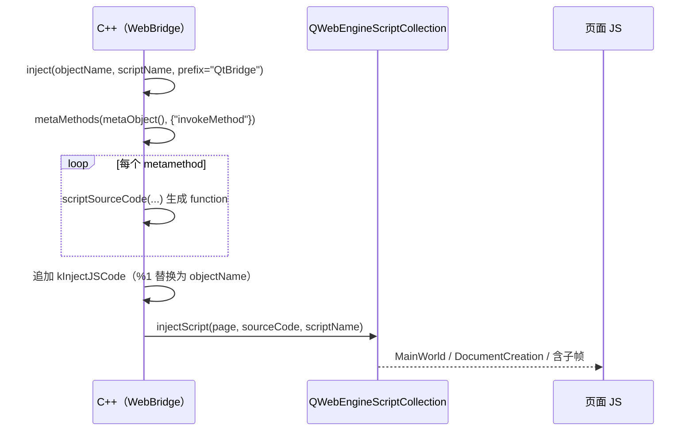

# SUI 详细设计

可复用 Qt 控件与 WebEngine 包装，分四组：基础控件、提示类（Tips）、命名规则（NameRule）、WebEngine。本篇记录**每个类的可覆写点与实际绘制/动画参数、WebBridge 的注入与回调协议、以及单例 Toast 的队列语义**；为什么把提示做成三层、为什么自己生成桥接 JS 见 [`../architecture/sui.md`](../architecture/sui.md)。

> 静态库 `SUI` · `sVanilla/src/SUI` · 链接 Qt6 Core/Gui/Widgets/Svg/WebEngineCore/WebEngineWidgets · 测试：`test/SUI/sui_test.cpp`（覆盖 `DownloadCount` 与 `SlidingWaitBar`）

## 一、文件清单

### 1.1 基础控件（`sVanilla/src/SUI/`）

| 文件 | 职责 |
| --- | --- |
| `AddLinkLineEdit` | 带"更多菜单"的输入框；站点图标 action、清空 action、回车 action；`paintEvent` 自绘，`eventFilter` 处理按钮 |
| `CollapsePanel` | 可折叠面板；内含 `EditableLabel`（`QStackedWidget` 实现的标签/编辑切换）、复选框、关闭按钮、折叠按钮 |
| `DividingLine` | 一条分割线，`setLineWidth(qreal)` + `paintEvent` |
| `DownloadCount` | 显示"下载中/已完成"两个计数的自绘小部件 |
| `FileSelector` | `QLineEdit` 派生，右侧 action 触发 `QFileDialog`；`Mode` = `FileOpen` / `Directory`（默认 `Directory`） |
| `FreezeTableView` | `QTableView` 派生（类名 `FreezeTreeView`），冻结左侧 N 列：叠一个 `QTableView` 并同步几何与滚动 |
| `RoundImageWidget` | 圆角图片（`m_radius = 10`），`resizeEvent` 里重算缩放 |
| `SearchLineEdit` | 搜索框，支持"失焦隐藏"（`setFocusOutHide`）+ `QPropertyAnimation` 动画，信号 `readyHide` / `startHide` |
| `SlidingWaitBar` | 不确定进度条：`QTimer` 30 ms 驱动滑块左右往复 |

### 1.2 提示类（`Tips/`）

| 文件 | 职责 |
| --- | --- |
| `TipDialog` | 模态提示对话框；`Level` = Success/Info/Warn/Error；可隐藏"确定"/"取消"按钮 |
| `Toast` | 单例非模态吐司；消息队列 + 位移动画，3 秒自动切换下一条 |
| `ToastTip` | 另一个单例吐司（带可选关闭按钮、可指定显示时长），淡入淡出动画 |

### 1.3 命名规则（`NameRule/`）

| 文件 | 职责 |
| --- | --- |
| `NameRuleEditWidget` | `QLineEdit` 派生，接受规则 token 的拖放（`dragEnter` / `dragMove` / `drop`），`m_rules` 存 token→含义映射 |
| `NameRuleSelectWidget` | `QListWidget` 派生，作为 token 源；`mimeData()` 按 Qt6/Qt5 分支重载 |
| `NameRuleWidget` | 组合控件：列表 + 编辑框 + 预览标签；`setParseNameRulesFunction` 注入解析函数，编辑完成发 `editingFinished(rule)` |

### 1.4 WebEngine（`WebEngine/`）

| 文件 | 职责 |
| --- | --- |
| `WebBridge` | 桥接核心：生成并注入 JS、接收 `invokeMethod` 调用、回写回调 |
| `WebFrame` | `QFrame` 容器：`WebPage` + `WebView`，注册 QWebChannel 桥接对象 |
| `WebPage` | `QWebEnginePage` 派生：证书错误处理、cookie 收集 |
| `WebSetting` | 两个自由函数：`initializeWebEngine(cache, storage)`、`initDefaultWebSettings(view)` |
| `WebView` | `QWebEngineView` 派生：进度、favicon、右键菜单、各类权限请求、F5 刷新、DevTools 窗口 |

## 二、有测试覆盖的两个控件

### 2.1 `DownloadCount`

| 成员 | 说明 |
| --- | --- |
| `m_downloadingCount` / `m_downloadedCount` | 两个计数，默认 0 |
| `setDownloadingCount` / `setDownloadedCount` | 赋值后 `update()` 触发重绘 |
| `sizeHint()` | `{2 * textWidth + 2 * padding, textHeight}` = `{66, 18}`（`textWidth=30`、`padding=3`、`textHeight=18`） |
| `paintEvent` | 圆角边框（`radius=5`、`border=1.5`）→ 竖分割线（在 `rect.center().x()`）→ 左右各 `drawText(AlignCenter, QString::number(...))` |

常量：`padding=3`、`radius=5`、`textWidth=30`、`textHeight=18`（`DownloadCount.cpp:6-9`）。

### 2.2 `SlidingWaitBar`

| 成员 | 说明 |
| --- | --- |
| `m_timer` | 间隔 **30 ms**，构造即 `start()`（"ConstructsAlreadyRunning"） |
| `m_offset` / `m_maxOffset` / `m_forward` | 滑块偏移 / 上限 / 方向 |
| `paintEvent` | 底色 `lightGray` 铺满，再用 `yellow` 画宽 `width()/5` 的滑块 |
| `resizeEvent` | `m_maxOffset = width() - width() / 5` |
| `onTimeout` | 步进 5；到右端反向、到左端再反向；`update()` |
| `start` / `stop` / `reStart` | `reStart` 额外把 `m_offset` 归零、`m_forward` 置真 |

## 三、`WebBridge`：JS ↔ C++ 协议

### 3.1 注册与命名

```cpp
void WebFrame::setWebChannelBridge(QObject* bridge)
{
    QWebChannel* channel = new QWebChannel(this);
    channel->registerObject(bridge->objectName(), bridge);
    m_page->setWebChannel(channel);
}
```

**QWebChannel 的注册名取自 `bridge->objectName()`**。此前 `WebBridge` 构造未设 `objectName`，注册名为空字符串，JS 侧拿不到对象；现已改为构造时默认 `setObjectName("WebBridge")`。

### 3.2 注入流程



`injectScript`（`WebBridge.cpp`）用 `QWebEngineScript` 插入，**同名脚本只插一次**（`sl.find(script_name).isEmpty()` 判重，重复注入返回 false）；参数为 `MainWorld`、`DocumentCreation`、`runsOnSubFrames = true`。

### 3.3 生成的 JS

`scriptSourceCode` 为每个元方法生成：

```js
function <method_name>(<参数名列表>) {
  try {
    if (typeof(<参数>) == 'undefined') { <参数> = '' };
    qt.webChannelTransport.send(JSON.stringify({type:6, object:'<objectName>', id:'<objectName>', method:<methodIndex>, args:[<参数名列表>]}));
  } catch(e) { console.warn('invokeQT call failed', e) }
}
window.external = window.external || {}
window.external.<prefix> = window.external.<prefix> || <method_name>
window.<objectName> = window.<objectName> || {}
window.<objectName>.<prefix> = <method_name>
```

即：JS 侧调用最终落到 `qt.webChannelTransport.send(...)`，走 QWebChannel 传到 C++ 的 `QMetaObject::invokeMethod`。参数未定义时被兜底为空串（按参数名逐个生成 `typeof` 检查）。

`kInjectJSCode`（`WebBridge.cpp:8` 起）提供 `QtBridge` 构造器：`callHandler(method_name, args, callback)`（无回调则 `callback_id` 传空串；有回调则分配 `callback_<n>` 并存入 `callbacks`）、`registerHandler`、`invokeCallback` 等，`%1` 替换为 `objectName`。

### 3.4 C++ 侧入口

| 方法 | 位置 | 行为 |
| --- | --- | --- |
| `invokeMethod(method_name, args, callback_id)` | `WebBridge.cpp` | 用 `metaMethod(metaObject(), method_name)` 查元方法，有效则 `method.invoke(this, Qt::AutoConnection, Q_ARG(QString, args), Q_ARG(QString, callback_id))`；无效打 `qWarning`（`undefined!`） |
| `invokeJSCallback(callback_id, return_args)` | 同上 | 拼 `window.qtBridge.invokeCallback('<id>', '<args>')`，用 `QueuedConnection` 调 `runJavaScript` 槽 |
| `runJavaScript(code)` | 同上 | `protected slots`，实际执行 JS |
| `asynCall(Func)` | `WebBridge.h` | `QTimer::singleShot(0, this, f)`，把操作挪回事件循环 |
| `genScriptName(object_name)` | 同上 | `<object_name>.injectionscript<N>`，`N` 来自**静态计数器**（进程内递增，非线程安全） |
| `injectWebChannelScript(page, js_file, object_name)` | 同上 | 读 `qrc`/磁盘上的 `qwebchannel.js` 之类文件并注入，脚本名用 `genScriptName` |
| `toWebString` / `toJsonString` / `toJsonObject` | 同上 | JSON 与字符串互转，供业务侧组包 |

### 3.5 `WebPage` 与 `WebView`

| 类 | 关键点 |
| --- | --- |
| `WebPage` | `QMap<QString, QString> m_cookies` 收集 cookie（`onCookieAdded` / `onCookieRemoved`）、`cookies()` / `containsCookie(name)`、`cookieAdded` 信号；处理 `QWebEngineCertificateError` 与客户端证书选择 |
| `WebView` | `m_loadProgress`（初始 100）；`contextMenuEvent` 自建菜单；`createWindow` 处理新窗口；`event` / `eventFilter` 处理 F5（`F5RefreshPage`）与 DevTools 请求；各种权限请求 handler；`showDevToolPage()` 打开 DevTools |
| `WebSetting` | `initializeWebEngine(cache_path, storage_path)` 设全局 profile 路径；`initDefaultWebSettings(view)` 逐个设 `QWebEngineSettings` |

## 四、`Toast` / `ToastTip` 的单例语义

| | `Toast` | `ToastTip` |
| --- | --- | --- |
| 实例 | `static Toast* instance`（`Toast.cpp:10`），`create(parent)` 构造，`showTip` 静态入口 | `static ToastTip* instance`，`create(parent)` + 静态 `showTip(tip, level, showTime=3000, isShowCloseBtn=false)` |
| 队列 | `QQueue<std::pair<QString, Level>> m_messageQueue`，逐条显示 | 无队列，直接显示 |
| 定时 | `QTimer` 3000 ms → `showNextMessage()` | 显示时长由 `showTime` 指定 |
| 动画 | `QPropertyAnimation("pos")` 300 ms，从 `topRight` 滑到 `topLeft`；隐藏时反向并连 `finished` 再 `hide()`（`m_hideConnection` 先 `disconnect` 再连，避免重复连接） | `QPropertyAnimation` 淡入淡出，`slotAnimationFinished` |
| 图标 | `:/icon/toast/<success\|info\|warn\|error>.svg`，`QSvgRenderer` 渲染 | 同族资源 |
| 交互 | 左键点击立即 `showNextMessage()` | `mousePressEvent` / `keyPressEvent` 关闭 |
| 定位 | `movePosition()`：有父部件时移到 `parent->width() - width() - 10, 30` | 由调用方布局 |

**风险**：`Toast::showTip` 在 `instance` 为空时**静默返回**——未先 `create()` 就调用不会崩溃，但也不会有任何提示。

## 五、`EditableLabel` / `CollapsePanel`

`EditableLabel` 是 `QStackedWidget`，在 `QLabel` 与 `QLineEdit` 两页间切换：

| 成员 | 说明 |
| --- | --- |
| `m_isEdited` | 是否被编辑过（`getEditedStatus()`）——声明为 `bool m_isEdited;`，两个构造函数均初始化为 `false` |
| `m_isReadOnly` / `m_maxLength = 50` / `m_checkFunc` | 只读、最大长度、编辑完成时的校验回调（`std::function<bool(QLineEdit*)>`） |
| `m_prefix` / `m_suffix` | 显示时的前后缀 |
| `slotEditfinished` | 走校验后发 `sigRenamed(newName)` |
| `eventFilter` | 处理回车/Esc 等 |

`CollapsePanel` 组合复选框 + `EditableLabel` 标题 + 关闭按钮 + 折叠按钮 + 内容部件；构造参数 `(title, contentWidget, displayCheckbox=true, displayCloseBtn=true, titleEditable=true, parent)`；信号 `sigCollapseBtnClicked` / `sigCloseBtnClicked` / `sigCheckBoxStateChanged`。

## 六、边界与错误处理矩阵

| 场景 | 当前行为 | 依据 |
| --- | --- | --- |
| `DownloadCount` 初值 | 两个计数均为 0 | `DownloadCountTest.DefaultsToZero` |
| 设置后可读 | setter/getter 往返一致 | `SetDownloadingCountIsReadable`、`SetDownloadedCountIsReadable` |
| 尺寸提示 | `{66, 18}`（2×30+2×3, 18） | `SizeHintIsTwiceTextWidthPlusPadding` |
| 绘制 | 不崩溃 | `PaintEventRendersWithoutCrash` |
| `SlidingWaitBar` 构造 | 定时器已在跑 | `ConstructsAlreadyRunning` |
| start/stop/reStart | 安全可重复 | `StartStopReStartAreSafe`、`RepeatedStopAndRestartAreSafe` |
| 运行/停止态绘制 | 不崩溃 | `PaintEventRendersWhileRunningAndStopped` |
| resize | 重算 `m_maxOffset` | `ResizeIsHandled` |
| 未 `create()` 就 `Toast::showTip` | 静默返回，无任何提示 | `Toast.cpp:24-30` |
| JS 调用未注册的 C++ 方法 | `qWarning("<name> undefined!")`，不抛 | `WebBridge::invokeMethod` |
| 重复注入同名脚本 | 返回 false（不覆盖） | `WebBridge::injectScript` |
| `bridge->objectName()` 与 JS 侧不一致 | QWebChannel 注册名不匹配，JS 拿不到对象 | `WebFrame::setWebChannelBridge`；构造默认名为 `WebBridge`，显式改名必须与 JS 同步 |
| `FreezeTreeView` 冻结列 | 叠加的 `QTableView` 与主视图同步几何/滚动 | `FreezeTableView.cpp:updateFrozenTableGeometry` |

## 七、测试映射

| 覆盖点 | 代表用例 |
| --- | --- |
| 计数控件默认值与往返 | `DownloadCountTest.DefaultsToZero`、`SetDownloadingCountIsReadable`、`SetDownloadedCountIsReadable` |
| 尺寸提示 | `DownloadCountTest.SizeHintIsTwiceTextWidthPlusPadding` |
| 自绘不崩溃 | `DownloadCountTest.PaintEventRendersWithoutCrash` |
| 进度条生命周期 | `SlidingWaitBarTest.ConstructsAlreadyRunning`、`StartStopReStartAreSafe`、`RepeatedStopAndRestartAreSafe` |
| 进度条绘制与 resize | `PaintEventRendersWhileRunningAndStopped`、`ResizeIsHandled` |

未覆盖：`WebEngine` 全家、`Tips` 全家、`NameRule` 全家、其余控件（它们需要 `QApplication` 与真实渲染，测试成本较高）。

## 八、扩展步骤与验证

新增一个提示场景：

1. 优先复用 `ToastTip::showTip(text, level, showTime, isShowCloseBtn)`（支持时长与关闭按钮）；
2. 若走 `Toast`（队列版），**必须先 `Toast::create(parent)`** 再 `showTip`（否则调用被静默忽略）；
3. 新图标放 `:/icon/toast/<level>.svg`，`Level` 枚举与 `QStringList{"success","info","warn","error"}` 的顺序必须一致（`Toast.cpp:125`）。

新增一个 JS 可调用的 C++ 方法：

1. 在 `WebBridge` 派生类里声明为 `public slots`，签名必须是 `(const QString& args, const QString& callback_id)`（因为 `invokeMethod` 固定传这两个 `Q_ARG`）；
2. 把方法名加入 `inject()` 里的 `names` 列表（当前只有 `"invokeMethod"`）；
3. 需要回传结果时调 `invokeJSCallback(callback_id, jsonString)`。

手工验证：

```sh
cmake --build out/harness --config Debug --target SUI_test
out/harness/test/SUI/Debug/SUI_test.exe
```

检查清单：改动 `WebBridge` 的 `objectName` 或注入协议后，需在本机打开登录页确认 JS 能调到 C++（`log/Client.log` 里应出现 `invokeMethod` 的 `qInfo` 输出）；改动 `DownloadCount` 的常量后回归 `SizeHintIsTwiceTextWidthPlusPadding`；改动 `SlidingWaitBar` 定时器参数后回归 `ConstructsAlreadyRunning`。
