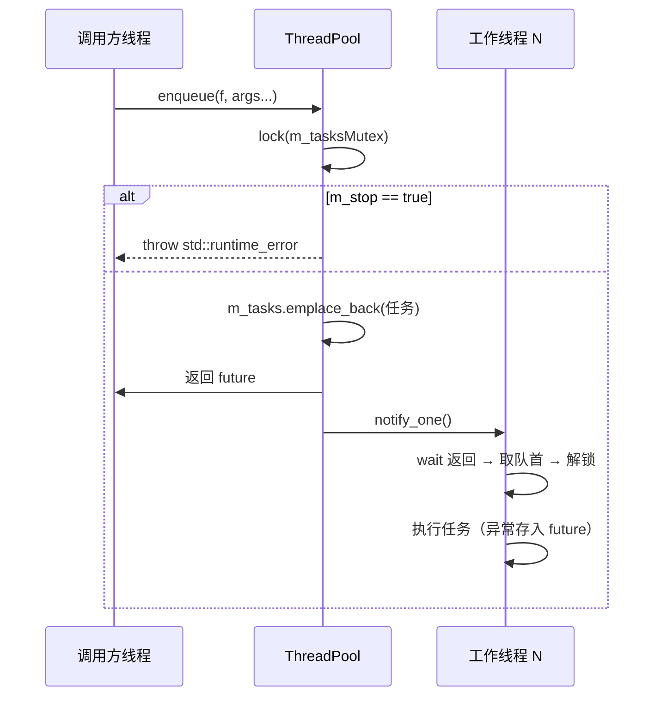
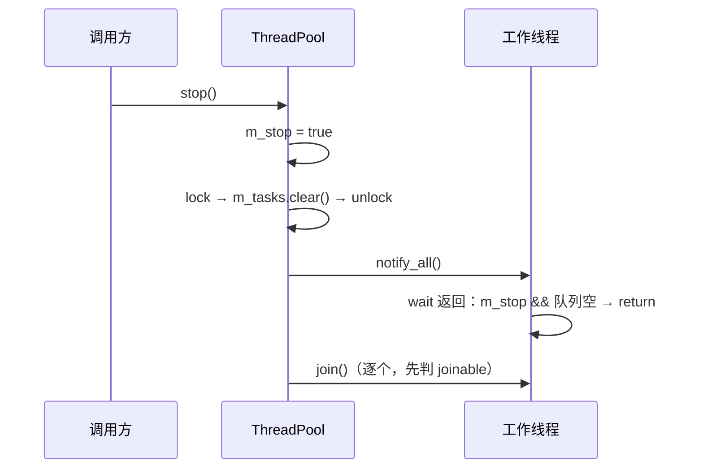

# ThreadPool 详细设计

通用线程池：`enqueue` 投递可调用对象并返回 `future`；`Task` 子类走 `std::shared_ptr` 重载，`SignalReturnTask` 用 Qt 信号回传结果。本篇记录**队列/线程的数据结构、两个 `enqueue` 重载的约束、停止与析构的时序、以及零线程与异常场景的实际行为**；为什么这么分层、为什么用 `std::list` 见 [`../architecture/threadpool.md`](../architecture/threadpool.md)。

> 静态库 `ThreadPool` · `sVanilla/src/ThreadPool` · 测试：`test/ThreadPool/threadpool_test.cpp`

## 一、文件清单

| 文件 | 职责 |
| --- | --- |
| `ThreadPool.h` | 类声明 + **两个 `enqueue` 模板的 inline 实现**（模板必须留在头文件） |
| `ThreadPool.cpp` | 构造/析构、`stop`、`drop`、`workLoop`、`threadNumber`、`numThreads` |
| `Task.h` | `Task` 抽象基类、`SignalReturnTask`（Qt 信号回传）、`TemplateSignalReturnTask<CallBack>` |
| `ThreadPoolLog.h` | 8 个 `THEADPOOL_LOG_*` 宏 → `spdlog::get("ThreadPool")` |
| `CMakeLists.txt` | 静态库；链接 Qt + spdlog |

## 二、数据结构

| 成员 | 类型 | 位置 | 说明 |
| --- | --- | --- | --- |
| `m_tasks` | `std::list<std::function<void()>>` | `ThreadPool.h:40` | FIFO 任务队列；用 `list` 是因为只在两端操作，且 `stop()` 需要 `clear()` |
| `m_tasksMutex` | `std::mutex` | `ThreadPool.h:41` | 保护 `m_tasks`；`stop()` 也在其保护下清空 |
| `m_condition` | `std::condition_variable` | `ThreadPool.h:42` | 通知有任务到来或需要退出 |
| `m_stop` | `std::atomic_bool` | `ThreadPool.h:43` | 停止标志；`enqueue` 与 `workLoop` 都直接读原子量 |
| `m_idMap` | `std::unordered_map<std::thread::id, int>` | `ThreadPool.h:44` | 工作线程 id → 序号；**只在构造期写入，之后只读**，故 `threadNumber()` 无锁 |
| `m_numThreads` | `size_t` | `ThreadPool.h:45` | 构造时记录的线程数（**不是 `m_workers.size()`**） |
| `m_workers` | `std::vector<std::thread>` | `ThreadPool.h:46` | 工作线程；构造期创建，`stop()` 时 join |

## 三、接口与行为规则

| 接口 | 位置 | 行为 |
| --- | --- | --- |
| `ThreadPool(size_t num = hardware_concurrency())` | `ThreadPool.cpp:4` | `num == 0` 时回退为 1 个线程；否则创建 `num` 个线程。线程全部创建后才填充 `m_idMap` |
| `enqueue(F&&, Args&&...)` | `ThreadPool.h:50` | 用 `std::bind` + `packaged_task` 包装；持锁检查 `m_stop`，已停则抛 `std::runtime_error("enqueue on stopped ThreadPool")`；入队后 `notify_one()` |
| `enqueue(std::shared_ptr<T>)` | `ThreadPool.h:73` | `enable_if` 限定 `T` 必须为 `Task` 的派生类（经 `remove_cv`）；包成 lambda 调 `sTask->Run()`，转发到上一重载，返回 `future<void>` |
| `threadNumber(id)` | `ThreadPool.cpp:32` | 查 `m_idMap`，未命中返回 `-1` |
| `numThreads()` | `ThreadPool.cpp:42` | 返回 `m_numThreads` |
| `stop()` | `ThreadPool.cpp:47` | 置 `m_stop` → 持锁 `m_tasks.clear()` → `notify_all()` → 逐个 `join()`（先判 `joinable()`） |
| `drop()` | `ThreadPool.cpp:64` | 仅持锁清空队列，**不停止线程、不设 `m_stop`** |
| `workLoop()` | `ThreadPool.cpp:72` | `wait` 直到 `m_stop || 队列非空`；若 `m_stop && 队列空` 则 return；否则取队首、出队在锁外执行 |
| `~ThreadPool()` | `ThreadPool.cpp:27` | 调 `stop()` |

### 3.1 任务执行与异常

任务体是被 `packaged_task` 包装的，任务内部抛出的异常**不会传播到工作线程**，而是存进 `future`，调用方 `get()` 时重新抛出；工作线程继续存活。已由 `ThreadPoolTest.TaskExceptionIsCapturedInFutureAndPoolStaysUsable` 与 `ThreadPoolTest.ThreadSurvivesTaskException` 固化。

### 3.2 `Task` 与 `SignalReturnTask`

| 类型 | 位置 | 说明 |
| --- | --- | --- |
| `Task` | `Task.h:8` | 纯虚 `Run()`；虚 `Destroy()` 默认 `delete this` |
| `SignalReturnTask` | `Task.h:19` | 继承 `QObject` + `Task`；构造时 `qRegisterMetaType<std::any>("std::any")`；信号 `result(const std::any&)` |
| `TemplateSignalReturnTask<CallBack>` | `Task.h:34` | `enable_if` 限定 `CallBack` 可无参调用；`Run()` 里 `emit result(m_callback())` |

`Destroy()` 默认 `delete this` 意味着**只能配合 `new` 出来的对象使用**；本仓库的实际用法是 `enqueue(std::shared_ptr<T>)`，由 `shared_ptr` 管理生命周期，`Destroy()` 无调用点。

## 四、关键时序

### 4.1 投递与执行



### 4.2 停止



`stop()` 的 `clear()` 意味着**停止时丢弃所有未执行任务**，且它们的 `packaged_task` 被析构 → 对应 `future` 变为 ready 并抛出 `std::future_error`（broken_promise 语义，由 `packaged_task` 析构保证）。

## 五、并发模型

| 方面 | 实现 |
| --- | --- |
| 临界区 | 只有 `m_tasks` 的入队/出队/清空持 `m_tasksMutex`；**任务执行在锁外**（否则会串行化整个池） |
| 等待 | `condition_variable::wait` 带谓词 `m_stop || !m_tasks.empty()`，天然防虚假唤醒 |
| 停止标志 | `std::atomic_bool`，`enqueue` 与 `workLoop` 免锁读 |
| `m_idMap` | 构造期写、之后只读，`threadNumber()` 免锁（**前提是没有并发构造/停止**） |
| 异常边界 | 任务异常封进 `future`；`enqueue` 在已停止时抛 `std::runtime_error` |

## 六、边界与错误处理矩阵

| 场景 | 当前行为 | 依据 |
| --- | --- | --- |
| 线程数 0 | 回退为 1 个工作线程；`numThreads()` 返回 1，任务正常执行 | `ThreadPool.cpp:6-8`；`ThreadPoolTest.ZeroWorkerCountFallsBackToOne` |
| 默认构造 | 用 `std::thread::hardware_concurrency()` | `ThreadPool.h:23`；`ThreadPoolTest.DefaultConstructorUsesHardwareConcurrency` |
| `enqueue` 返回值 | `future` 能拿到函数返回值 | `ThreadPoolTest.EnqueueReturnsFutureWithResult` |
| `enqueue(shared_ptr<Task>)` | 走第二个重载，任务被执行 | `ThreadPoolTest.EnqueueAcceptsTaskSubclass` |
| 大量任务 | 全部被执行 | `ThreadPoolTest.RunsEveryQueuedTask` |
| 任务抛异常 | 异常存入 future，池仍可用 | `ThreadPoolTest.TaskExceptionIsCapturedInFutureAndPoolStaysUsable` |
| 多任务并行 | 有空闲 worker 时真并行 | `ThreadPoolTest.RunsTwoTasksInParallelWhenWorkersAreAvailable` |
| 工作线程 id 映射 | `threadNumber()` 返回 0..N-1，非工作线程返回 -1 | `ThreadPoolTest.ThreadNumberMapsWorkerThreadIds` |
| `stop()` 后 `enqueue` | 抛 `std::runtime_error` | `ThreadPoolTest.EnqueueAfterStopThrows` |
| 重复 `stop()` / 析构 | 幂等（第二次 `joinable()` 为 false，跳过），析构安全 | `ThreadPoolTest.StopIsIdempotentAndAllowsDestruction` |
| `drop()` | 丢弃待执行任务，池继续工作 | `ThreadPoolTest.DropDiscardsPendingTasksButKeepsPoolWorking` |
| `numThreads()` 与实际线程数 | 正数参数保持一致；传入 0 时均为 1 | `ThreadPoolTest.NumThreadsReportsRequestedCount`、`ZeroWorkerCountFallsBackToOne` |

## 七、测试映射

| 覆盖点 | 代表用例 |
| --- | --- |
| 线程数上报 | `ThreadPoolTest.NumThreadsReportsRequestedCount`、`DefaultConstructorUsesHardwareConcurrency` |
| 两个 `enqueue` 重载 | `EnqueueReturnsFutureWithResult`、`EnqueueAcceptsTaskSubclass` |
| 执行完整性 | `RunsEveryQueuedTask`、`RunsTwoTasksInParallelWhenWorkersAreAvailable` |
| 异常隔离 | `TaskExceptionIsCapturedInFutureAndPoolStaysUsable`、`ThreadSurvivesTaskException` |
| id 映射 | `ThreadNumberMapsWorkerThreadIds` |
| 生命周期 | `EnqueueAfterStopThrows`、`StopIsIdempotentAndAllowsDestruction`、`DropDiscardsPendingTasksButKeepsPoolWorking` |
| 零线程退化 | `ZeroWorkerCountFallsBackToOne` |

`threadpool_test.cpp` 自带 `main()` 并注册 `NullLoggerEnvironment`，把 `ThreadPool` logger 指向 `null_sink`，测试期不产生日志文件。

## 八、扩展步骤与验证

新增一类任务（以"需要把结果回传到 Qt 主线程"为例）：

1. 定义 `struct XxxResult { ... };`；
2. 继承 `SignalReturnTask`，或直接用 `TemplateSignalReturnTask<CallBack>` 包一个返回 `std::any` 的 lambda；
3. `enqueue(std::shared_ptr<Task>(new 派生类))`——注意用 `shared_ptr` 管理，不要走 `Destroy()`；
4. 在接收方 `connect(task, &SignalReturnTask::result, ...)`，跨线程连接由 Qt 排队处理。

手工验证：

```sh
cmake --build out/harness --config Debug --target ThreadPool_test
out/harness/test/ThreadPool/Debug/ThreadPool_test.exe
```

检查清单：改动 `workLoop` 或 `stop()` 后必须回归 `StopIsIdempotentAndAllowsDestruction` 与 `EnqueueAfterStopThrows`；改动 `enqueue` 后回归 `TaskExceptionIsCapturedInFutureAndPoolStaysUsable`；改动线程数下限时回归 `ZeroWorkerCountFallsBackToOne`。
