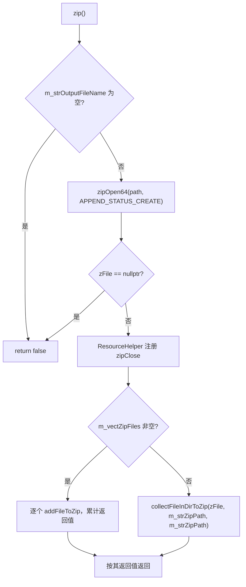
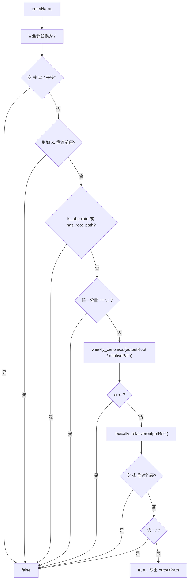
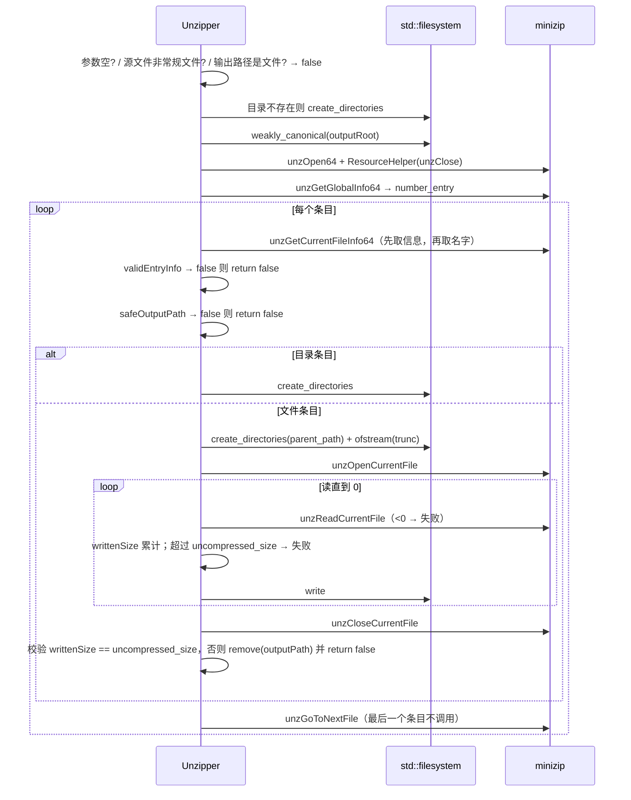

# Zipper 详细设计

基于 minizip 的打包（`Zipper`）与解包（`Unzipper`），解包侧实现了完整的 zip-slip / zip-bomb 防护。本篇记录**四个安全判定的逐条规则、压缩与解压的逐步骤返回值、以及 ResourceHelper 的语义**；为什么把防护放在解包侧、为什么选 minizip 见 [`../architecture/zipper.md`](../architecture/zipper.md)。

> 静态库 `Zipper` · `sVanilla/src/Zipper` · 链接 minizip / zlib · 测试：`test/Zipper/zipper_test.cpp`

## 一、文件清单

| 文件 | 职责 |
| --- | --- |
| `Zipper.h` | `ResourceHelper`、`Zipper`、`Unzipper` 三个类的声明 |
| `Zipper.cpp` | 匿名命名空间内 4 个常量 + 5 个安全判定函数；三类成员实现 |
| `CMakeLists.txt` | 静态库；链接 minizip / zlib |


## 二、常量与匿名命名空间

| 常量 | 值 | 位置 | 用途 |
| --- | --- | --- | ---: |
| `maxEntryNameSize` | `UINT16_MAX` = 65535 | `Zipper.cpp:21` | 条目名长度上限（zip 格式的上限也是 65535） |
| `maxCompressionRatio` | `1000` | `Zipper.cpp:22` | 解压比上限，防 zip bomb |
| `readBufferSize` | `1 MiB` | `Zipper.cpp:23` | 解压读缓冲 |
| `zip64SizeThreshold` | `UINT32_MAX` = 4294967295 | `Zipper.cpp:24` | 判定是否启用 zip64 写入 |

## 三、`ResourceHelper`

| 成员 | 位置 | 行为 |
| --- | --- | --- |
| `ResourceHelper(const std::function<void()>&)` | `Zipper.cpp:109` | 单个回调入 `m_fns` |
| `ResourceHelper(const std::list<std::function<void()>>&)` | `Zipper.cpp:114` | 批量初始化 |
| `~ResourceHelper()` | `Zipper.cpp:119` | **按插入顺序**依次执行所有非空回调 |
| `addFn(fn)` | `Zipper.cpp:130` | 追加回调 |

语义接近 `scope_exit`：不提供"取消释放"接口，也没有移动/拷贝抑制（拷贝会double-free 风险，但当前只在栈上一次性使用）。

## 四、`Zipper`：打包

### 4.1 状态

| 成员 | 说明 |
| --- | --- |
| `m_vectZipFiles` | 文件列表；`zip()` 在它非空时按列表打包（条目名取 `filename()`），为空时退回目录模式 |
| `m_strZipPath` | 文件列表为空时要打包的目录 |
| `m_strOutputFileName` | 输出 zip 路径 |
| `m_strRelativePath` | 预留的相对路径前缀——**无任何读取点** |

### 4.2 `zip()` 流程



目录模式中，`collectFileInDirToZip` 的第三参数是 `m_strZipPath` 自身，因此条目相对路径按目录内相对位置计算。文件列表模式取每个源文件的 `filename()` 作为归档内名称。

### 4.3 `collectFileInDirToZip(zfile, filepath, parentdirName)`

| 步骤 | 位置 | 行为 |
| --- | --- | --- |
| 参数校验 | `Zipper.cpp:262` | `zfile == nullptr` 或 `filepath` 为空 → false |
| baseDir 计算 | `Zipper.cpp:267` | `parentdirName` 为空时用 `path(filepath).parent_path()`，否则用 `parentdirName` |
| 递归遍历 | `Zipper.cpp:279` | 迭代器构造使用 `error_code`，源目录不存在时返回 `false`；后续递增与路径转换仍使用可抛异常的重载 |
| 目录项 | `Zipper.cpp:275` | `addFileToZip(zfile, strRelative, "")`（srcfile 为空 → 写成目录条目） |
| 文件项 | `Zipper.cpp:279` | `addFileToZip(zfile, strRelative, strAbsolute)` |
| 返回值 | `Zipper.cpp:283` | 累计 `addFileToZip` 的返回值，任一失败即返回 `false` |

### 4.4 `addFileToZip(zfile, fileNameinZip, srcfile)`

| 步骤 | 位置 | 行为 |
| --- | --- | --- |
| 参数校验 | `Zipper.cpp:202` | `zfile == nullptr` 或 `fileNameinZip` 为空 → false |
| 时间戳 | `Zipper.cpp:207-214` | `time(nullptr)` + `localtime` 填 `zip_fileinfo.tmz_date`；`localtime` 返回值**未判空** |
| 目录条目 | `Zipper.cpp:217-220` | `srcfile` 为空且名不以 `/` 或 `\` 结尾时补 `/` |
| 大小获取 | `Zipper.cpp:223-227` | `filesystem::file_size(srcfile, error)`（srcfile 为空时按 0）；出错 → false |
| zip64 判定 | `Zipper.cpp:228` | `fileSize >= zip64SizeThreshold ? 1 : 0`（用 `>=`，边界 4294967295 也会启用 zip64，偏保守但无害） |
| 打开条目 | `Zipper.cpp:229` | `zipOpenNewFileInZip64(..., Z_DEFLATED, Z_DEFAULT_COMPRESSION, zip64)`；非 `ZIP_OK` → false |
| 写内容 | `Zipper.cpp:235-254` | 1 MiB 缓冲；循环条件 `while (!stream.eof())`，`read` 后 `zipWriteInFileInZip(..., gcount)` |
| 关闭条目 | `Zipper.cpp:255` | `zipCloseFileInZip`；返回 true |

## 五、`Unzipper`：解包

### 5.1 `safeOutputPath(outputRoot, entryName, outputPath)` 的判定顺序



逐条对应：反斜杠归一（`Zipper.cpp:73`）、绝对路径前缀（`74-77`）、盘符前缀（`78-81`）、`is_absolute` / `has_root_path`（`84-87`）、`..` 分量（`88-91`）、`weakly_canonical` 解析（`93-98`）、逃逸再校验（`100-105`）。最后两步是关键：`weakly_canonical` 会解析符号链接与 `.`/`..`，解析后再次用 `lexically_relative` 确认结果仍在 root 内。

### 5.2 `validEntryInfo(fileInfo)` 的判定顺序

| 序 | 条件 | 结果 | 位置 |
| --- | ---: | --- | --- |
| 1 | `size_filename == 0` 或 `> 65535` | false | `Zipper.cpp:52` |
| 2 | `isSymlink(fileInfo)`（`(external_fa >> 16) & 0170000 == 0120000`） | false | `Zipper.cpp:56` |
| 3 | `uncompressed_size == 0` | **true**（空文件合法） | `Zipper.cpp:60` |
| 4 | `compressed_size == 0`（而 uncompressed 非 0） | false | `Zipper.cpp:64` |
| 5 | `uncompressed_size / compressed_size > 1000` | false（zip bomb 防护） | `Zipper.cpp:68` |

### 5.3 `unzip()` 流程



关键：解压是**全有或全无**——任一条目失败立即 `return false`，已解压的文件**不回滚**（只删除当前这个失败的文件）。

## 六、边界与错误处理矩阵

| 场景 | 当前行为 | 依据 |
| --- | --- | --- |
| 正常解包 | 创建输出目录并写出文件 | `UnzipperTest.CreatesOutputDirectoryAndExtractsFile` |
| 多条目 | 全部解压 | `UnzipperTest.ExtractsEveryEntry` |
| zip64 条目 | 正常解压 | `UnzipperTest.ExtractsZip64Entry` |
| 条目名含 `../` | `safeOutputPath` 拒绝，整体失败 | `UnzipperTest.RejectsParentDirectoryTraversal` |
| 条目名含反斜杠穿越 | 归一为 `/` 后拒绝 | `UnzipperTest.RejectsBackslashTraversal` |
| Windows 绝对路径条目 | 盘符前缀判定拒绝 | `UnzipperTest.RejectsAbsoluteWindowsPath` |
| 归档文件不存在 | false | `UnzipperTest.RejectsMissingArchive` |
| 空参数 | false | `UnzipperTest.RejectsEmptyArguments` |
| 输出路径是普通文件 | false | `UnzipperTest.RejectsOutputPathThatIsARegularFile` |
| setter/getter 往返 | 一致 | `UnzipperTest.SettersAndGettersRoundTrip` / `ZipperTest.SettersAndGettersRoundTrip` |
| 打包目录后解包 | 内容可还原 | `ZipperTest.PackagesDirectoryContentsAndRestoresThemWithUnzipper` |
| 输出名为空 | false | `ZipperTest.RejectsEmptyOutputFileName` |
| 源目录不存在 | **返回 false**（不再抛异常） | `ZipperTest.ReturnsFalseForMissingSourceDirectory` |
| 单文件打包 | 正常 | `ZipperTest.AddFileToZipStoresSingleFile` |
| 非法参数打包 | false | `ZipperTest.AddFileToZipRejectsInvalidArguments` |
| `ResourceHelper` 析构 | 执行回调 | `ResourceHelperTest.RunsCallbackOnDestruction` |
| `addFn` 追加 | 追加后仍会执行 | `ResourceHelperTest.AddFnAppendsAdditionalCallbacks` |
| 多回调顺序 | 按插入顺序 | `ResourceHelperTest.RunsCallbackListInOrder` |
| 空回调 | 跳过 | `ResourceHelperTest.SkipsEmptyCallbacks` |

## 七、测试映射

| 覆盖点 | 代表用例 |
| --- | --- |
| 路径穿越防护（三种写法） | `RejectsParentDirectoryTraversal`、`RejectsBackslashTraversal`、`RejectsAbsoluteWindowsPath` |
| 入口参数校验 | `RejectsEmptyArguments`、`RejectsMissingArchive`、`RejectsOutputPathThatIsARegularFile`、`RejectsEmptyOutputFileName` |
| 打包/解包往返 | `PackagesDirectoryContentsAndRestoresThemWithUnzipper`、`ExtractsEveryEntry`、`ExtractsZip64Entry` |
| 单文件打包 | `AddFileToZipStoresSingleFile`、`AddFileToZipRejectsInvalidArguments` |
| RAII 助手 | `ResourceHelperTest.*` |
| 属性往返 | `SettersAndGettersRoundTrip` |

## 八、扩展步骤与验证

加一条新的安全校验（以"拒绝条目名含 NUL"为例）：

1. 在匿名命名空间的 `validEntryInfo` 或 `safeOutputPath` 里加判定——**放在已有判定之后**，注意顺序影响"哪一条先拒绝"；
2. 返回 false 即整个 `unzip()` 失败（全有或全无语义）；
3. 在 `test/Zipper/zipper_test.cpp` 补一个 `UnzipperTest.RejectsXxx` 用例，用内存/临时目录构造对应归档。

手工验证：

```sh
cmake --build out/harness --config Debug --target Zipper_test
out/harness/test/Zipper/Debug/Zipper_test.exe
```

检查清单：改动 `safeOutputPath` 后必须回归路径穿越测试；改动 `validEntryInfo` 后回归 `ExtractsZip64Entry`（大文件不能因阈值被误杀）与 `CreatesOutputDirectoryAndExtractsFile`（空文件条目仍可通过第 3 条判定）。
